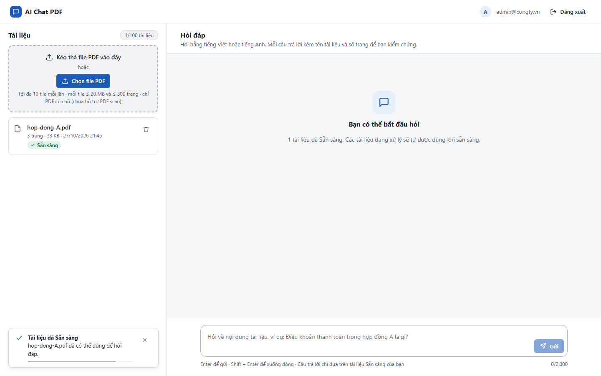
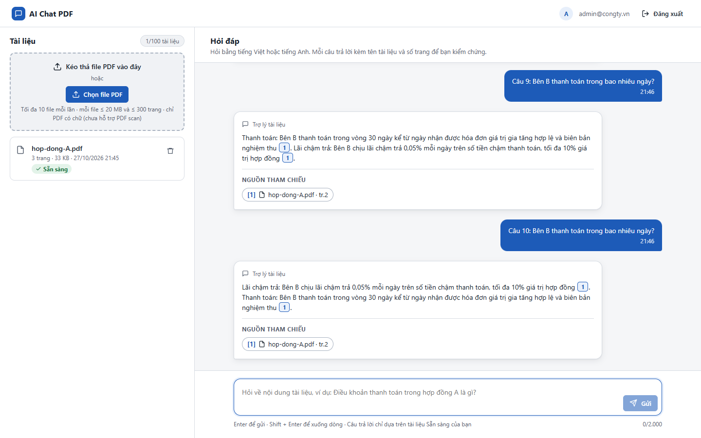
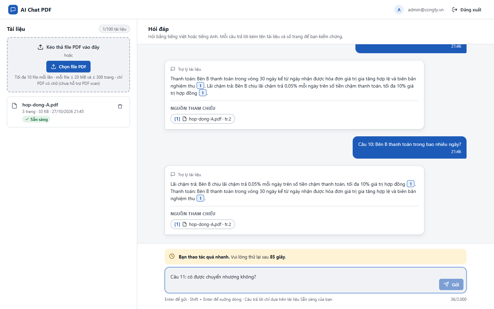
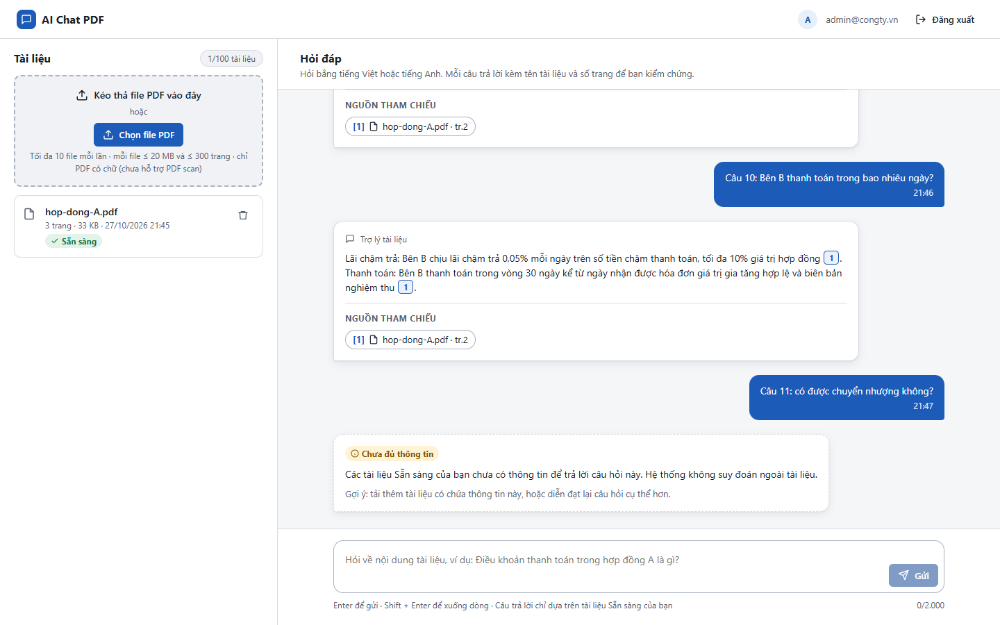

# Test report – E2E-006: Rate limit câu hỏi và đếm ngược

| Trường | Giá trị |
|---|---|
| Test case | [E2E-006](../../doc/07-verification/test_cases/E2E-006_rate-limit-cau-hoi-va-dem-nguoc.md) |
| Kết luận | **ĐẠT** |
| Bắt đầu | 2026-10-27T14:45:32.556Z |
| Kết thúc | 2026-10-27T14:47:01.552Z (89.0 s) |
| Cách thực hiện | Tự động – Playwright (app/frontend/evidence/fixture.ts) |
| URL ứng dụng | http://localhost:8080/ |
| Bản build | 166929f + thay đổi chưa commit trong app/ |
| Trình duyệt | Microsoft Edge (Playwright, channel msedge) |
| Hệ điều hành | win32 x64 |
| Spec | app/frontend/testcases/E2E-006_rate-limit-cau-hoi-va-dem-nguoc.spec.ts |

## Kết quả từng bước

| # | Bước | Kết quả mong đợi | Kết quả thực tế | Trạng thái | Bằng chứng |
|---|---|---|---|---|---|
| 1 | Đăng nhập Quản trị viên, tải hop-dong-A.pdf và chờ Sẵn sàng | Dòng Sẵn sàng | Như mong đợi | Đạt | [ảnh](screenshots/01-dang-nhap-quan-tri-vien-tai-hop-dong-a-pdf-va-cho-.png) |
| 2 | Chờ đầu phút kế tiếp rồi gửi liên tiếp 10 câu hỏi ngắn | 10 câu trả lời | Như mong đợi | Đạt | [ảnh](screenshots/02-cho-dau-phut-ke-tiep-roi-gui-lien-tiep-10-cau-hoi-.png) |
| 3 | Gõ câu thứ 11 và gửi | Cảnh báo "Bạn thao tác quá nhanh… N giây"; nội dung câu hỏi còn trong ô; nút Gửi khóa | Đếm ngược ban đầu: 85 giây | Đạt | [ảnh](screenshots/03-go-cau-thu-11-va-gui.png) |
| 4 | Chụp ảnh sau 5 s | Số giây đếm ngược giảm | Còn 51 giây (trước đó 85) | Đạt | [ảnh](screenshots/04-chup-anh-sau-5-s.png) |
| 5 | Chờ hết đếm ngược | Cảnh báo biến mất; gửi được câu hỏi | Như mong đợi | Đạt | [ảnh](screenshots/05-cho-het-dem-nguoc.png) |

## Video

- [E2E-006-app.webm](video/E2E-006-app.webm)

## Ảnh chụp màn hình

## Log

- (không có)

## Ghi chú / lỗi phát hiện

- (không có)
