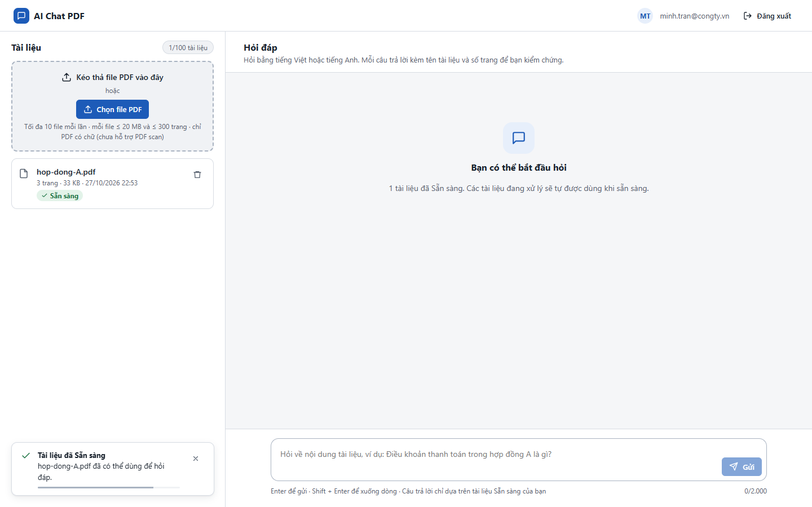
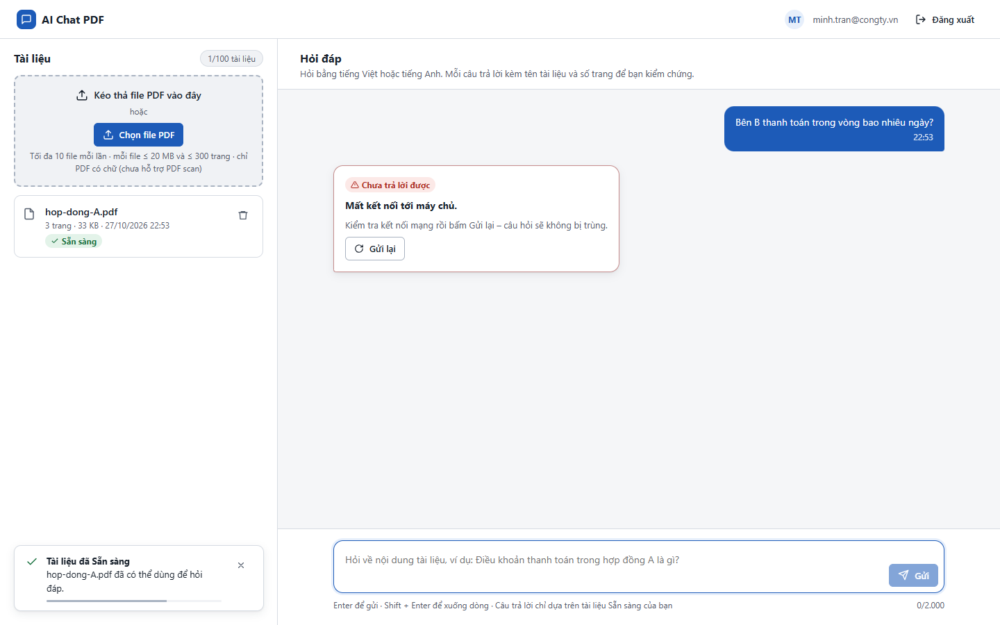
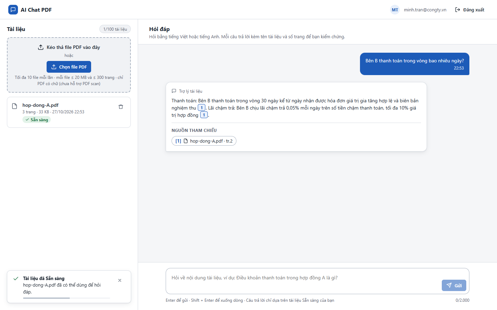
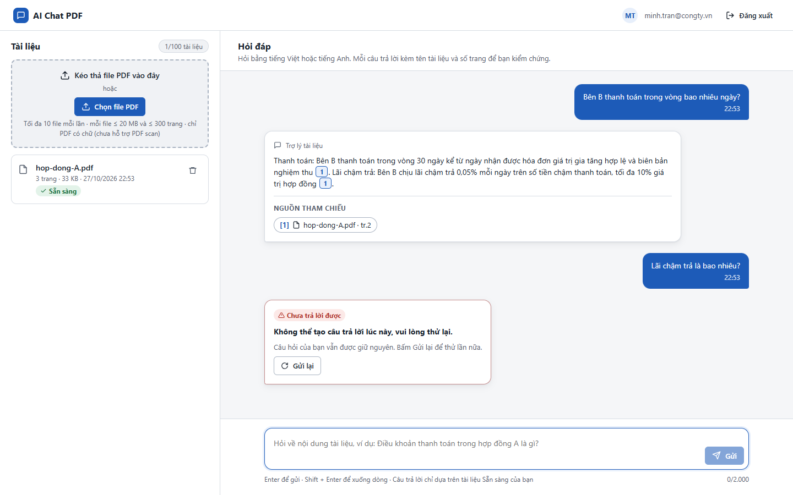
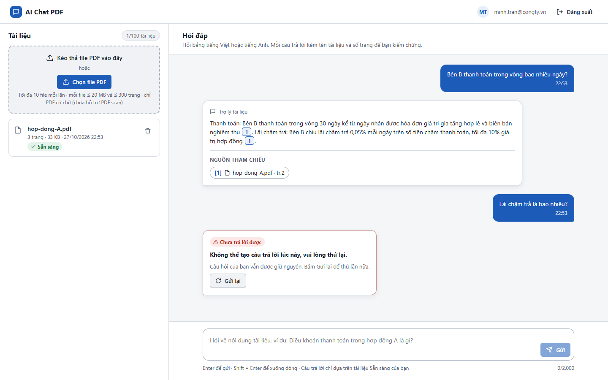
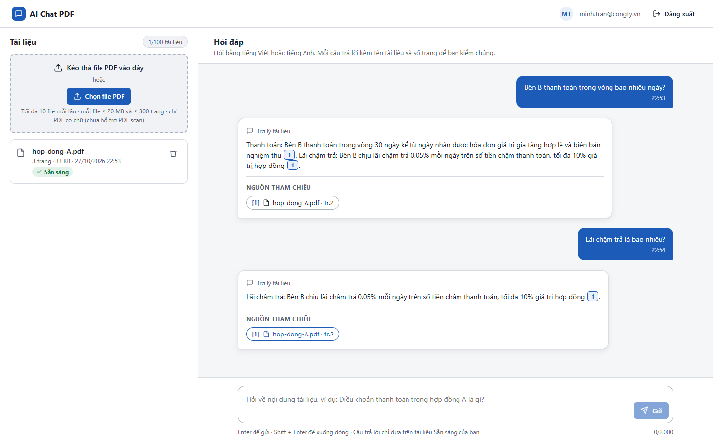

# Test report – E2E-007: Lỗi AI và Gửi lại

| Trường | Giá trị |
|---|---|
| Test case | [E2E-007](../../doc/07-verification/test_cases/E2E-007_loi-ai-va-gui-lai.md) |
| Kết luận | **ĐẠT** |
| Bắt đầu | 2026-10-27T15:53:25.934Z |
| Kết thúc | 2026-10-27T15:54:31.318Z (65.4 s) |
| Cách thực hiện | Tự động – Playwright (app/frontend/evidence/fixture.ts) |
| URL ứng dụng | http://localhost:8080/ |
| Bản build | 166929f + thay đổi chưa commit trong app/ |
| Trình duyệt | Microsoft Edge (Playwright, channel msedge) |
| Hệ điều hành | win32 x64 |
| Spec | app/frontend/testcases/E2E-007_loi-ai-va-gui-lai.spec.ts |

## Kết quả từng bước

| # | Bước | Kết quả mong đợi | Kết quả thực tế | Trạng thái | Bằng chứng |
|---|---|---|---|---|---|
| 1 | Đăng nhập P2, tải hop-dong-A.pdf và chờ Sẵn sàng | Dòng Sẵn sàng | Như mong đợi | Đạt | [ảnh](screenshots/01-dang-nhap-p2-tai-hop-dong-a-pdf-va-cho-san-sang.png) |
| 2 | (Mất mạng – E-05) Chặn POST /messages, gửi câu hỏi thanh toán | Thẻ "Chưa trả lời được – Mất kết nối tới máy chủ", câu hỏi gốc vẫn hiện, có nút Gửi lại | Như mong đợi | Đạt | [ảnh](screenshots/02-mat-mang-e-05-chan-post-messages-gui-cau-hoi-thanh.png) |
| 3 | Bỏ chặn, bấm Gửi lại | Câu trả lời có "30 ngày" thay thẻ lỗi tại cùng vị trí; không tạo lượt mới | Như mong đợi | Đạt | [ảnh](screenshots/03-bo-chan-bam-gui-lai.png) |
| 4 | (Dịch vụ AI lỗi – E-06) Khởi động lại với LLM không hợp lệ; hỏi câu mới | Thẻ "Không thể tạo câu trả lời lúc này, vui lòng thử lại"; không có câu trả lời dở dang | Như mong đợi | Đạt | [ảnh](screenshots/04-dich-vu-ai-loi-e-06-khoi-dong-lai-voi-llm-khong-ho.png) |
| 5 | Bấm Gửi lại lần nữa (vẫn lỗi) | Thẻ lỗi hiện lại, vẫn có nút Gửi lại | Như mong đợi | Đạt | [ảnh](screenshots/05-bam-gui-lai-lan-nua-van-loi.png) |
| 6 | Khôi phục LLM mặc định; tải lại trang; bấm Gửi lại trên thẻ lỗi | Có câu trả lời | Như mong đợi | Đạt | [ảnh](screenshots/06-khoi-phuc-llm-mac-dinh-tai-lai-trang-bam-gui-lai-t.png) |

## Video

- [E2E-007-app.webm](video/E2E-007-app.webm)

## Ảnh chụp màn hình

## Log

- (không có)

## Ghi chú / lỗi phát hiện

- Khởi động lại ứng dụng với {"LLM_PROVIDER":"anthropic","LLM_API_KEY":"sk-ant-invalid"}: [app] restart xong – http://localhost:8080/ sẵn sàng
- Khởi động lại ứng dụng với {}: [app] restart xong – http://localhost:8080/ sẵn sàng
