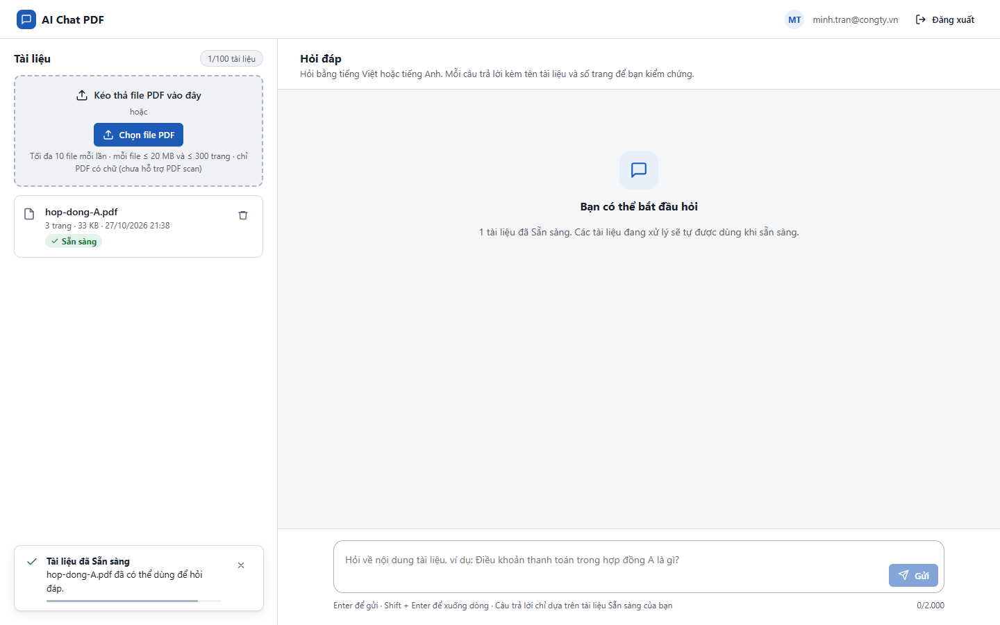
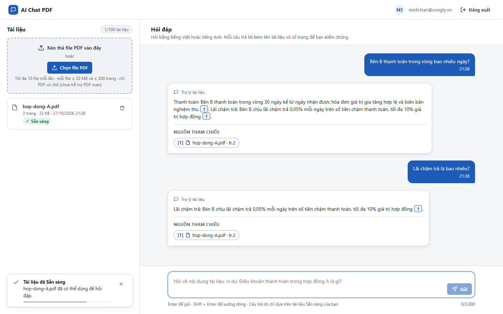
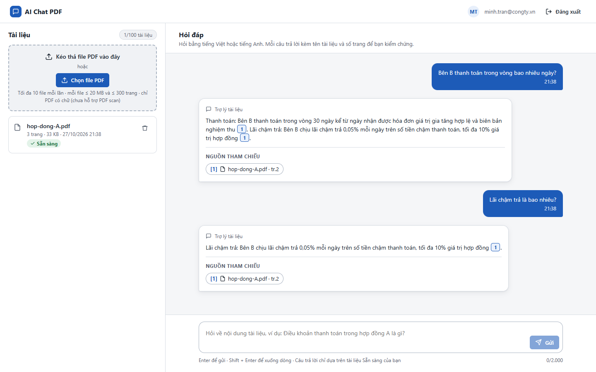
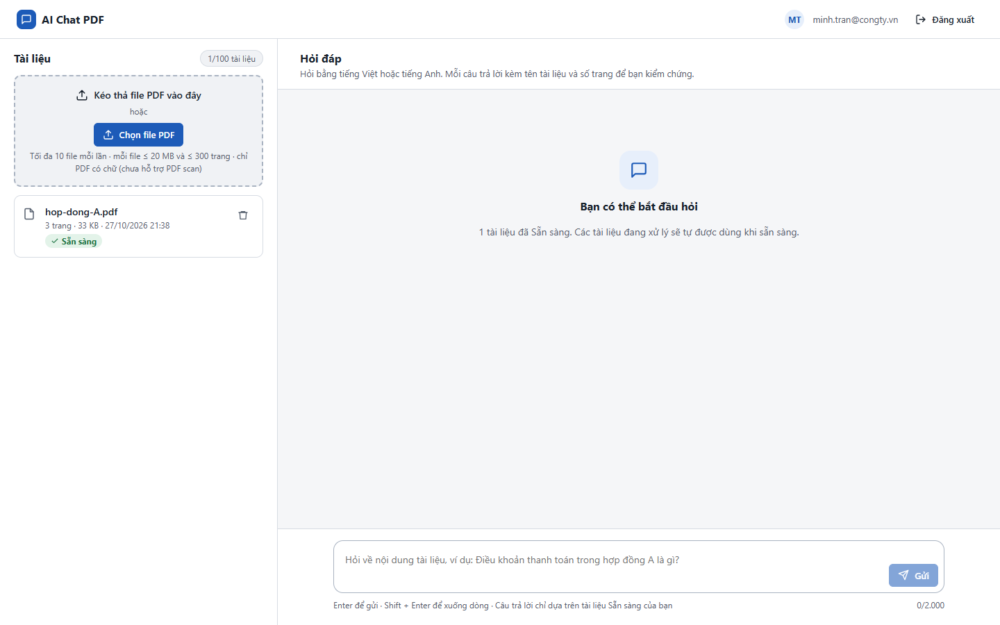

# Test report – E2E-009: Tải lại trang giữa phiên

| Trường | Giá trị |
|---|---|
| Test case | [E2E-009](../../doc/07-verification/test_cases/E2E-009_tai-lai-trang-giua-phien.md) |
| Kết luận | **ĐẠT** |
| Bắt đầu | 2026-10-27T14:38:26.762Z |
| Kết thúc | 2026-10-27T14:38:38.144Z (11.4 s) |
| Cách thực hiện | Tự động – Playwright (app/frontend/evidence/fixture.ts) |
| URL ứng dụng | http://localhost:8080/ |
| Bản build | 166929f + thay đổi chưa commit trong app/ |
| Trình duyệt | Microsoft Edge (Playwright, channel msedge) |
| Hệ điều hành | win32 x64 |
| Spec | app/frontend/testcases/E2E-009_tai-lai-trang-giua-phien.spec.ts |

## Kết quả từng bước

| # | Bước | Kết quả mong đợi | Kết quả thực tế | Trạng thái | Bằng chứng |
|---|---|---|---|---|---|
| 1 | Đăng nhập P2, tải hop-dong-A.pdf và chờ Sẵn sàng | Dòng Sẵn sàng | Như mong đợi | Đạt | [ảnh](screenshots/01-dang-nhap-p2-tai-hop-dong-a-pdf-va-cho-san-sang.png) |
| 2 | Hỏi 2 câu | 2 lượt hỏi–đáp | Như mong đợi | Đạt | [ảnh](screenshots/02-hoi-2-cau.png) |
| 3 | Nhấn F5 (reload) | Danh sách vẫn có hop-dong-A.pdf Sẵn sàng; hội thoại đủ 2 lượt kèm nguồn | Như mong đợi | Đạt | [ảnh](screenshots/03-nhan-f5-reload.png) |
| 4 | Đăng xuất rồi đăng nhập lại P2 | Tài liệu còn; hội thoại mới trống (NFR-024) | Như mong đợi | Đạt | [ảnh](screenshots/04-dang-xuat-roi-dang-nhap-lai-p2.png) |

## Video

- [E2E-009-app.webm](video/E2E-009-app.webm)

## Ảnh chụp màn hình

## Log

- (không có)

## Ghi chú / lỗi phát hiện

- (không có)
