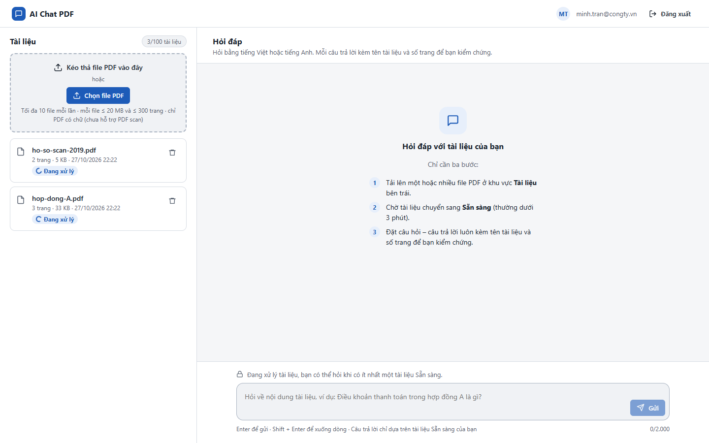
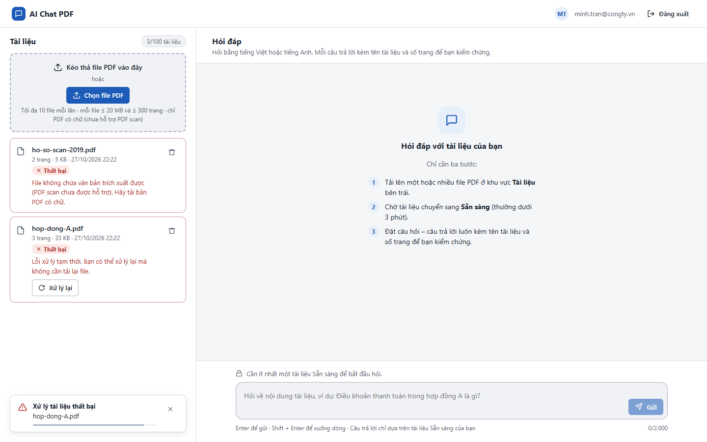
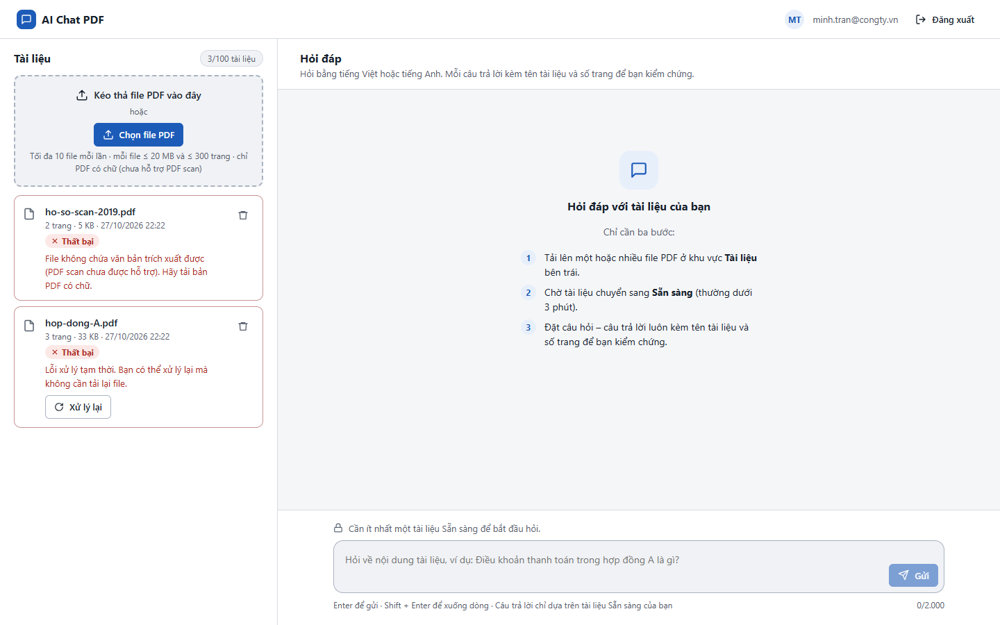
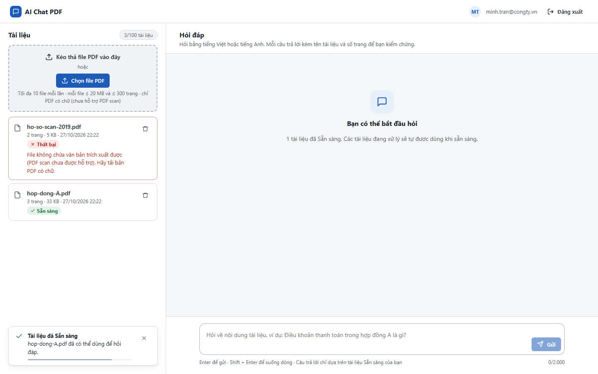

# Test report – E2E-010: Xử lý lại tài liệu lỗi tạm thời

| Trường | Giá trị |
|---|---|
| Test case | [E2E-010](../../doc/07-verification/test_cases/E2E-010_xu-ly-lai-tai-lieu-loi-tam-thoi.md) |
| Kết luận | **ĐẠT** |
| Bắt đầu | 2026-10-27T15:21:33.286Z |
| Kết thúc | 2026-10-27T15:25:43.963Z (250.7 s) |
| Cách thực hiện | Tự động – Playwright (app/frontend/evidence/fixture.ts) |
| URL ứng dụng | http://localhost:8080/ |
| Bản build | 166929f + thay đổi chưa commit trong app/ |
| Trình duyệt | Microsoft Edge (Playwright, channel msedge) |
| Hệ điều hành | win32 x64 |
| Spec | app/frontend/testcases/E2E-010_xu-ly-lai-tai-lieu-loi-tam-thoi.spec.ts |

## Kết quả từng bước

| # | Bước | Kết quả mong đợi | Kết quả thực tế | Trạng thái | Bằng chứng |
|---|---|---|---|---|---|
| 1 | Khởi động lại với dịch vụ embedding không tồn tại | Ứng dụng sẵn sàng | Như mong đợi | Đạt | [ảnh](screenshots/01-khoi-dong-lai-voi-dich-vu-embedding-khong-ton-tai.png) |
| 2 | Đăng nhập P2, tải hop-dong-A.pdf và ho-so-scan-2019.pdf | Đang xử lý | Như mong đợi | Đạt | [ảnh](screenshots/02-dang-nhap-p2-tai-hop-dong-a-pdf-va-ho-so-scan-2019.png) |
| 3 | Chờ hết 3 lần thử (backoff 30 s + 120 s) | Dòng Thất bại – "Lỗi xử lý tạm thời…", có nút Xử lý lại | Như mong đợi | Đạt | [ảnh](screenshots/03-cho-het-3-lan-thu-backoff-30-s-120-s.png) |
| 4 | So sánh với ho-so-scan-2019.pdf (R-03) | Không có nút Xử lý lại | Như mong đợi | Đạt | [ảnh](screenshots/04-so-sanh-voi-ho-so-scan-2019-pdf-r-03.png) |
| 5 | Cấu hình mặc định đã khôi phục; tải lại trang | Dòng hop-dong-A.pdf vẫn Thất bại R-04 | Như mong đợi | Đạt | [ảnh](screenshots/05-cau-hinh-mac-dinh-da-khoi-phuc-tai-lai-trang.png) |
| 6 | Bấm Xử lý lại | Dòng chuyển Đang xử lý → Sẵn sàng; không phải tải lại file | Như mong đợi | Đạt | [ảnh](screenshots/06-bam-xu-ly-lai.png) |

## Video

- [E2E-010-app.webm](video/E2E-010-app.webm)

## Ảnh chụp màn hình

## Log

- (không có)

## Ghi chú / lỗi phát hiện

- Khởi động lại ứng dụng với {"EMBEDDING_PROVIDER":"http","EMBEDDING_URL":"http://127.0.0.1:9"}: [app] restart xong – http://localhost:8080/ sẵn sàng
- Khởi động lại ứng dụng với {}: [app] restart xong – http://localhost:8080/ sẵn sàng
