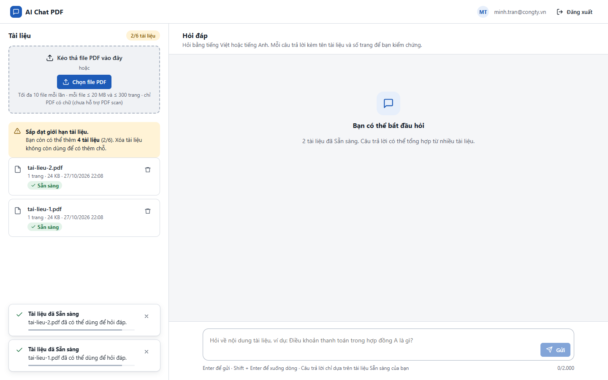
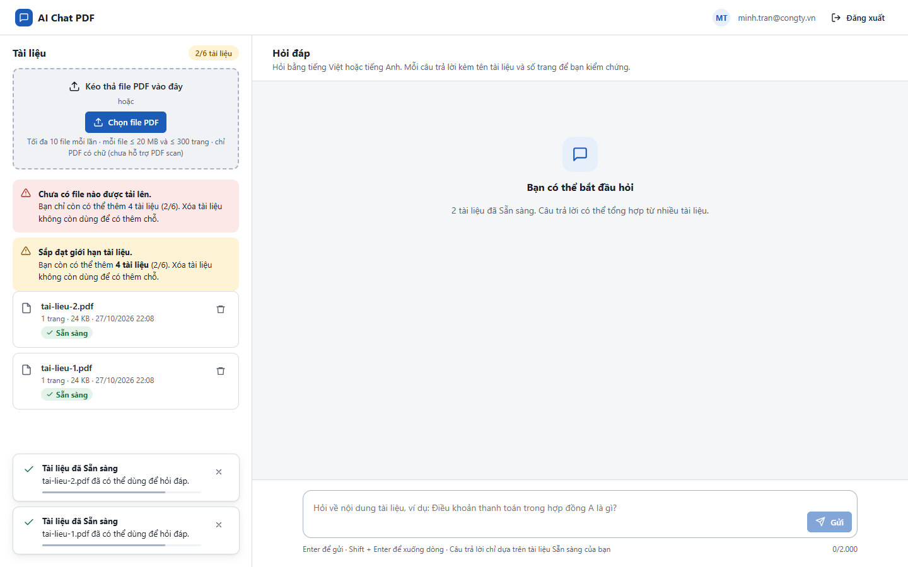

# Test report – E2E-011: Vượt giới hạn số file và hạn mức

| Trường | Giá trị |
|---|---|
| Test case | [E2E-011](../../doc/07-verification/test_cases/E2E-011_vuot-gioi-han-so-file-va-han-muc.md) |
| Kết luận | **ĐẠT** |
| Bắt đầu | 2026-10-27T15:07:44.021Z |
| Kết thúc | 2026-10-27T15:08:41.286Z (57.3 s) |
| Cách thực hiện | Tự động – Playwright (app/frontend/evidence/fixture.ts) |
| URL ứng dụng | http://localhost:8080/ |
| Bản build | 166929f + thay đổi chưa commit trong app/ |
| Trình duyệt | Microsoft Edge (Playwright, channel msedge) |
| Hệ điều hành | win32 x64 |
| Spec | app/frontend/testcases/E2E-011_vuot-gioi-han-so-file-va-han-muc.spec.ts |

## Kết quả từng bước

| # | Bước | Kết quả mong đợi | Kết quả thực tế | Trạng thái | Bằng chứng |
|---|---|---|---|---|---|
| 1 | Đăng nhập P2, xóa tài liệu cũ; chọn 12 file PDF cùng lúc | Thông báo "Mỗi lần chỉ tải tối đa 10 file – bạn đã chọn 12 file"; danh sách không đổi | Như mong đợi | Đạt | [ảnh](screenshots/01-dang-nhap-p2-xoa-tai-lieu-cu-chon-12-file-pdf-cung.png) |
| 2 | Khởi động lại với MAX_DOCS_PER_WORKSPACE=6; tải 2 file | Cảnh báo "Sắp đạt giới hạn… còn 4 tài liệu"; huy hiệu hạn mức màu cảnh báo | Như mong đợi | Đạt | [ảnh](screenshots/02-khoi-dong-lai-voi-max-docs-per-workspace-6-tai-2-f.png) |
| 3 | Chọn 5 file | Thông báo chỉ còn thêm được 4 tài liệu; không file nào tải lên | Như mong đợi | Đạt | [ảnh](screenshots/03-chon-5-file.png) |

## Video

- [E2E-011-app.webm](video/E2E-011-app.webm)

## Ảnh chụp màn hình

## Log

- (không có)

## Ghi chú / lỗi phát hiện

- Khởi động lại ứng dụng với {"MAX_DOCS_PER_WORKSPACE":"6"}: [app] restart xong – http://localhost:8080/ sẵn sàng
- Khởi động lại ứng dụng với {}: [app] restart xong – http://localhost:8080/ sẵn sàng
