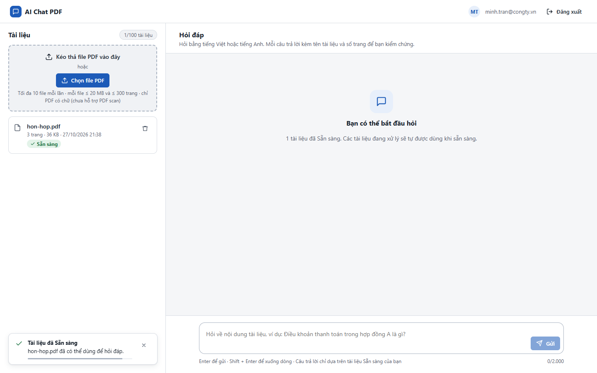
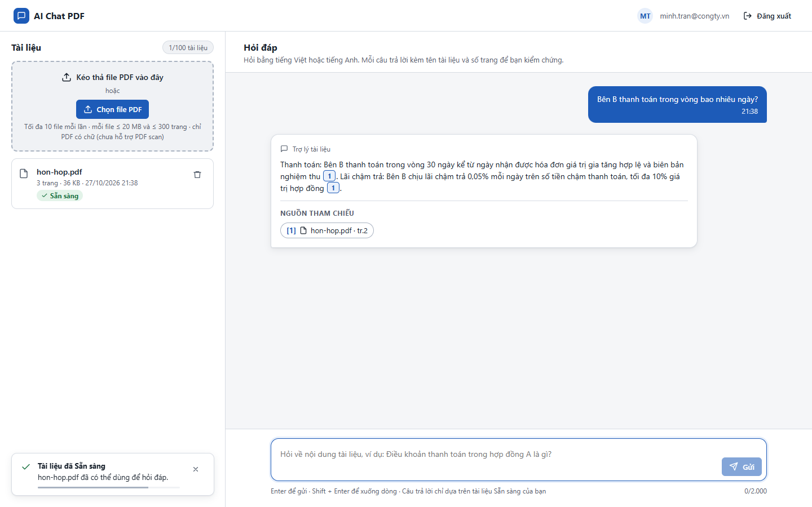
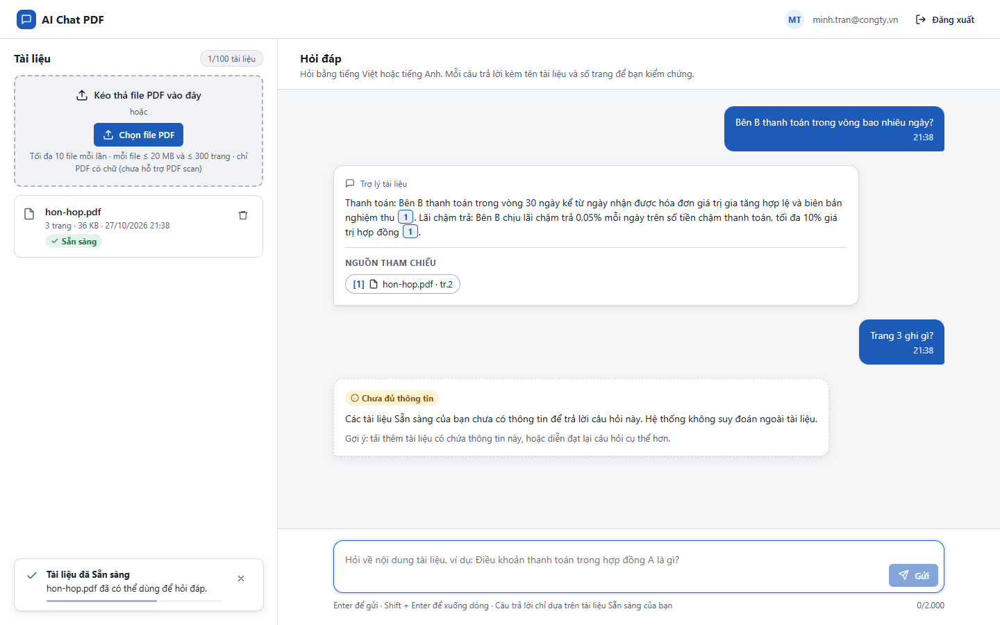

# Test report – E2E-012: PDF có một phần là ảnh scan

| Trường | Giá trị |
|---|---|
| Test case | [E2E-012](../../doc/07-verification/test_cases/E2E-012_pdf-co-mot-phan-la-anh-scan.md) |
| Kết luận | **ĐẠT** |
| Bắt đầu | 2026-10-27T14:38:39.861Z |
| Kết thúc | 2026-10-27T14:38:53.489Z (13.6 s) |
| Cách thực hiện | Tự động – Playwright (app/frontend/evidence/fixture.ts) |
| URL ứng dụng | http://localhost:8080/ |
| Bản build | 166929f + thay đổi chưa commit trong app/ |
| Trình duyệt | Microsoft Edge (Playwright, channel msedge) |
| Hệ điều hành | win32 x64 |
| Spec | app/frontend/testcases/E2E-012_pdf-co-mot-phan-la-anh-scan.spec.ts |

## Kết quả từng bước

| # | Bước | Kết quả mong đợi | Kết quả thực tế | Trạng thái | Bằng chứng |
|---|---|---|---|---|---|
| 1 | Tạo hon-hop.pdf: trang 1–2 là hợp đồng A (chữ), trang 3 là ảnh scan | File 3 trang | Đã tạo C:\Users\admin\AppData\Local\Temp\hon-hop.pdf (3 trang) | Đạt | [ảnh](screenshots/01-tao-hon-hop-pdf-trang-1-2-la-hop-dong-a-chu-trang-.png) |
| 2 | Đăng nhập P2, tải hon-hop.pdf | Sẵn sàng (không Thất bại) | Như mong đợi | Đạt | [ảnh](screenshots/02-dang-nhap-p2-tai-hon-hop-pdf.png) |
| 3 | Hỏi "Bên B thanh toán trong vòng bao nhiêu ngày?" | Có "30 ngày", nguồn hon-hop.pdf · tr.2 | Như mong đợi | Đạt | [ảnh](screenshots/03-hoi-ben-b-thanh-toan-trong-vong-bao-nhieu-ngay.png) |
| 4 | Hỏi về nội dung chỉ có trong trang ảnh ("Trang 3 ghi gì?") | Chưa đủ thông tin | Như mong đợi | Đạt | [ảnh](screenshots/04-hoi-ve-noi-dung-chi-co-trong-trang-anh-trang-3-ghi.png) |

## Video

- [E2E-012-app.webm](video/E2E-012-app.webm)

## Ảnh chụp màn hình

## Log

- (không có)

## Ghi chú / lỗi phát hiện

- (không có)
