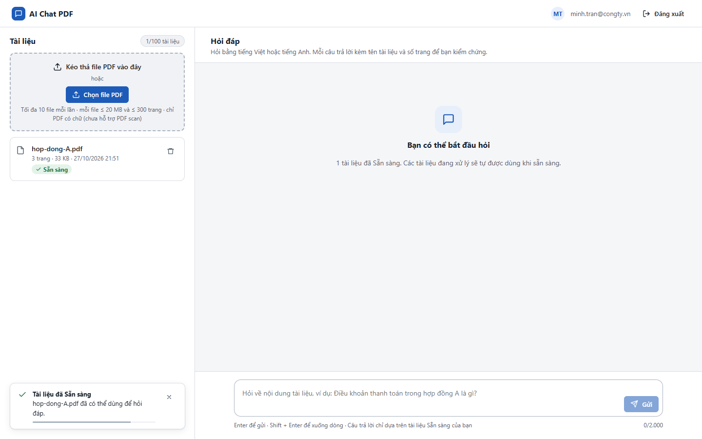
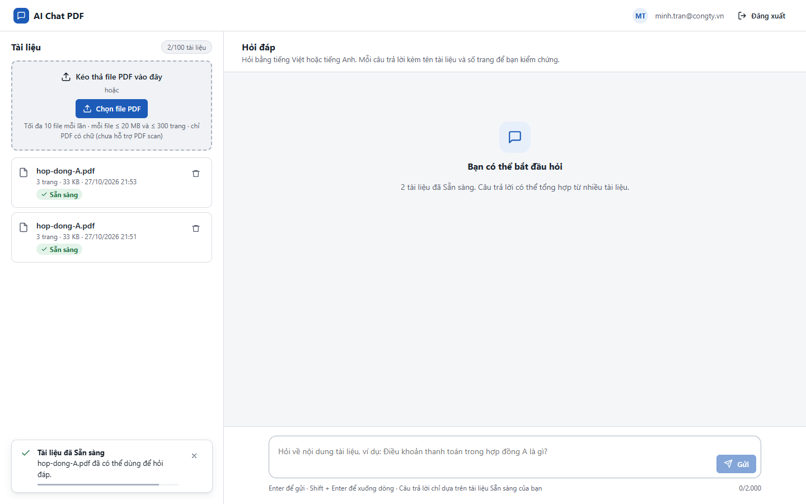
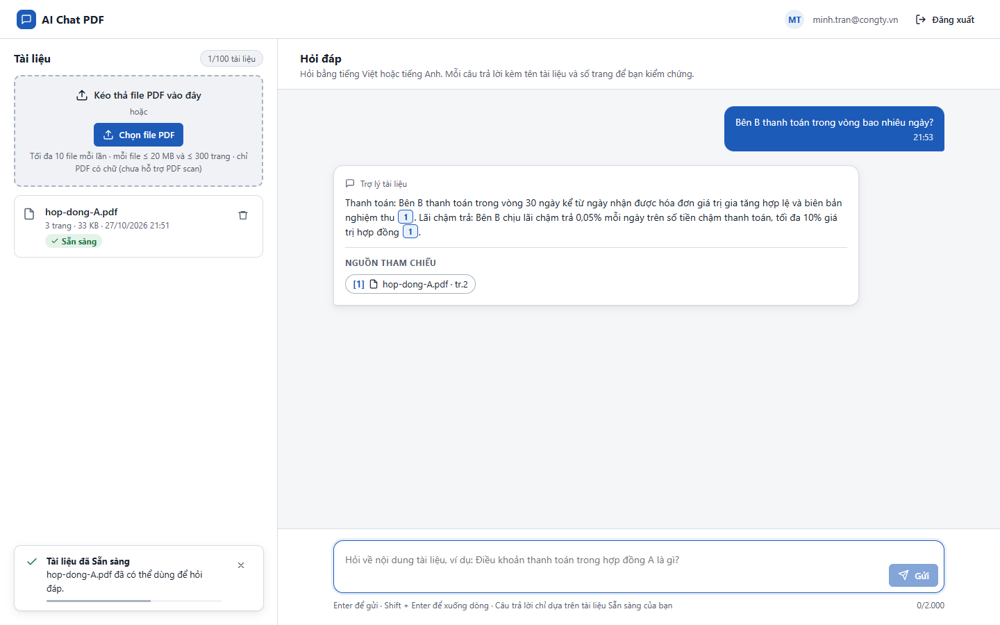

# Test report – E2E-013: Trùng tên file

| Trường | Giá trị |
|---|---|
| Test case | [E2E-013](../../doc/07-verification/test_cases/E2E-013_trung-ten-file.md) |
| Kết luận | **ĐẠT** |
| Bắt đầu | 2026-10-27T14:51:42.704Z |
| Kết thúc | 2026-10-27T14:53:27.913Z (105.2 s) |
| Cách thực hiện | Tự động – Playwright (app/frontend/evidence/fixture.ts) |
| URL ứng dụng | http://localhost:8080/ |
| Bản build | 166929f + thay đổi chưa commit trong app/ |
| Trình duyệt | Microsoft Edge (Playwright, channel msedge) |
| Hệ điều hành | win32 x64 |
| Spec | app/frontend/testcases/E2E-013_trung-ten-file.spec.ts |

## Kết quả từng bước

| # | Bước | Kết quả mong đợi | Kết quả thực tế | Trạng thái | Bằng chứng |
|---|---|---|---|---|---|
| 1 | Đăng nhập P2, tải hop-dong-A.pdf, chờ Sẵn sàng | 1 dòng | Như mong đợi | Đạt | [ảnh](screenshots/01-dang-nhap-p2-tai-hop-dong-a-pdf-cho-san-sang.png) |
| 2 | Chờ ≥ 61 s rồi tải lại hop-dong-A.pdf | 2 dòng cùng tên, thời điểm tải lên khác nhau | Thời điểm tải lên: 27/10/2026 21:53 \| 27/10/2026 21:51 | Đạt | [ảnh](screenshots/02-cho-61-s-roi-tai-lai-hop-dong-a-pdf.png) |
| 3 | Xóa dòng mới hơn | Còn 1 dòng (bản cũ), vẫn Sẵn sàng | Như mong đợi | Đạt | [ảnh](screenshots/03-xoa-dong-moi-hon.png) |
| 4 | Hỏi "Bên B thanh toán trong vòng bao nhiêu ngày?" | Câu trả lời có nguồn hop-dong-A.pdf | Như mong đợi | Đạt | [ảnh](screenshots/04-hoi-ben-b-thanh-toan-trong-vong-bao-nhieu-ngay.png) |

## Video

- [E2E-013-app.webm](video/E2E-013-app.webm)

## Ảnh chụp màn hình

## Log

- (không có)

## Ghi chú / lỗi phát hiện

- (không có)
