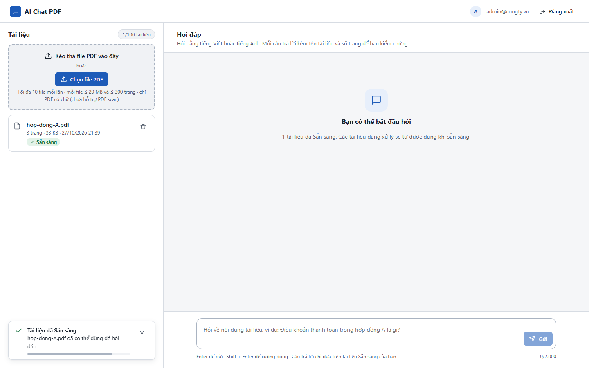
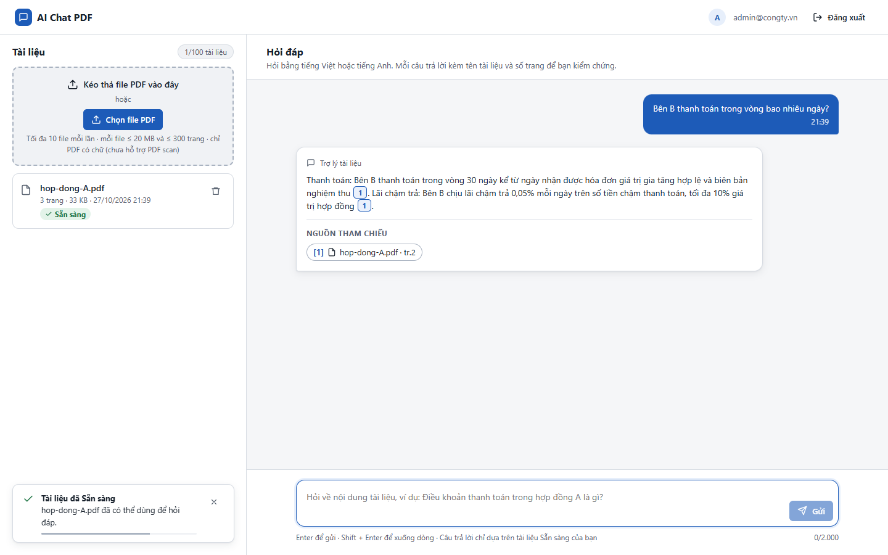
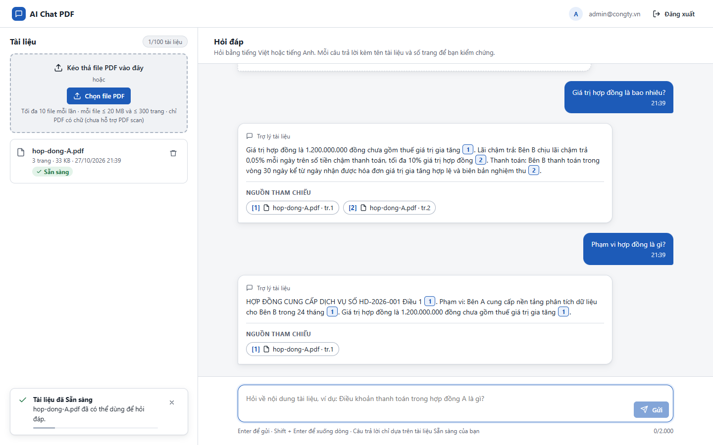

# Test report – E2E-014: Năm câu hỏi liên tiếp

| Trường | Giá trị |
|---|---|
| Test case | [E2E-014](../../doc/07-verification/test_cases/E2E-014_nam-cau-hoi-lien-tiep.md) |
| Kết luận | **ĐẠT** |
| Bắt đầu | 2026-10-27T14:38:55.177Z |
| Kết thúc | 2026-10-27T14:39:07.596Z (12.4 s) |
| Cách thực hiện | Tự động – Playwright (app/frontend/evidence/fixture.ts) |
| URL ứng dụng | http://localhost:8080/ |
| Bản build | 166929f + thay đổi chưa commit trong app/ |
| Trình duyệt | Microsoft Edge (Playwright, channel msedge) |
| Hệ điều hành | win32 x64 |
| Spec | app/frontend/testcases/E2E-014_nam-cau-hoi-lien-tiep.spec.ts |

## Kết quả từng bước

| # | Bước | Kết quả mong đợi | Kết quả thực tế | Trạng thái | Bằng chứng |
|---|---|---|---|---|---|
| 1 | Đăng nhập Quản trị viên, tải hop-dong-A.pdf và chờ Sẵn sàng | Dòng Sẵn sàng | Như mong đợi | Đạt | [ảnh](screenshots/01-dang-nhap-quan-tri-vien-tai-hop-dong-a-pdf-va-cho-.png) |
| 2 | Hỏi "Bên B thanh toán trong vòng bao nhiêu ngày?" | Câu trả lời 1 | Như mong đợi | Đạt | [ảnh](screenshots/02-hoi-ben-b-thanh-toan-trong-vong-bao-nhieu-ngay.png) |
| 3 | Hỏi tiếp 5 câu: lãi chậm trả; hiệu lực; bảo hành; giá trị; phạm vi | Mỗi câu có câu trả lời (hoặc Chưa đủ thông tin) ngay dưới câu hỏi | Như mong đợi | Đạt | [ảnh](screenshots/03-hoi-tiep-5-cau-lai-cham-tra-hieu-luc-bao-hanh-gia-.png) |
| 4 | Cuộn hội thoại, chụp ảnh | 6 lượt đúng thứ tự gửi | Thứ tự 6 câu hỏi khớp thứ tự gửi | Đạt | [ảnh](screenshots/04-cuon-hoi-thoai-chup-anh.png) |

## Video

- [E2E-014-app.webm](video/E2E-014-app.webm)

## Ảnh chụp màn hình

## Log

- (không có)

## Ghi chú / lỗi phát hiện

- (không có)
