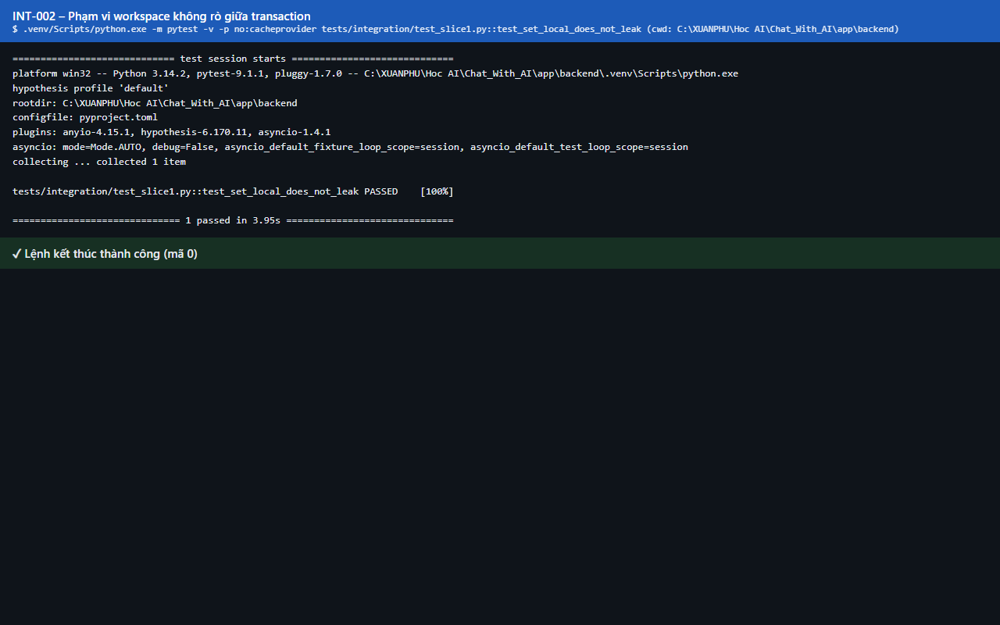

# Test report – INT-002: Phạm vi workspace không rò giữa transaction

| Trường | Giá trị |
|---|---|
| Test case | [INT-002](../../doc/07-verification/test_cases/INT-002_pham-vi-workspace-khong-ro-giua-transaction.md) |
| Kết luận | **ĐẠT** |
| Bắt đầu | 2026-10-27T14:03:20.772Z |
| Kết thúc | 2026-10-27T14:03:36.450Z (15.7 s) |
| Cách thực hiện | Tự động – dòng lệnh (app/frontend/evidence/record-cli.ts) |
| URL ứng dụng | http://localhost:8080/ |
| Bản build | 166929f + thay đổi chưa commit trong app/ |
| Trình duyệt | Microsoft Edge (Playwright, channel msedge) |
| Hệ điều hành | win32 x64 |
| Thư mục chạy | C:\XUANPHU\Hoc AI\Chat_With_AI\app\backend |

## Kết quả từng bước

| # | Bước | Kết quả mong đợi | Kết quả thực tế | Trạng thái | Bằng chứng |
|---|---|---|---|---|---|
| 1 | Chạy: .venv/Scripts/python.exe -m pytest -v -p no:cacheprovider tests/integration/test_slice1.py::test_set_local_does_not_leak | Lệnh kết thúc với mã 0 | Mã thoát 0 | Đạt | [ảnh](screenshots/01-ket-qua-lenh.png) [ảnh](screenshots/02-toan-bo-output.png) |

## Video

- [INT-002-cli.webm](video/INT-002-cli.webm)

## Ảnh chụp màn hình

## Log

- [output.log](logs/output.log)

## Ghi chú / lỗi phát hiện

- (không có)
