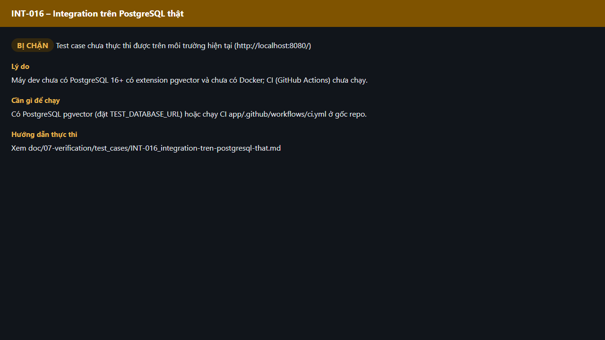

# Test report – INT-016: Integration trên PostgreSQL thật

| Trường | Giá trị |
|---|---|
| Test case | [INT-016](../../doc/07-verification/test_cases/INT-016_integration-tren-postgresql-that.md) |
| Kết luận | **BỊ CHẶN** |
| Bắt đầu | 2026-10-27T15:13:33.607Z |
| Kết thúc | 2026-10-27T15:13:39.353Z (5.7 s) |
| Cách thực hiện | Không thực thi – bị chặn (evidence/blocked.ts) |
| URL ứng dụng | http://localhost:8080/ |
| Bản build | 166929f + thay đổi chưa commit trong app/ |
| Trình duyệt | Microsoft Edge (Playwright, channel msedge) |
| Hệ điều hành | win32 x64 |

## Kết quả từng bước

| # | Bước | Kết quả mong đợi | Kết quả thực tế | Trạng thái | Bằng chứng |
|---|---|---|---|---|---|
| 1 | Kiểm tra điều kiện thực thi | Có PostgreSQL pgvector (đặt TEST_DATABASE_URL) hoặc chạy CI app/.github/workflows/ci.yml ở gốc repo. | Máy dev chưa có PostgreSQL 16+ có extension pgvector và chưa có Docker; CI (GitHub Actions) chưa chạy. | Bị chặn | [ảnh](screenshots/01-ly-do-bi-chan.png) |

## Video

- [INT-016-blocked.webm](video/INT-016-blocked.webm)

## Ảnh chụp màn hình

## Log

- (không có)

## Ghi chú / lỗi phát hiện

- Bị chặn: Máy dev chưa có PostgreSQL 16+ có extension pgvector và chưa có Docker; CI (GitHub Actions) chưa chạy.
- Cần: Có PostgreSQL pgvector (đặt TEST_DATABASE_URL) hoặc chạy CI app/.github/workflows/ci.yml ở gốc repo.
