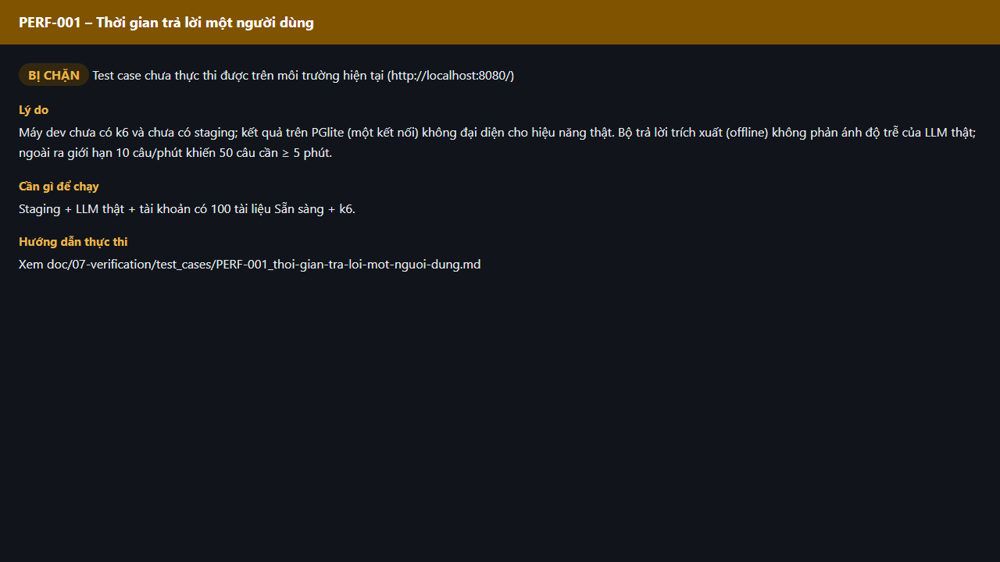

# Test report – PERF-001: Thời gian trả lời một người dùng

| Trường | Giá trị |
|---|---|
| Test case | [PERF-001](../../doc/07-verification/test_cases/PERF-001_thoi-gian-tra-loi-mot-nguoi-dung.md) |
| Kết luận | **BỊ CHẶN** |
| Bắt đầu | 2026-10-27T15:13:59.143Z |
| Kết thúc | 2026-10-27T15:14:06.409Z (7.3 s) |
| Cách thực hiện | Không thực thi – bị chặn (evidence/blocked.ts) |
| URL ứng dụng | http://localhost:8080/ |
| Bản build | 166929f + thay đổi chưa commit trong app/ |
| Trình duyệt | Microsoft Edge (Playwright, channel msedge) |
| Hệ điều hành | win32 x64 |

## Kết quả từng bước

| # | Bước | Kết quả mong đợi | Kết quả thực tế | Trạng thái | Bằng chứng |
|---|---|---|---|---|---|
| 1 | Kiểm tra điều kiện thực thi | Staging + LLM thật + tài khoản có 100 tài liệu Sẵn sàng + k6. | Máy dev chưa có k6 và chưa có staging; kết quả trên PGlite (một kết nối) không đại diện cho hiệu năng thật. Bộ trả lời trích xuất (offline) không phản ánh độ trễ của LLM thật; ngoài ra giới hạn 10 câu/phút khiến 50 câu cần ≥ 5 phút. | Bị chặn | [ảnh](screenshots/01-ly-do-bi-chan.png) |

## Video

- [PERF-001-blocked.webm](video/PERF-001-blocked.webm)

## Ảnh chụp màn hình

## Log

- (không có)

## Ghi chú / lỗi phát hiện

- Bị chặn: Máy dev chưa có k6 và chưa có staging; kết quả trên PGlite (một kết nối) không đại diện cho hiệu năng thật. Bộ trả lời trích xuất (offline) không phản ánh độ trễ của LLM thật; ngoài ra giới hạn 10 câu/phút khiến 50 câu cần ≥ 5 phút.
- Cần: Staging + LLM thật + tài khoản có 100 tài liệu Sẵn sàng + k6.
