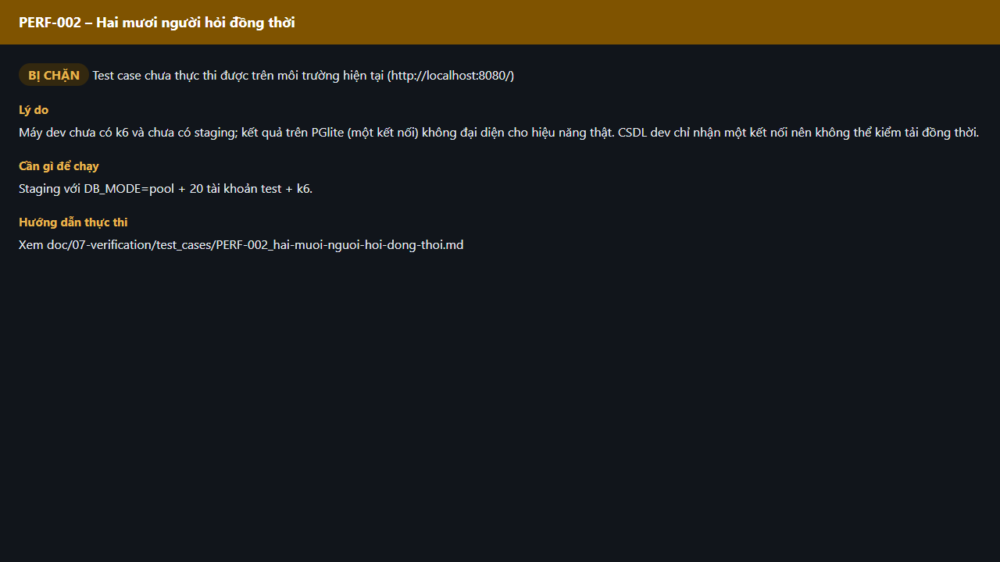

# Test report – PERF-002: Hai mươi người hỏi đồng thời

| Trường | Giá trị |
|---|---|
| Test case | [PERF-002](../../doc/07-verification/test_cases/PERF-002_hai-muoi-nguoi-hoi-dong-thoi.md) |
| Kết luận | **BỊ CHẶN** |
| Bắt đầu | 2026-10-27T15:14:10.415Z |
| Kết thúc | 2026-10-27T15:14:17.266Z (6.9 s) |
| Cách thực hiện | Không thực thi – bị chặn (evidence/blocked.ts) |
| URL ứng dụng | http://localhost:8080/ |
| Bản build | 166929f + thay đổi chưa commit trong app/ |
| Trình duyệt | Microsoft Edge (Playwright, channel msedge) |
| Hệ điều hành | win32 x64 |

## Kết quả từng bước

| # | Bước | Kết quả mong đợi | Kết quả thực tế | Trạng thái | Bằng chứng |
|---|---|---|---|---|---|
| 1 | Kiểm tra điều kiện thực thi | Staging với DB_MODE=pool + 20 tài khoản test + k6. | Máy dev chưa có k6 và chưa có staging; kết quả trên PGlite (một kết nối) không đại diện cho hiệu năng thật. CSDL dev chỉ nhận một kết nối nên không thể kiểm tải đồng thời. | Bị chặn | [ảnh](screenshots/01-ly-do-bi-chan.png) |

## Video

- [PERF-002-blocked.webm](video/PERF-002-blocked.webm)

## Ảnh chụp màn hình

## Log

- (không có)

## Ghi chú / lỗi phát hiện

- Bị chặn: Máy dev chưa có k6 và chưa có staging; kết quả trên PGlite (một kết nối) không đại diện cho hiệu năng thật. CSDL dev chỉ nhận một kết nối nên không thể kiểm tải đồng thời.
- Cần: Staging với DB_MODE=pool + 20 tài khoản test + k6.
