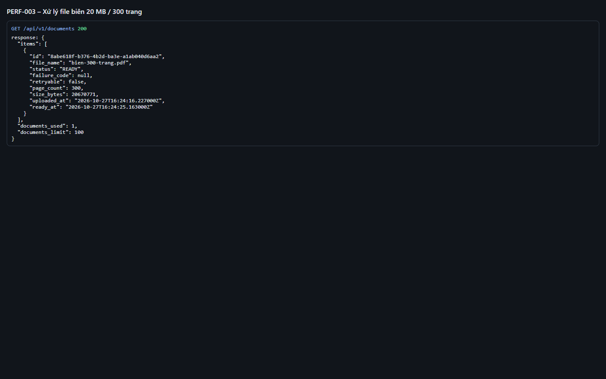
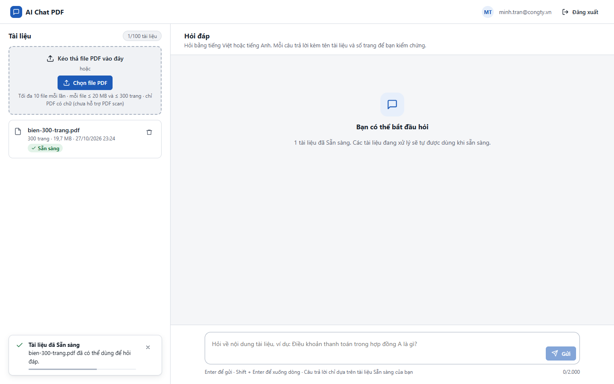

# Test report – PERF-003: Xử lý file biên 20 MB / 300 trang

| Trường | Giá trị |
|---|---|
| Test case | [PERF-003](../../doc/07-verification/test_cases/PERF-003_xu-ly-file-bien-20-mb-300-trang.md) |
| Kết luận | **ĐẠT** |
| Bắt đầu | 2026-10-27T16:24:00.511Z |
| Kết thúc | 2026-10-27T16:24:32.412Z (31.9 s) |
| Cách thực hiện | Tự động – Playwright (app/frontend/evidence/fixture.ts) |
| URL ứng dụng | http://localhost:8080/ |
| Bản build | 166929f + thay đổi chưa commit trong app/ |
| Trình duyệt | Microsoft Edge (Playwright, channel msedge) |
| Hệ điều hành | win32 x64 |
| Spec | app/frontend/testcases/PERF-003_xu-ly-file-bien-20-mb-300-trang.spec.ts |

## Kết quả từng bước

| # | Bước | Kết quả mong đợi | Kết quả thực tế | Trạng thái | Bằng chứng |
|---|---|---|---|---|---|
| 1 | Tạo PDF 300 trang có chữ, gần 20 MB (văn bản + ảnh nhiễu để đạt dung lượng) | File hợp lệ: ≤ 20 MB, 300 trang | 19.7 MB, 300 trang | Đạt | [ảnh](screenshots/01-tao-pdf-300-trang-co-chu-gan-20-mb-van-ban-anh-nhi.png) |
| 2 | Tải lên trên giao diện, bấm giờ tới khi Sẵn sàng | Tài liệu Sẵn sàng | Từ lúc chọn file tới Sẵn sàng: 17 s | Đạt | [ảnh](screenshots/02-tai-len-tren-giao-dien-bam-gio-toi-khi-san-sang.png) |
| 3 | So sánh với ngưỡng NFR-002 | ≤ 3 phút (180 s) | 17 s ≤ 180 s (tham khảo ENV-DEV) | Đạt | [ảnh](screenshots/03-so-sanh-voi-nguong-nfr-002.png) |

## Video

- [PERF-003-app.webm](video/PERF-003-app.webm)
- [PERF-003-page2.webm](video/PERF-003-page2.webm)

## Ảnh chụp màn hình

## Log

- [api.log](logs/api.log)

## Ghi chú / lỗi phát hiện

- PERF-003 trên ENV-DEV (PGlite, embedding hashing, máy dev): 17 s. Chỉ để tham khảo – NFR-002 chính thức cần đo trên staging (embedding bge-m3, PostgreSQL thật).
