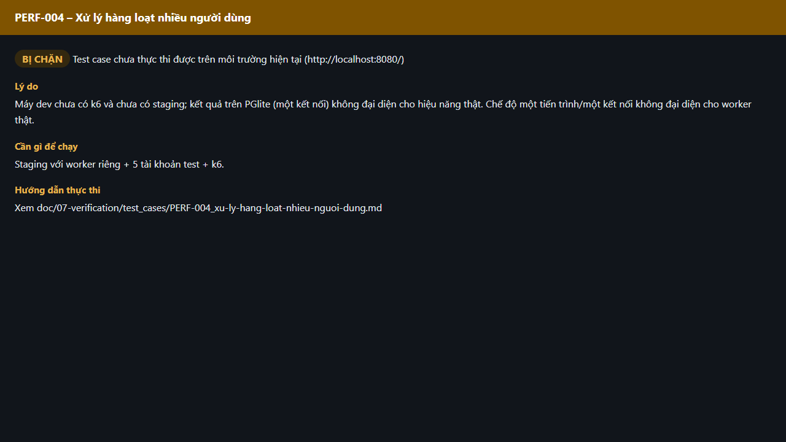

# Test report – PERF-004: Xử lý hàng loạt nhiều người dùng

| Trường | Giá trị |
|---|---|
| Test case | [PERF-004](../../doc/07-verification/test_cases/PERF-004_xu-ly-hang-loat-nhieu-nguoi-dung.md) |
| Kết luận | **BỊ CHẶN** |
| Bắt đầu | 2026-10-27T15:14:19.974Z |
| Kết thúc | 2026-10-27T15:14:25.990Z (6.0 s) |
| Cách thực hiện | Không thực thi – bị chặn (evidence/blocked.ts) |
| URL ứng dụng | http://localhost:8080/ |
| Bản build | 166929f + thay đổi chưa commit trong app/ |
| Trình duyệt | Microsoft Edge (Playwright, channel msedge) |
| Hệ điều hành | win32 x64 |

## Kết quả từng bước

| # | Bước | Kết quả mong đợi | Kết quả thực tế | Trạng thái | Bằng chứng |
|---|---|---|---|---|---|
| 1 | Kiểm tra điều kiện thực thi | Staging với worker riêng + 5 tài khoản test + k6. | Máy dev chưa có k6 và chưa có staging; kết quả trên PGlite (một kết nối) không đại diện cho hiệu năng thật. Chế độ một tiến trình/một kết nối không đại diện cho worker thật. | Bị chặn | [ảnh](screenshots/01-ly-do-bi-chan.png) |

## Video

- [PERF-004-blocked.webm](video/PERF-004-blocked.webm)

## Ảnh chụp màn hình

## Log

- (không có)

## Ghi chú / lỗi phát hiện

- Bị chặn: Máy dev chưa có k6 và chưa có staging; kết quả trên PGlite (một kết nối) không đại diện cho hiệu năng thật. Chế độ một tiến trình/một kết nối không đại diện cho worker thật.
- Cần: Staging với worker riêng + 5 tài khoản test + k6.
