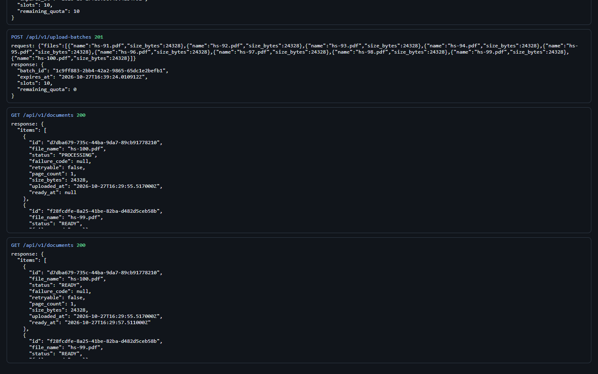
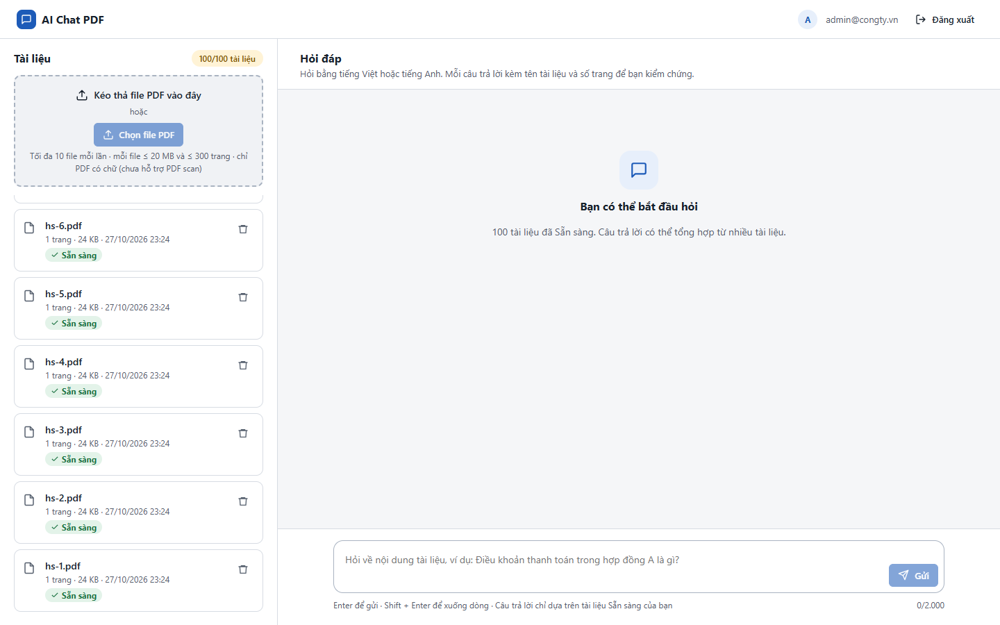
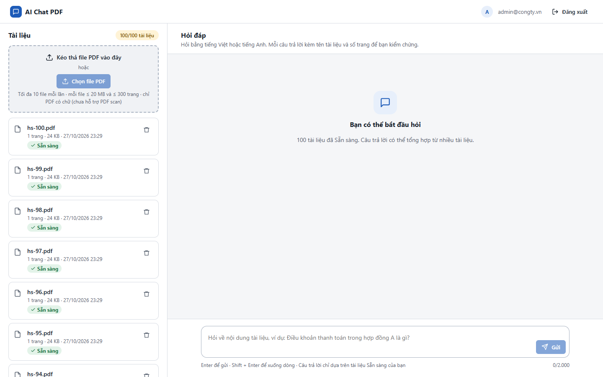

# Test report – PERF-006: Hiệu năng giao diện

| Trường | Giá trị |
|---|---|
| Test case | [PERF-006](../../doc/07-verification/test_cases/PERF-006_hieu-nang-giao-dien.md) |
| Kết luận | **ĐẠT** |
| Bắt đầu | 2026-10-27T16:24:34.284Z |
| Kết thúc | 2026-10-27T16:31:11.661Z (397.4 s) |
| Cách thực hiện | Tự động – Playwright (app/frontend/evidence/fixture.ts) |
| URL ứng dụng | http://localhost:8080/ |
| Bản build | 166929f + thay đổi chưa commit trong app/ |
| Trình duyệt | Microsoft Edge (Playwright, channel msedge) |
| Hệ điều hành | win32 x64 |
| Spec | app/frontend/testcases/PERF-006_hieu-nang-giao-dien.spec.ts |

## Kết quả từng bước

| # | Bước | Kết quả mong đợi | Kết quả thực tế | Trạng thái | Bằng chứng |
|---|---|---|---|---|---|
| 1 | Đăng nhập Quản trị viên, xóa tài liệu cũ; tải 100 tài liệu (10 lô × 10 file) | documents_used = 100 | Như mong đợi | Đạt | [ảnh](screenshots/01-dang-nhap-quan-tri-vien-xoa-tai-lieu-cu-tai-100-ta.png) |
| 2 | Tải lại trang với 100 tài liệu; đo LCP | LCP < 2,5 s | LCP = 1112 ms | Đạt | [ảnh](screenshots/02-tai-lai-trang-voi-100-tai-lieu-do-lcp.png) |
| 3 | Cuộn danh sách 100 tài liệu từ đầu tới cuối | Không lỗi console; cuộn được | Chiều cao danh sách 9812 px; 0 lỗi trang | Đạt | [ảnh](screenshots/03-cuon-danh-sach-100-tai-lieu-tu-dau-toi-cuoi.png) |
| 4 | Bật CPU throttling 4×, tải lại, đo LCP | LCP < 4 s (ghi nhận) | LCP (CPU 4×) = 1360 ms | Đạt | [ảnh](screenshots/04-bat-cpu-throttling-4-tai-lai-do-lcp.png) |
| 5 | Dọn dẹp: xóa 100 tài liệu thử | Danh sách rỗng | Như mong đợi | Đạt | [ảnh](screenshots/05-don-dep-xoa-100-tai-lieu-thu.png) |

## Video

- [PERF-006-app.webm](video/PERF-006-app.webm)
- [PERF-006-page2.webm](video/PERF-006-page2.webm)

## Ảnh chụp màn hình

## Log

- [api.log](logs/api.log)

## Ghi chú / lỗi phát hiện

- (không có)
