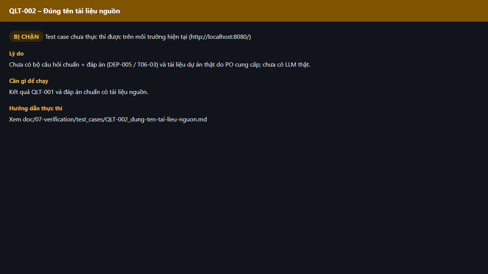

# Test report – QLT-002: Đúng tên tài liệu nguồn

| Trường | Giá trị |
|---|---|
| Test case | [QLT-002](../../doc/07-verification/test_cases/QLT-002_dung-ten-tai-lieu-nguon.md) |
| Kết luận | **BỊ CHẶN** |
| Bắt đầu | 2026-10-27T15:14:47.270Z |
| Kết thúc | 2026-10-27T15:14:53.768Z (6.5 s) |
| Cách thực hiện | Không thực thi – bị chặn (evidence/blocked.ts) |
| URL ứng dụng | http://localhost:8080/ |
| Bản build | 166929f + thay đổi chưa commit trong app/ |
| Trình duyệt | Microsoft Edge (Playwright, channel msedge) |
| Hệ điều hành | win32 x64 |

## Kết quả từng bước

| # | Bước | Kết quả mong đợi | Kết quả thực tế | Trạng thái | Bằng chứng |
|---|---|---|---|---|---|
| 1 | Kiểm tra điều kiện thực thi | Kết quả QLT-001 và đáp án chuẩn có tài liệu nguồn. | Chưa có bộ câu hỏi chuẩn + đáp án (DEP-005 / T06-03) và tài liệu dự án thật do PO cung cấp; chưa có LLM thật. | Bị chặn | [ảnh](screenshots/01-ly-do-bi-chan.png) |

## Video

- [QLT-002-blocked.webm](video/QLT-002-blocked.webm)

## Ảnh chụp màn hình

## Log

- (không có)

## Ghi chú / lỗi phát hiện

- Bị chặn: Chưa có bộ câu hỏi chuẩn + đáp án (DEP-005 / T06-03) và tài liệu dự án thật do PO cung cấp; chưa có LLM thật.
- Cần: Kết quả QLT-001 và đáp án chuẩn có tài liệu nguồn.
