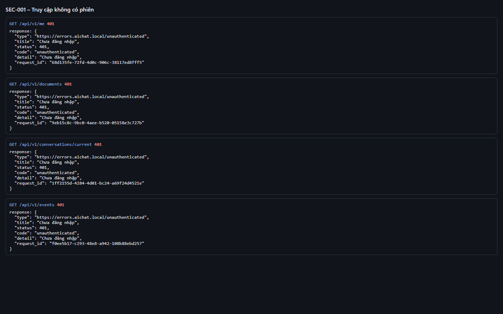
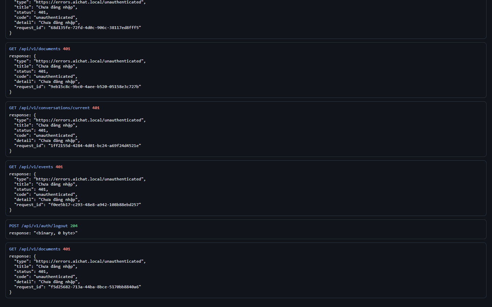
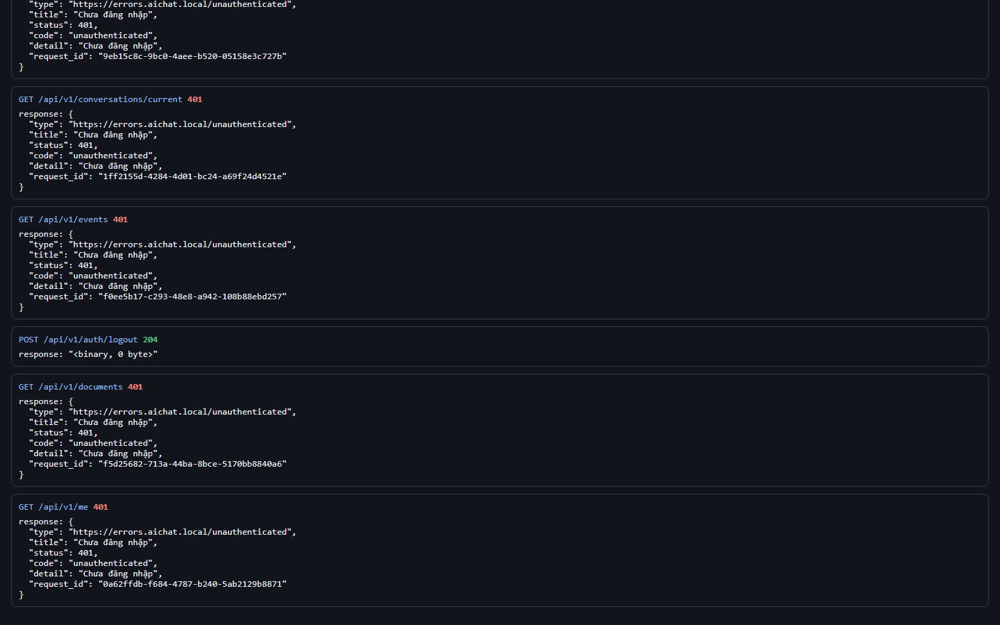

# Test report – SEC-001: Truy cập không có phiên

| Trường | Giá trị |
|---|---|
| Test case | [SEC-001](../../doc/07-verification/test_cases/SEC-001_truy-cap-khong-co-phien.md) |
| Kết luận | **ĐẠT** |
| Bắt đầu | 2026-10-27T15:45:21.497Z |
| Kết thúc | 2026-10-27T15:45:29.820Z (8.3 s) |
| Cách thực hiện | Tự động – Playwright (app/frontend/evidence/fixture.ts) |
| URL ứng dụng | http://localhost:8080/ |
| Bản build | 166929f + thay đổi chưa commit trong app/ |
| Trình duyệt | Microsoft Edge (Playwright, channel msedge) |
| Hệ điều hành | win32 x64 |
| Spec | app/frontend/testcases/SEC-001_truy-cap-khong-co-phien.spec.ts |

## Kết quả từng bước

| # | Bước | Kết quả mong đợi | Kết quả thực tế | Trạng thái | Bằng chứng |
|---|---|---|---|---|---|
| 1 | Gọi /me, /documents, /conversations/current, /events khi chưa đăng nhập | Mỗi request 401 unauthenticated | Như mong đợi | Đạt | [ảnh](screenshots/01-goi-me-documents-conversations-current-events-khi-.png) |
| 2 | Mở http://localhost:8080/ | Chuyển tới trang IdP | Như mong đợi | Đạt | [ảnh](screenshots/02-mo-http-localhost-8080.png) |
| 3 | Đăng nhập P1, đăng xuất; gọi lại GET /documents | 401 | Như mong đợi | Đạt | [ảnh](screenshots/03-dang-nhap-p1-dang-xuat-goi-lai-get-documents.png) |
| 4 | Gửi cookie sid giả rồi gọi /me | 401 | Như mong đợi | Đạt | [ảnh](screenshots/04-gui-cookie-sid-gia-roi-goi-me.png) |

## Video

- [SEC-001-app.webm](video/SEC-001-app.webm)
- [SEC-001-page2.webm](video/SEC-001-page2.webm)

## Ảnh chụp màn hình

## Log

- [api.log](logs/api.log)

## Ghi chú / lỗi phát hiện

- (không có)
