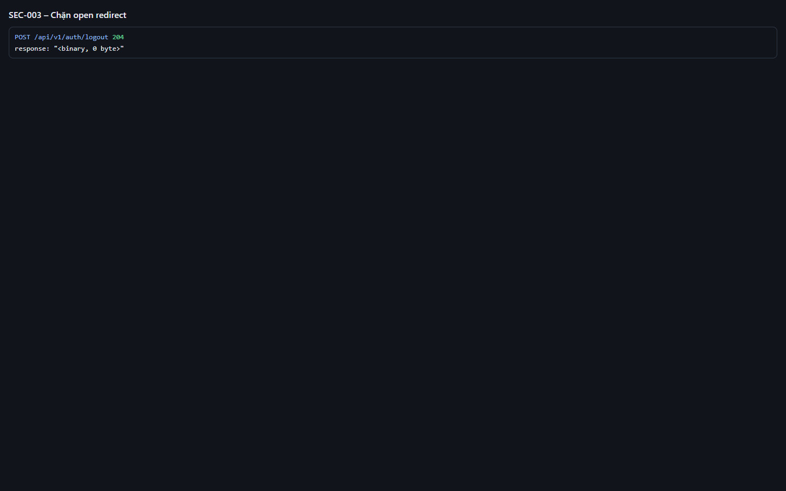
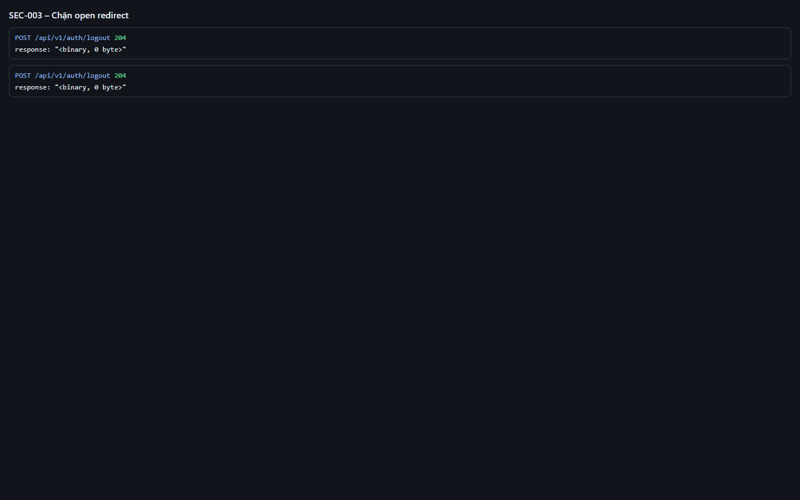
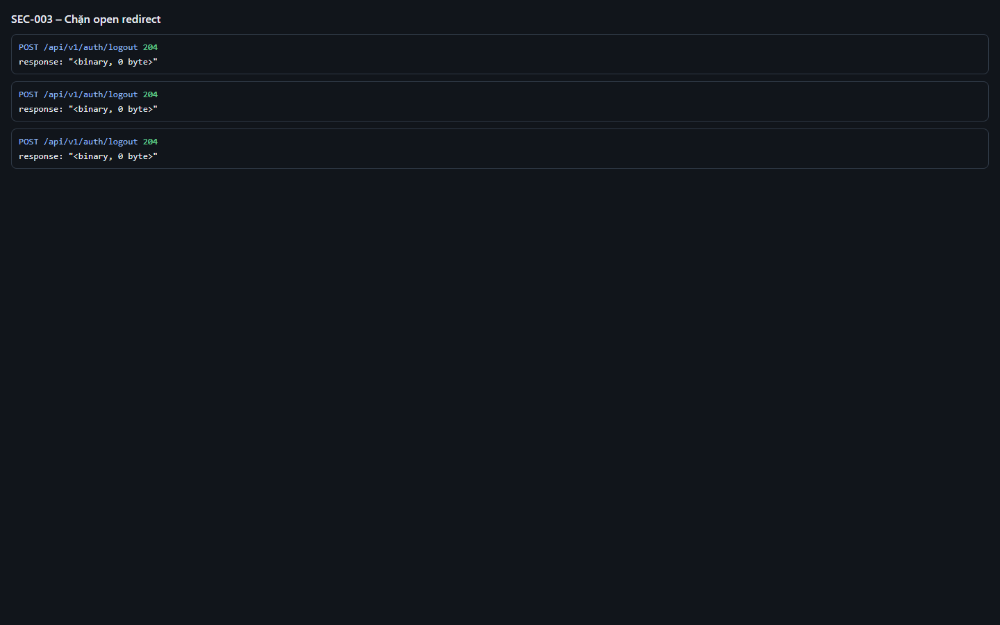
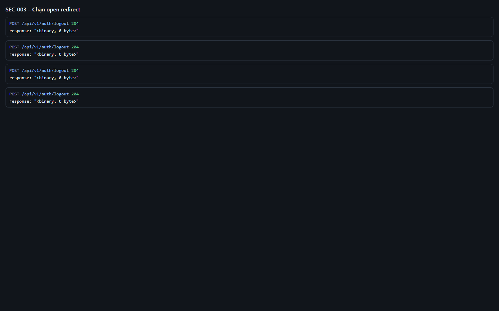
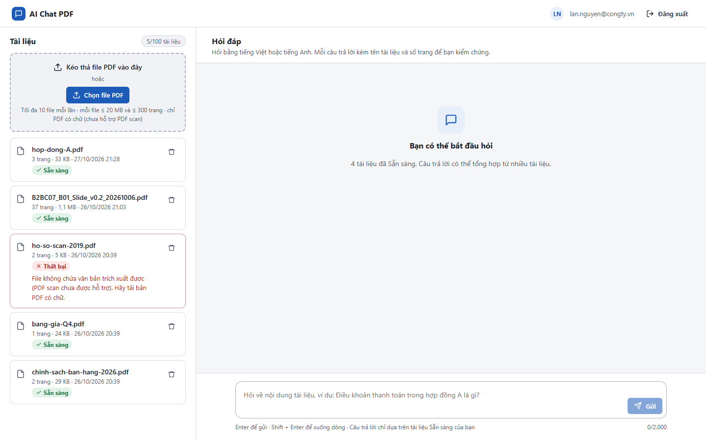

# Test report – SEC-003: Chặn open redirect

| Trường | Giá trị |
|---|---|
| Test case | [SEC-003](../../doc/07-verification/test_cases/SEC-003_chan-open-redirect.md) |
| Kết luận | **ĐẠT** |
| Bắt đầu | 2026-10-27T15:45:48.247Z |
| Kết thúc | 2026-10-27T15:45:59.027Z (10.8 s) |
| Cách thực hiện | Tự động – Playwright (app/frontend/evidence/fixture.ts) |
| URL ứng dụng | http://localhost:8080/ |
| Bản build | 166929f + thay đổi chưa commit trong app/ |
| Trình duyệt | Microsoft Edge (Playwright, channel msedge) |
| Hệ điều hành | win32 x64 |
| Spec | app/frontend/testcases/SEC-003_chan-open-redirect.spec.ts |

## Kết quả từng bước

| # | Bước | Kết quả mong đợi | Kết quả thực tế | Trạng thái | Bằng chứng |
|---|---|---|---|---|---|
| 1 | Mở /api/v1/auth/login?return_to=https://evil.example, chọn P1 | Sau callback về http://localhost:8080/ (không tới domain ngoài) | Như mong đợi | Đạt | [ảnh](screenshots/01-mo-api-v1-auth-login-return-to-https-evil-example-.png) |
| 2 | Mở /api/v1/auth/login?return_to=//evil.example, chọn P1 | Sau callback về http://localhost:8080/ (không tới domain ngoài) | Như mong đợi | Đạt | [ảnh](screenshots/02-mo-api-v1-auth-login-return-to-evil-example-chon-p.png) |
| 3 | Mở /api/v1/auth/login?return_to=/\evil.example, chọn P1 | Sau callback về http://localhost:8080/ (không tới domain ngoài) | Như mong đợi | Đạt | [ảnh](screenshots/03-mo-api-v1-auth-login-return-to-evil-example-chon-p.png) |
| 4 | Mở /api/v1/auth/login?return_to=javascript:alert(1), chọn P1 | Sau callback về http://localhost:8080/ (không tới domain ngoài) | Như mong đợi | Đạt | [ảnh](screenshots/04-mo-api-v1-auth-login-return-to-javascript-alert-1-.png) |
| 5 | Thử return_to=/ (hợp lệ) | Về / | Như mong đợi | Đạt | [ảnh](screenshots/05-thu-return-to-hop-le.png) |

## Video

- [SEC-003-app.webm](video/SEC-003-app.webm)
- [SEC-003-page2.webm](video/SEC-003-page2.webm)

## Ảnh chụp màn hình

## Log

- [api.log](logs/api.log)

## Ghi chú / lỗi phát hiện

- (không có)
