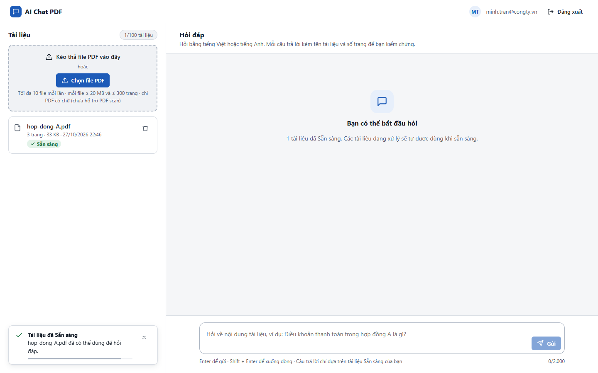
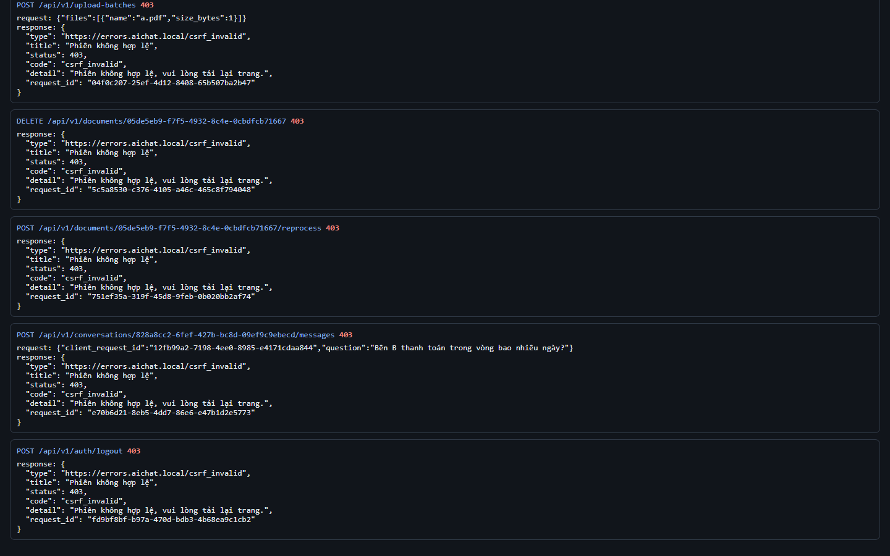
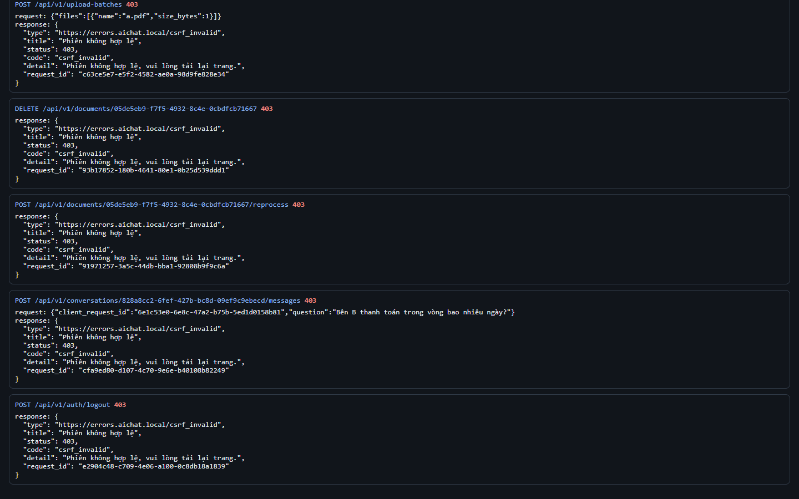
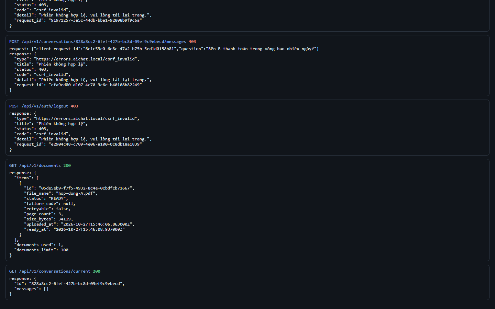

# Test report – SEC-004: CSRF cho mọi thao tác ghi

| Trường | Giá trị |
|---|---|
| Test case | [SEC-004](../../doc/07-verification/test_cases/SEC-004_csrf-cho-moi-thao-tac-ghi.md) |
| Kết luận | **ĐẠT** |
| Bắt đầu | 2026-10-27T15:46:00.777Z |
| Kết thúc | 2026-10-27T15:46:17.821Z (17.0 s) |
| Cách thực hiện | Tự động – Playwright (app/frontend/evidence/fixture.ts) |
| URL ứng dụng | http://localhost:8080/ |
| Bản build | 166929f + thay đổi chưa commit trong app/ |
| Trình duyệt | Microsoft Edge (Playwright, channel msedge) |
| Hệ điều hành | win32 x64 |
| Spec | app/frontend/testcases/SEC-004_csrf-cho-moi-thao-tac-ghi.spec.ts |

## Kết quả từng bước

| # | Bước | Kết quả mong đợi | Kết quả thực tế | Trạng thái | Bằng chứng |
|---|---|---|---|---|---|
| 1 | Đăng nhập P2, tải hop-dong-A.pdf và chờ Sẵn sàng | Dòng Sẵn sàng | Như mong đợi | Đạt | [ảnh](screenshots/01-dang-nhap-p2-tai-hop-dong-a-pdf-va-cho-san-sang.png) |
| 2 | Gọi 5 thao tác ghi KHÔNG có X-CSRF-Token | Mỗi request 403 csrf_invalid | Như mong đợi | Đạt | [ảnh](screenshots/02-goi-5-thao-tac-ghi-khong-co-x-csrf-token.png) |
| 3 | Gọi lại với token sai (X-CSRF-Token: abc) | 403 | Như mong đợi | Đạt | [ảnh](screenshots/03-goi-lai-voi-token-sai-x-csrf-token-abc.png) |
| 4 | Kiểm tra trạng thái | Tài liệu vẫn còn; không có lượt hỏi mới | Như mong đợi | Đạt | [ảnh](screenshots/04-kiem-tra-trang-thai.png) |

## Video

- [SEC-004-app.webm](video/SEC-004-app.webm)
- [SEC-004-page2.webm](video/SEC-004-page2.webm)

## Ảnh chụp màn hình

## Log

- [api.log](logs/api.log)

## Ghi chú / lỗi phát hiện

- (không có)
