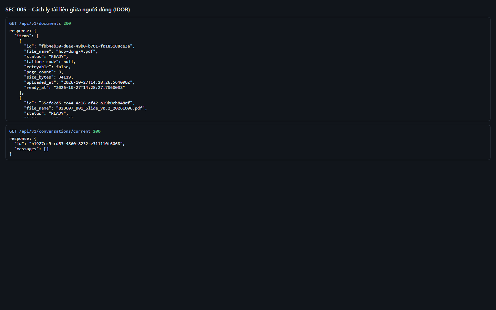
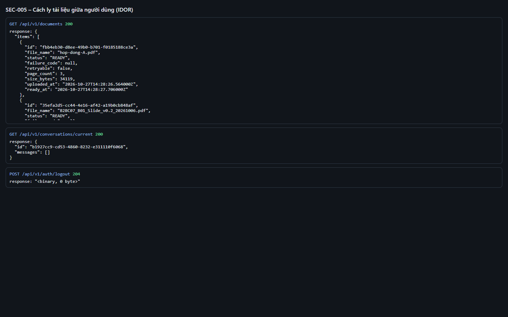
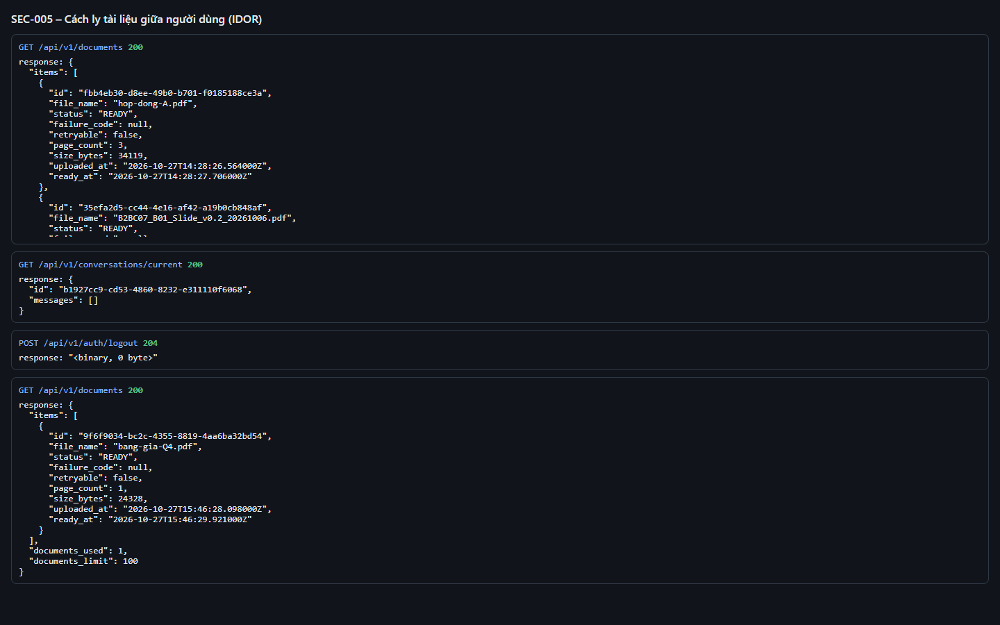
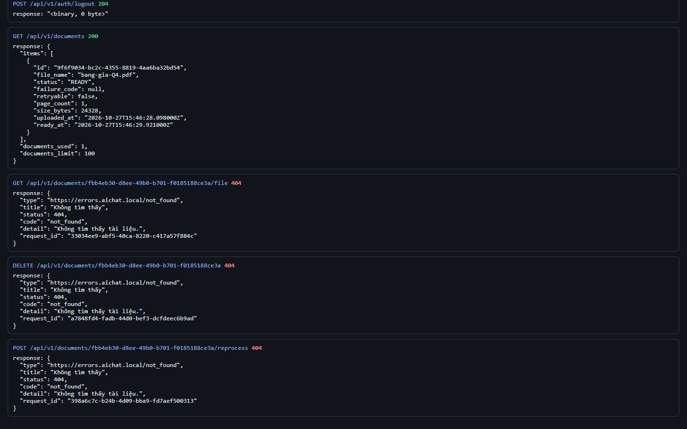
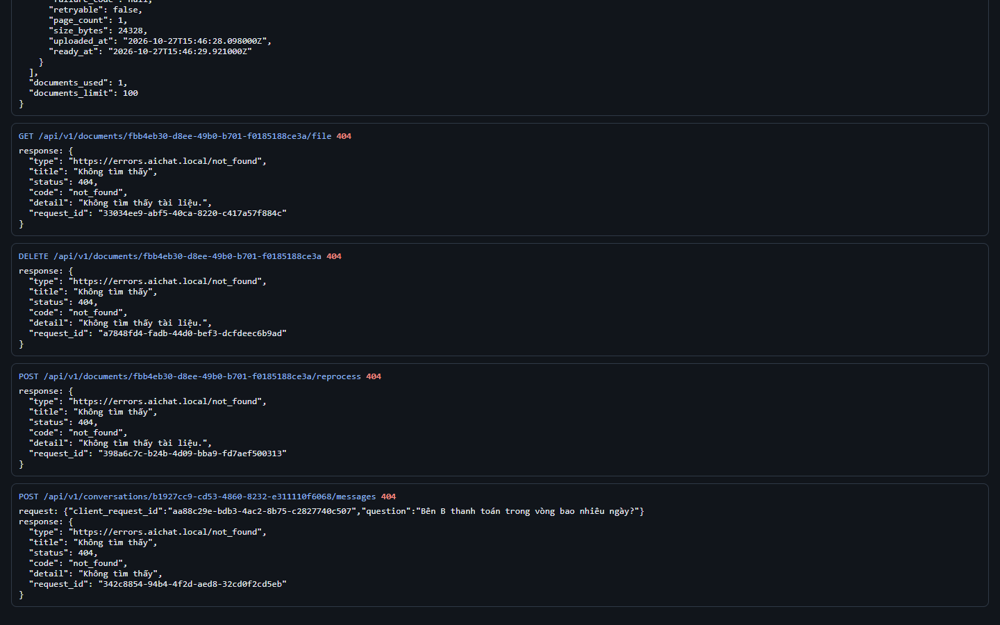
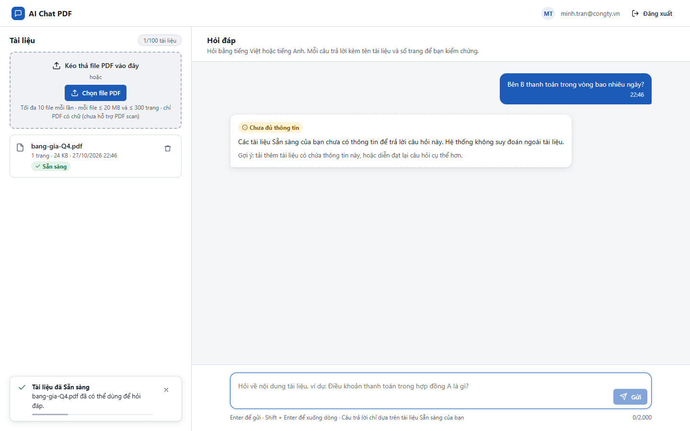
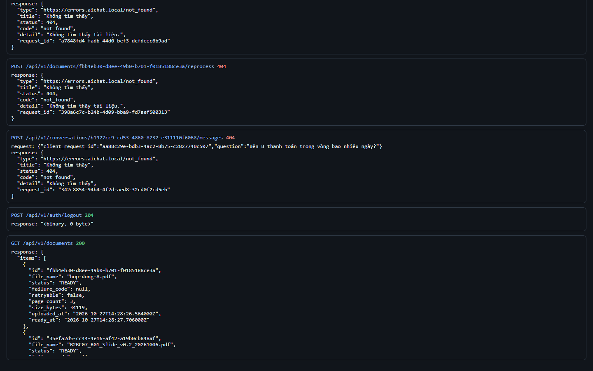

# Test report – SEC-005: Cách ly tài liệu giữa người dùng (IDOR)

| Trường | Giá trị |
|---|---|
| Test case | [SEC-005](../../doc/07-verification/test_cases/SEC-005_cach-ly-tai-lieu-giua-nguoi-dung-idor.md) |
| Kết luận | **ĐẠT** |
| Bắt đầu | 2026-10-27T15:46:20.004Z |
| Kết thúc | 2026-10-27T15:46:37.846Z (17.8 s) |
| Cách thực hiện | Tự động – Playwright (app/frontend/evidence/fixture.ts) |
| URL ứng dụng | http://localhost:8080/ |
| Bản build | 166929f + thay đổi chưa commit trong app/ |
| Trình duyệt | Microsoft Edge (Playwright, channel msedge) |
| Hệ điều hành | win32 x64 |
| Spec | app/frontend/testcases/SEC-005_cach-ly-tai-lieu-giua-nguoi-dung-idor.spec.ts |

## Kết quả từng bước

| # | Bước | Kết quả mong đợi | Kết quả thực tế | Trạng thái | Bằng chứng |
|---|---|---|---|---|---|
| 1 | Đăng nhập P1, đảm bảo có tài liệu Sẵn sàng, ghi id tài liệu và id hội thoại | Có id | Như mong đợi | Đạt | [ảnh](screenshots/01-dang-nhap-p1-dam-bao-co-tai-lieu-san-sang-ghi-id-t.png) |
| 2 | Đăng xuất; đăng nhập P2 (chỉ có bảng giá) | Màn hình P2 | Như mong đợi | Đạt | [ảnh](screenshots/02-dang-xuat-dang-nhap-p2-chi-co-bang-gia.png) |
| 3 | GET /documents của P2 | Không có tài liệu của P1 | Như mong đợi | Đạt | [ảnh](screenshots/03-get-documents-cua-p2.png) |
| 4 | GET file, DELETE, POST reprocess trên id tài liệu P1 | Mỗi request 404 not_found | Như mong đợi | Đạt | [ảnh](screenshots/04-get-file-delete-post-reprocess-tren-id-tai-lieu-p1.png) |
| 5 | POST /messages vào hội thoại của P1 | 404 hoặc 409 – không trả nội dung của P1 | HTTP 404 | Đạt | [ảnh](screenshots/05-post-messages-vao-hoi-thoai-cua-p1.png) |
| 6 | P2 hỏi câu chỉ có trong tài liệu của P1 | Không trích dẫn và không nêu nội dung tài liệu P1 | Như mong đợi | Đạt | [ảnh](screenshots/06-p2-hoi-cau-chi-co-trong-tai-lieu-cua-p1.png) |
| 7 | Đăng nhập lại P1 | Tài liệu của P1 còn nguyên | Như mong đợi | Đạt | [ảnh](screenshots/07-dang-nhap-lai-p1.png) |

## Video

- [SEC-005-app.webm](video/SEC-005-app.webm)
- [SEC-005-page2.webm](video/SEC-005-page2.webm)

## Ảnh chụp màn hình

## Log

- [api.log](logs/api.log)

## Ghi chú / lỗi phát hiện

- (không có)
