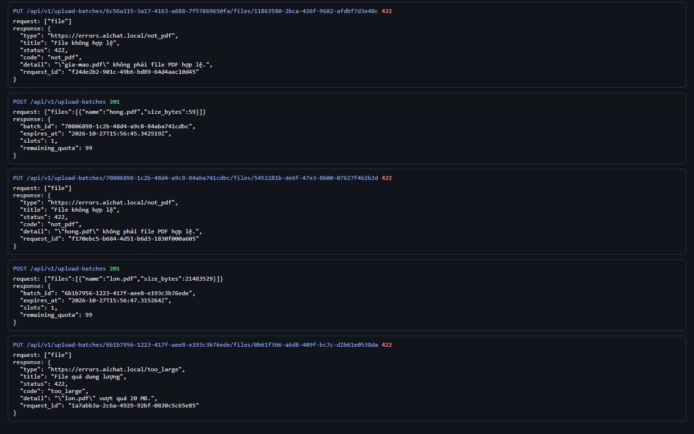
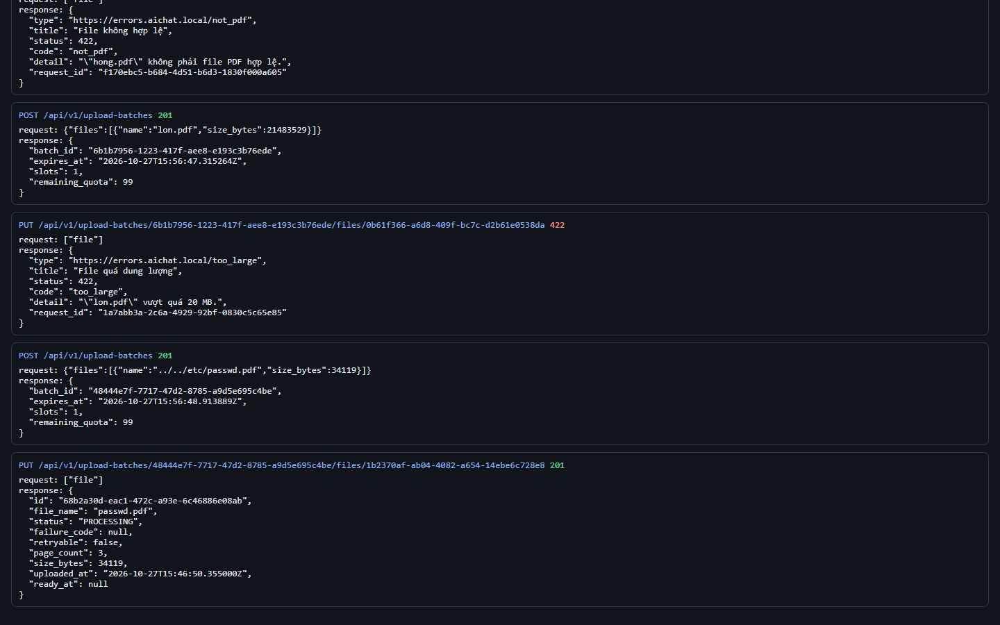
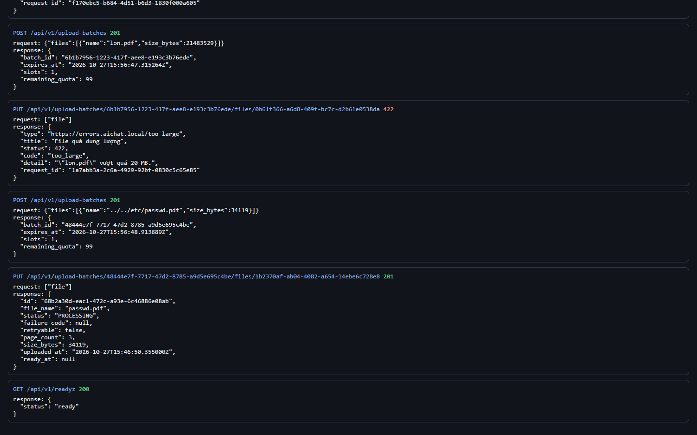

# Test report – SEC-009: Kiểm tra file tải lên an toàn

| Trường | Giá trị |
|---|---|
| Test case | [SEC-009](../../doc/07-verification/test_cases/SEC-009_kiem-tra-file-tai-len-an-toan.md) |
| Kết luận | **ĐẠT** |
| Bắt đầu | 2026-10-27T15:46:39.653Z |
| Kết thúc | 2026-10-27T15:46:56.916Z (17.3 s) |
| Cách thực hiện | Tự động – Playwright (app/frontend/evidence/fixture.ts) |
| URL ứng dụng | http://localhost:8080/ |
| Bản build | 166929f + thay đổi chưa commit trong app/ |
| Trình duyệt | Microsoft Edge (Playwright, channel msedge) |
| Hệ điều hành | win32 x64 |
| Spec | app/frontend/testcases/SEC-009_kiem-tra-file-tai-len-an-toan.spec.ts |

## Kết quả từng bước

| # | Bước | Kết quả mong đợi | Kết quả thực tế | Trạng thái | Bằng chứng |
|---|---|---|---|---|---|
| 1 | Đăng nhập P2, xóa tài liệu cũ | Danh sách rỗng | Như mong đợi | Đạt | [ảnh](screenshots/01-dang-nhap-p2-xoa-tai-lieu-cu.png) |
| 2 | PUT gia-mao.pdf, hong.pdf và file ~20,5 MB | 422 cho từng file | Như mong đợi | Đạt | [ảnh](screenshots/02-put-gia-mao-pdf-hong-pdf-va-file-20-5-mb.png) |
| 3 | PUT PDF hợp lệ với tên ../../etc/passwd.pdf | 201; file_name = passwd.pdf (đã bỏ đường dẫn) | Như mong đợi | Đạt | [ảnh](screenshots/03-put-pdf-hop-le-voi-ten-etc-passwd-pdf.png) |
| 4 | Gọi GET /api/v1/readyz sau các bước trên | 200 ready – API vẫn hoạt động | Như mong đợi | Đạt | [ảnh](screenshots/04-goi-get-api-v1-readyz-sau-cac-buoc-tren.png) |

## Video

- [SEC-009-app.webm](video/SEC-009-app.webm)
- [SEC-009-page2.webm](video/SEC-009-page2.webm)

## Ảnh chụp màn hình

## Log

- [api.log](logs/api.log)

## Ghi chú / lỗi phát hiện

- (không có)
