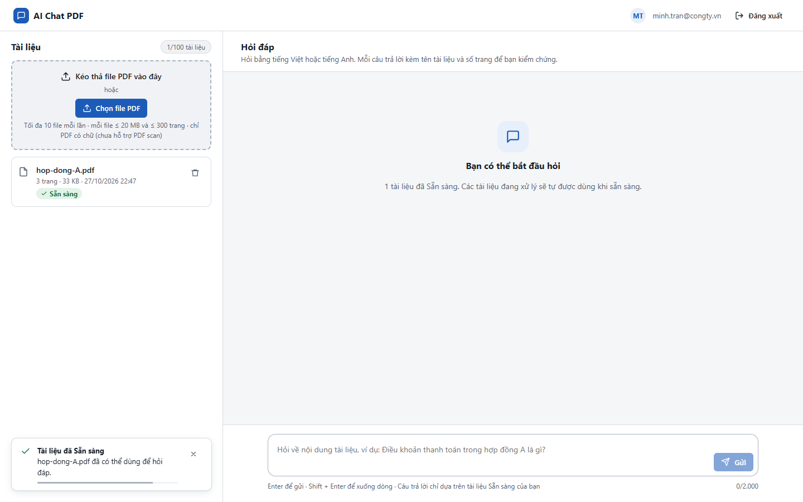
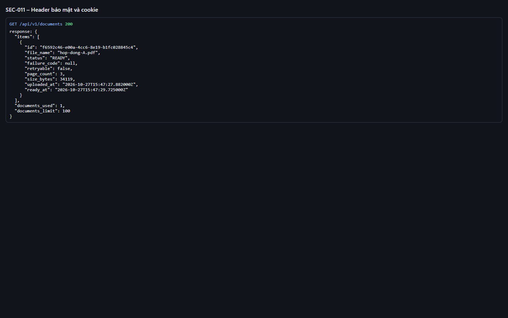
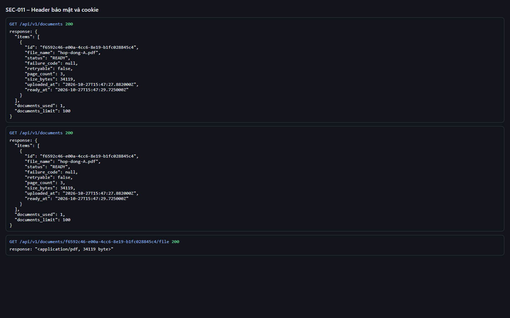
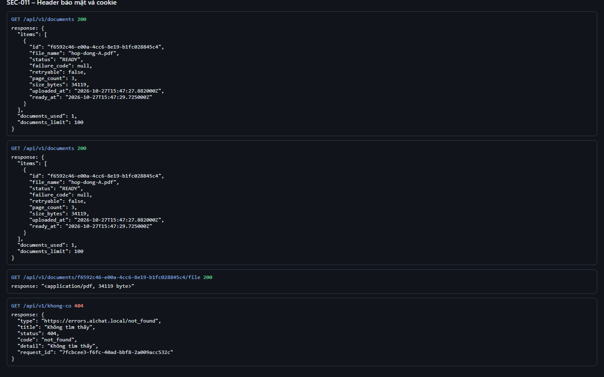

# Test report – SEC-011: Header bảo mật và cookie

| Trường | Giá trị |
|---|---|
| Test case | [SEC-011](../../doc/07-verification/test_cases/SEC-011_header-bao-mat-va-cookie.md) |
| Kết luận | **ĐẠT** |
| Bắt đầu | 2026-10-27T15:47:21.870Z |
| Kết thúc | 2026-10-27T15:47:34.748Z (12.9 s) |
| Cách thực hiện | Tự động – Playwright (app/frontend/evidence/fixture.ts) |
| URL ứng dụng | http://localhost:8080/ |
| Bản build | 166929f + thay đổi chưa commit trong app/ |
| Trình duyệt | Microsoft Edge (Playwright, channel msedge) |
| Hệ điều hành | win32 x64 |
| Spec | app/frontend/testcases/SEC-011_header-bao-mat-va-cookie.spec.ts |

## Kết quả từng bước

| # | Bước | Kết quả mong đợi | Kết quả thực tế | Trạng thái | Bằng chứng |
|---|---|---|---|---|---|
| 1 | Đăng nhập P2, tải hop-dong-A.pdf và chờ Sẵn sàng | Dòng Sẵn sàng | Như mong đợi | Đạt | [ảnh](screenshots/01-dang-nhap-p2-tai-hop-dong-a-pdf-va-cho-san-sang.png) |
| 2 | GET /api/v1/documents; đọc header | nosniff, no-referrer, X-Frame-Options DENY, CSP có frame-ancestors 'none', Cache-Control private no-store, có X-Request-ID | XCTO=nosniff; RP=no-referrer; XFO=DENY; CC=private, no-store | Đạt | [ảnh](screenshots/02-get-api-v1-documents-doc-header.png) |
| 3 | GET /documents/{id}/file | X-Frame-Options: SAMEORIGIN; CSP frame-ancestors 'self' | Như mong đợi | Đạt | [ảnh](screenshots/03-get-documents-id-file.png) |
| 4 | Đọc cookie | sid: HttpOnly, Lax; csrf_token: Strict; Secure=false trên localhost (staging phải true) | sid.secure=false, csrf_token.secure=false (localhost/HTTP) | Đạt | [ảnh](screenshots/04-doc-cookie.png) |
| 5 | GET /api/v1/khong-co | 404 problem+json, không lộ stack trace | Như mong đợi | Đạt | [ảnh](screenshots/05-get-api-v1-khong-co.png) |

## Video

- [SEC-011-app.webm](video/SEC-011-app.webm)
- [SEC-011-page2.webm](video/SEC-011-page2.webm)

## Ảnh chụp màn hình

## Log

- [api.log](logs/api.log)

## Ghi chú / lỗi phát hiện

- (không có)
