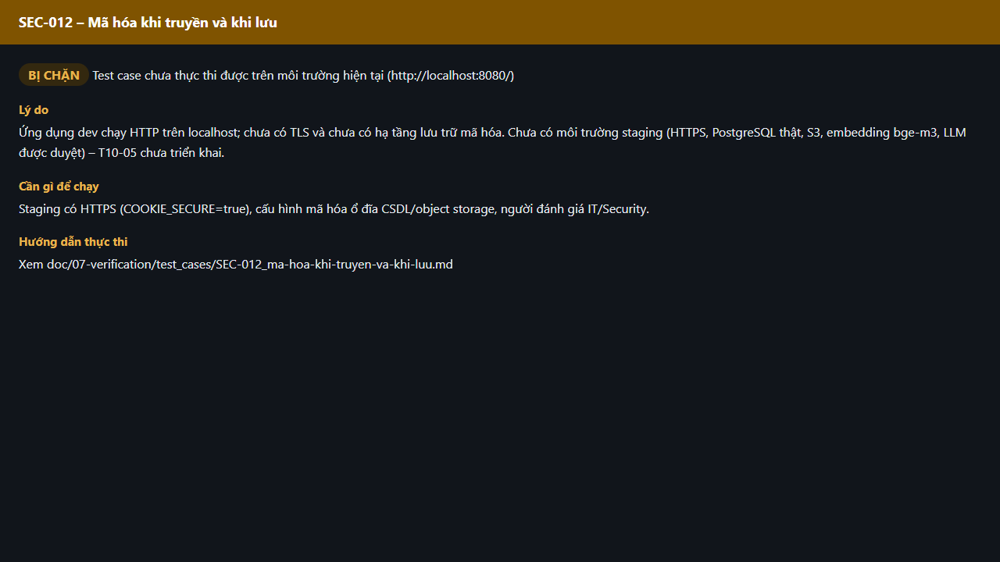

# Test report – SEC-012: Mã hóa khi truyền và khi lưu

| Trường | Giá trị |
|---|---|
| Test case | [SEC-012](../../doc/07-verification/test_cases/SEC-012_ma-hoa-khi-truyen-va-khi-luu.md) |
| Kết luận | **BỊ CHẶN** |
| Bắt đầu | 2026-10-27T15:13:41.127Z |
| Kết thúc | 2026-10-27T15:13:46.941Z (5.8 s) |
| Cách thực hiện | Không thực thi – bị chặn (evidence/blocked.ts) |
| URL ứng dụng | http://localhost:8080/ |
| Bản build | 166929f + thay đổi chưa commit trong app/ |
| Trình duyệt | Microsoft Edge (Playwright, channel msedge) |
| Hệ điều hành | win32 x64 |

## Kết quả từng bước

| # | Bước | Kết quả mong đợi | Kết quả thực tế | Trạng thái | Bằng chứng |
|---|---|---|---|---|---|
| 1 | Kiểm tra điều kiện thực thi | Staging có HTTPS (COOKIE_SECURE=true), cấu hình mã hóa ổ đĩa CSDL/object storage, người đánh giá IT/Security. | Ứng dụng dev chạy HTTP trên localhost; chưa có TLS và chưa có hạ tầng lưu trữ mã hóa. Chưa có môi trường staging (HTTPS, PostgreSQL thật, S3, embedding bge-m3, LLM được duyệt) – T10-05 chưa triển khai. | Bị chặn | [ảnh](screenshots/01-ly-do-bi-chan.png) |

## Video

- [SEC-012-blocked.webm](video/SEC-012-blocked.webm)

## Ảnh chụp màn hình

## Log

- (không có)

## Ghi chú / lỗi phát hiện

- Bị chặn: Ứng dụng dev chạy HTTP trên localhost; chưa có TLS và chưa có hạ tầng lưu trữ mã hóa. Chưa có môi trường staging (HTTPS, PostgreSQL thật, S3, embedding bge-m3, LLM được duyệt) – T10-05 chưa triển khai.
- Cần: Staging có HTTPS (COOKIE_SECURE=true), cấu hình mã hóa ổ đĩa CSDL/object storage, người đánh giá IT/Security.
