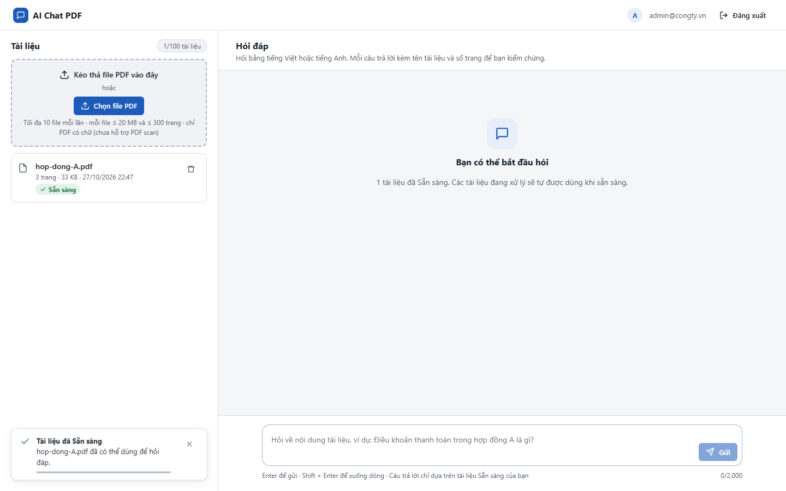
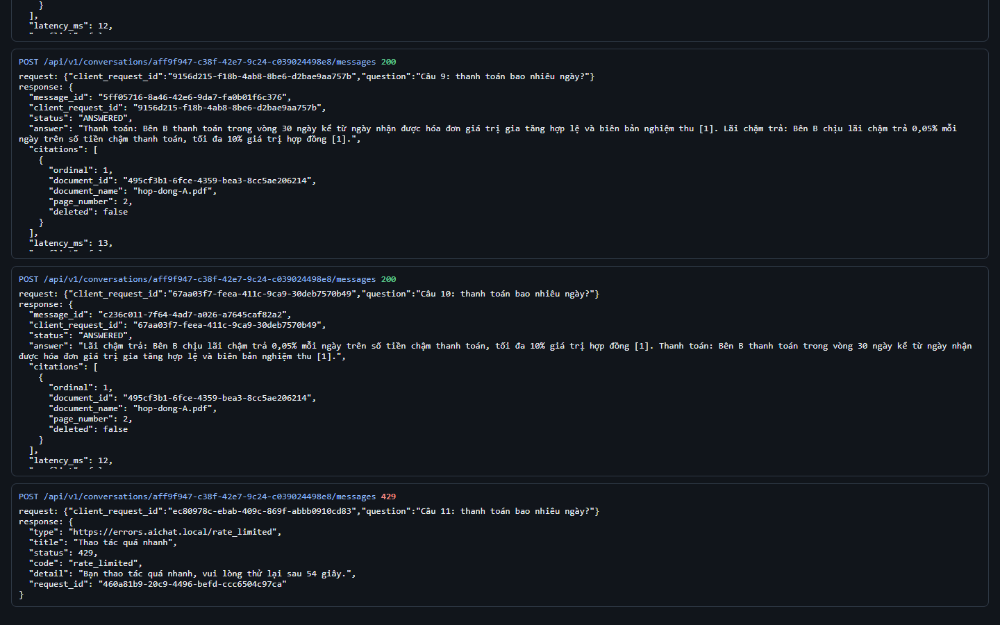
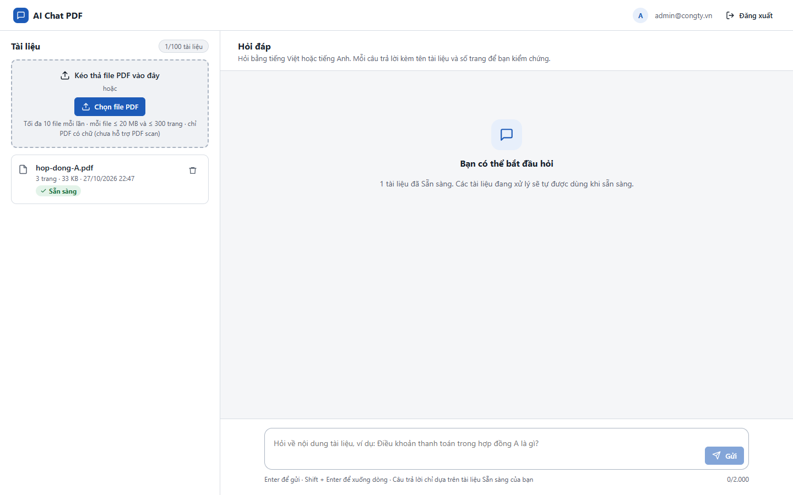

# Test report – SEC-013: Rate limit chống lạm dụng

| Trường | Giá trị |
|---|---|
| Test case | [SEC-013](../../doc/07-verification/test_cases/SEC-013_rate-limit-chong-lam-dung.md) |
| Kết luận | **ĐẠT** |
| Bắt đầu | 2026-10-27T15:47:36.440Z |
| Kết thúc | 2026-10-27T15:48:24.611Z (48.2 s) |
| Cách thực hiện | Tự động – Playwright (app/frontend/evidence/fixture.ts) |
| URL ứng dụng | http://localhost:8080/ |
| Bản build | 166929f + thay đổi chưa commit trong app/ |
| Trình duyệt | Microsoft Edge (Playwright, channel msedge) |
| Hệ điều hành | win32 x64 |
| Spec | app/frontend/testcases/SEC-013_rate-limit-chong-lam-dung.spec.ts |

## Kết quả từng bước

| # | Bước | Kết quả mong đợi | Kết quả thực tế | Trạng thái | Bằng chứng |
|---|---|---|---|---|---|
| 1 | Đăng nhập Quản trị viên, tải hop-dong-A.pdf và chờ Sẵn sàng | Dòng Sẵn sàng | Như mong đợi | Đạt | [ảnh](screenshots/01-dang-nhap-quan-tri-vien-tai-hop-dong-a-pdf-va-cho-.png) |
| 2 | Chờ đầu phút rồi gửi 11 câu hỏi | Câu 11 → 429 kèm Retry-After | Mã trả về: 200, 200, 200, 200, 200, 200, 200, 200, 200, 200, 429 | Đạt | [ảnh](screenshots/02-cho-dau-phut-roi-gui-11-cau-hoi.png) |
| 3 | Quản trị viên vẫn bị giới hạn, còn P1 ở phiên khác thì không (giới hạn theo người dùng) | P1: 200 | Như mong đợi | Đạt | [ảnh](screenshots/03-quan-tri-vien-van-bi-gioi-han-con-p1-o-phien-khac-.png) |
| 4 | Đối chiếu API-013 (giới hạn tải file theo giờ) | Báo cáo API-013 có kết luận ĐẠT | Như mong đợi | Đạt | [ảnh](screenshots/04-doi-chieu-api-013-gioi-han-tai-file-theo-gio.png) |

## Video

- [SEC-013-app.webm](video/SEC-013-app.webm)
- [SEC-013-page2.webm](video/SEC-013-page2.webm)

## Ảnh chụp màn hình

## Log

- [api.log](logs/api.log)

## Ghi chú / lỗi phát hiện

- API-013 (rate limit tải file): ĐẠT
