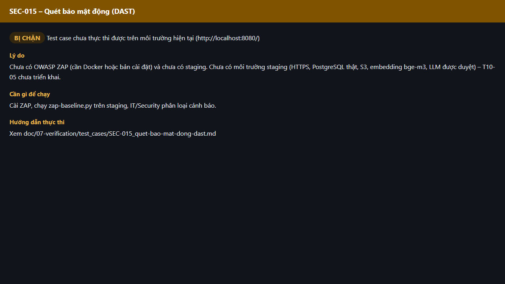

# Test report – SEC-015: Quét bảo mật động (DAST)

| Trường | Giá trị |
|---|---|
| Test case | [SEC-015](../../doc/07-verification/test_cases/SEC-015_quet-bao-mat-dong-dast.md) |
| Kết luận | **BỊ CHẶN** |
| Bắt đầu | 2026-10-27T15:13:48.598Z |
| Kết thúc | 2026-10-27T15:13:55.584Z (7.0 s) |
| Cách thực hiện | Không thực thi – bị chặn (evidence/blocked.ts) |
| URL ứng dụng | http://localhost:8080/ |
| Bản build | 166929f + thay đổi chưa commit trong app/ |
| Trình duyệt | Microsoft Edge (Playwright, channel msedge) |
| Hệ điều hành | win32 x64 |

## Kết quả từng bước

| # | Bước | Kết quả mong đợi | Kết quả thực tế | Trạng thái | Bằng chứng |
|---|---|---|---|---|---|
| 1 | Kiểm tra điều kiện thực thi | Cài ZAP, chạy zap-baseline.py trên staging, IT/Security phân loại cảnh báo. | Chưa có OWASP ZAP (cần Docker hoặc bản cài đặt) và chưa có staging. Chưa có môi trường staging (HTTPS, PostgreSQL thật, S3, embedding bge-m3, LLM được duyệt) – T10-05 chưa triển khai. | Bị chặn | [ảnh](screenshots/01-ly-do-bi-chan.png) |

## Video

- [SEC-015-blocked.webm](video/SEC-015-blocked.webm)

## Ảnh chụp màn hình

## Log

- (không có)

## Ghi chú / lỗi phát hiện

- Bị chặn: Chưa có OWASP ZAP (cần Docker hoặc bản cài đặt) và chưa có staging. Chưa có môi trường staging (HTTPS, PostgreSQL thật, S3, embedding bge-m3, LLM được duyệt) – T10-05 chưa triển khai.
- Cần: Cài ZAP, chạy zap-baseline.py trên staging, IT/Security phân loại cảnh báo.
