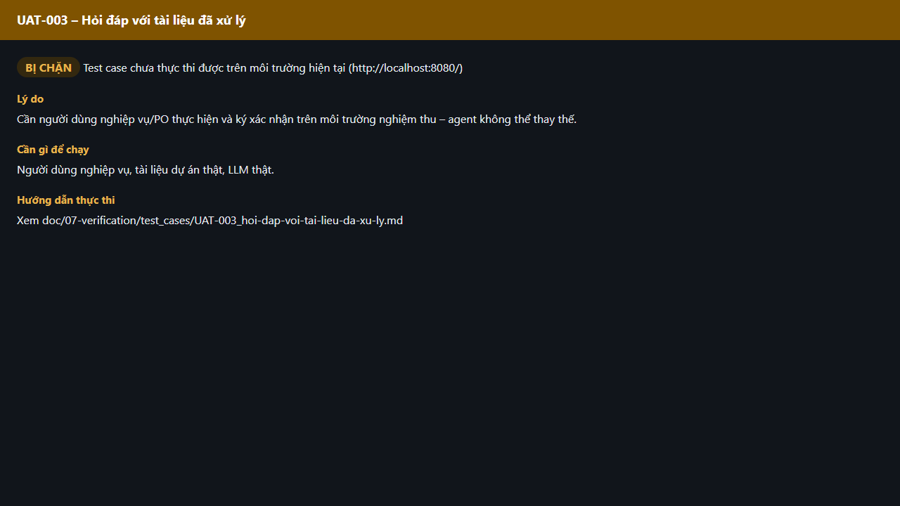

# Test report – UAT-003: Hỏi đáp với tài liệu đã xử lý

| Trường | Giá trị |
|---|---|
| Test case | [UAT-003](../../doc/07-verification/test_cases/UAT-003_hoi-dap-voi-tai-lieu-da-xu-ly.md) |
| Kết luận | **BỊ CHẶN** |
| Bắt đầu | 2026-10-27T15:15:52.186Z |
| Kết thúc | 2026-10-27T15:15:58.324Z (6.1 s) |
| Cách thực hiện | Không thực thi – bị chặn (evidence/blocked.ts) |
| URL ứng dụng | http://localhost:8080/ |
| Bản build | 166929f + thay đổi chưa commit trong app/ |
| Trình duyệt | Microsoft Edge (Playwright, channel msedge) |
| Hệ điều hành | win32 x64 |

## Kết quả từng bước

| # | Bước | Kết quả mong đợi | Kết quả thực tế | Trạng thái | Bằng chứng |
|---|---|---|---|---|---|
| 1 | Kiểm tra điều kiện thực thi | Người dùng nghiệp vụ, tài liệu dự án thật, LLM thật. | Cần người dùng nghiệp vụ/PO thực hiện và ký xác nhận trên môi trường nghiệm thu – agent không thể thay thế. | Bị chặn | [ảnh](screenshots/01-ly-do-bi-chan.png) |

## Video

- [UAT-003-blocked.webm](video/UAT-003-blocked.webm)

## Ảnh chụp màn hình

## Log

- (không có)

## Ghi chú / lỗi phát hiện

- Bị chặn: Cần người dùng nghiệp vụ/PO thực hiện và ký xác nhận trên môi trường nghiệm thu – agent không thể thay thế.
- Cần: Người dùng nghiệp vụ, tài liệu dự án thật, LLM thật.
