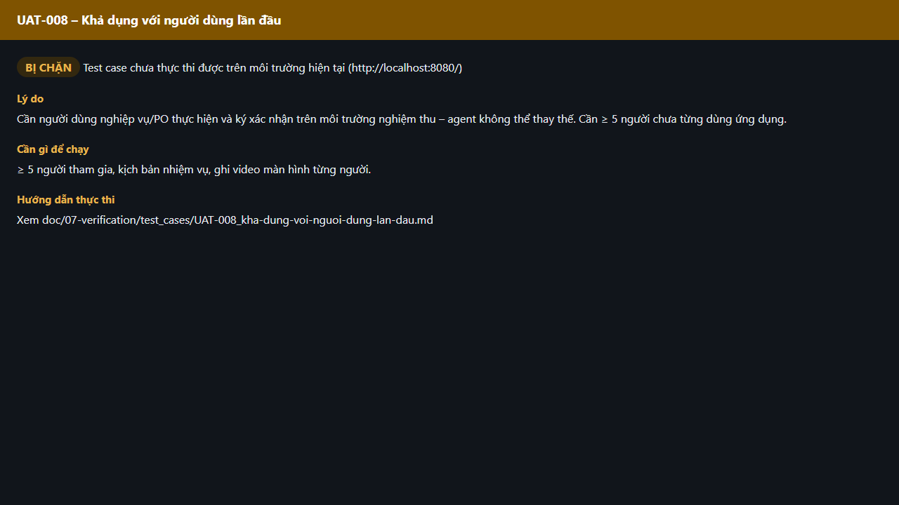

# Test report – UAT-008: Khả dụng với người dùng lần đầu

| Trường | Giá trị |
|---|---|
| Test case | [UAT-008](../../doc/07-verification/test_cases/UAT-008_kha-dung-voi-nguoi-dung-lan-dau.md) |
| Kết luận | **BỊ CHẶN** |
| Bắt đầu | 2026-10-27T15:16:41.682Z |
| Kết thúc | 2026-10-27T15:16:48.742Z (7.1 s) |
| Cách thực hiện | Không thực thi – bị chặn (evidence/blocked.ts) |
| URL ứng dụng | http://localhost:8080/ |
| Bản build | 166929f + thay đổi chưa commit trong app/ |
| Trình duyệt | Microsoft Edge (Playwright, channel msedge) |
| Hệ điều hành | win32 x64 |

## Kết quả từng bước

| # | Bước | Kết quả mong đợi | Kết quả thực tế | Trạng thái | Bằng chứng |
|---|---|---|---|---|---|
| 1 | Kiểm tra điều kiện thực thi | ≥ 5 người tham gia, kịch bản nhiệm vụ, ghi video màn hình từng người. | Cần người dùng nghiệp vụ/PO thực hiện và ký xác nhận trên môi trường nghiệm thu – agent không thể thay thế. Cần ≥ 5 người chưa từng dùng ứng dụng. | Bị chặn | [ảnh](screenshots/01-ly-do-bi-chan.png) |

## Video

- [UAT-008-blocked.webm](video/UAT-008-blocked.webm)

## Ảnh chụp màn hình

## Log

- (không có)

## Ghi chú / lỗi phát hiện

- Bị chặn: Cần người dùng nghiệp vụ/PO thực hiện và ký xác nhận trên môi trường nghiệm thu – agent không thể thay thế. Cần ≥ 5 người chưa từng dùng ứng dụng.
- Cần: ≥ 5 người tham gia, kịch bản nhiệm vụ, ghi video màn hình từng người.
