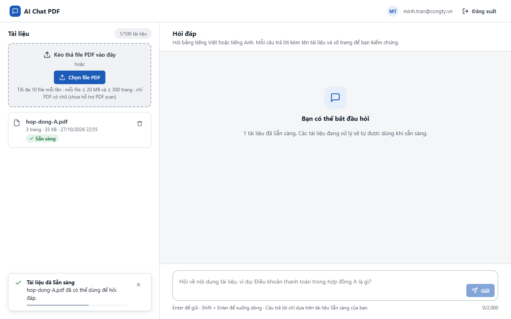
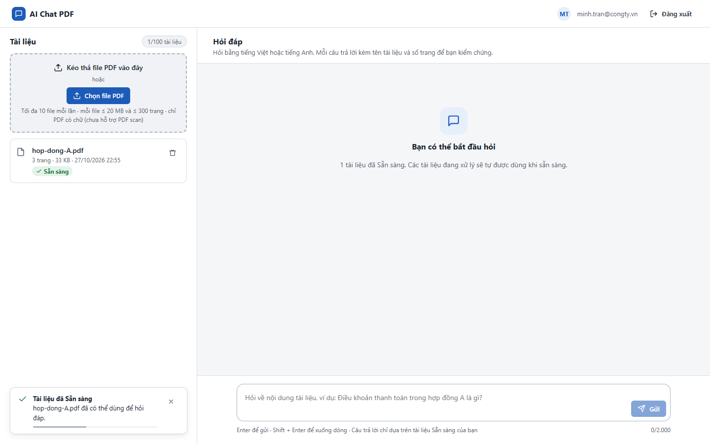
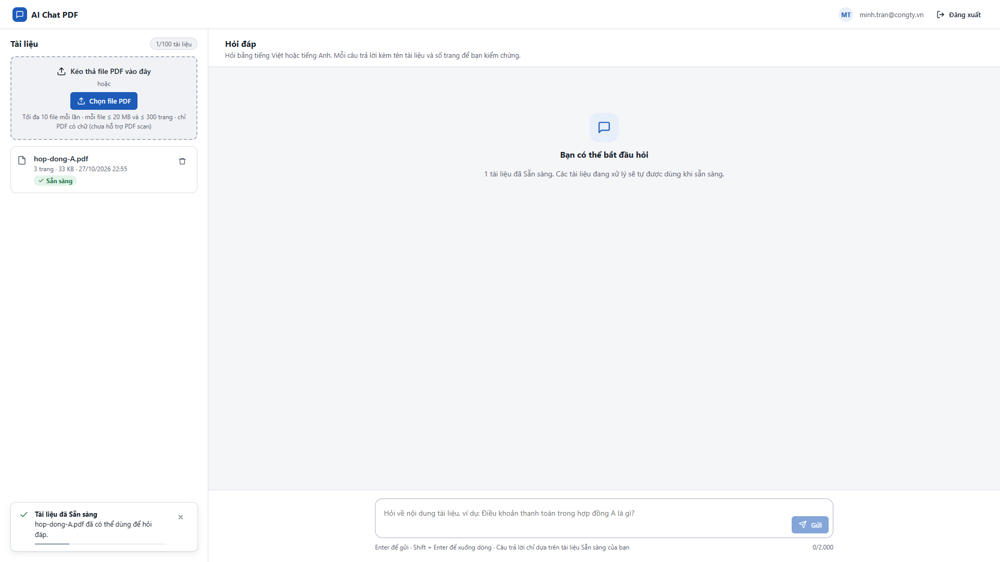

# Test report – UI-002: Độ rộng màn hình

| Trường | Giá trị |
|---|---|
| Test case | [UI-002](../../doc/07-verification/test_cases/UI-002_do-rong-man-hinh.md) |
| Kết luận | **ĐẠT** |
| Bắt đầu | 2026-10-27T15:55:32.704Z |
| Kết thúc | 2026-10-27T15:55:45.522Z (12.8 s) |
| Cách thực hiện | Tự động – Playwright (app/frontend/evidence/fixture.ts) |
| URL ứng dụng | http://localhost:8080/ |
| Bản build | 166929f + thay đổi chưa commit trong app/ |
| Trình duyệt | Microsoft Edge (Playwright, channel msedge) |
| Hệ điều hành | win32 x64 |
| Spec | app/frontend/testcases/UI-002_do-rong-man-hinh.spec.ts |

## Kết quả từng bước

| # | Bước | Kết quả mong đợi | Kết quả thực tế | Trạng thái | Bằng chứng |
|---|---|---|---|---|---|
| 1 | Đăng nhập P2, tải hop-dong-A.pdf và chờ Sẵn sàng | Dòng Sẵn sàng | Như mong đợi | Đạt | [ảnh](screenshots/01-dang-nhap-p2-tai-hop-dong-a-pdf-va-cho-san-sang.png) |
| 2 | Viewport 1280×800 | Không cuộn ngang; thấy cả khu Tài liệu và Hỏi đáp | scrollWidth=1280 ≤ clientWidth=1280; chiều rộng khung hội thoại=816 px | Đạt | [ảnh](screenshots/02-viewport-1280-800.png) |
| 3 | Viewport 1440×900 | Không cuộn ngang; thấy cả khu Tài liệu và Hỏi đáp | scrollWidth=1440 ≤ clientWidth=1440; chiều rộng khung hội thoại=880 px | Đạt | [ảnh](screenshots/03-viewport-1440-900.png) |
| 4 | Viewport 1920×1080 | Không cuộn ngang; thấy cả khu Tài liệu và Hỏi đáp | scrollWidth=1920 ≤ clientWidth=1920; chiều rộng khung hội thoại=880 px | Đạt | [ảnh](screenshots/04-viewport-1920-1080.png) |

## Video

- [UI-002-app.webm](video/UI-002-app.webm)

## Ảnh chụp màn hình

## Log

- (không có)

## Ghi chú / lỗi phát hiện

- (không có)
