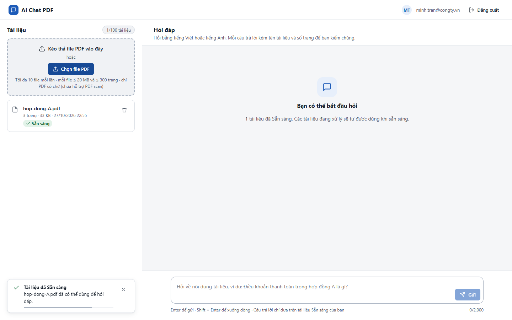
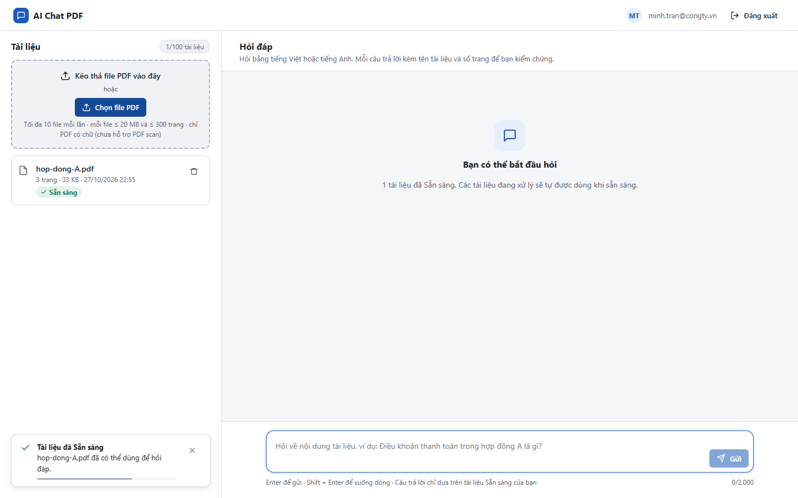
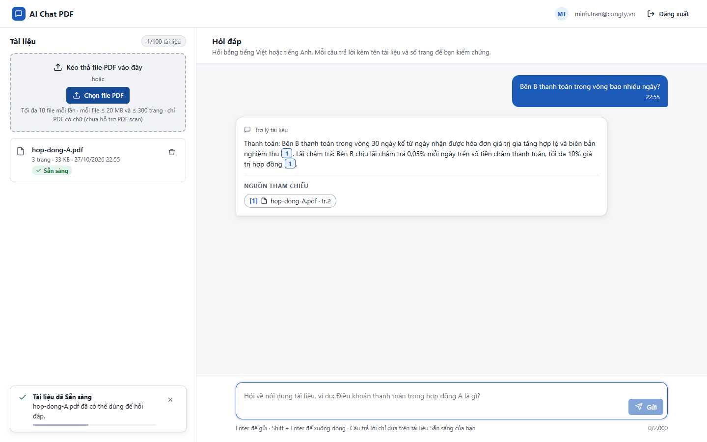

# Test report – UI-003: Trạng thái thành phần

| Trường | Giá trị |
|---|---|
| Test case | [UI-003](../../doc/07-verification/test_cases/UI-003_trang-thai-thanh-phan.md) |
| Kết luận | **ĐẠT** |
| Bắt đầu | 2026-10-27T15:55:47.209Z |
| Kết thúc | 2026-10-27T15:55:58.354Z (11.1 s) |
| Cách thực hiện | Tự động – Playwright (app/frontend/evidence/fixture.ts) |
| URL ứng dụng | http://localhost:8080/ |
| Bản build | 166929f + thay đổi chưa commit trong app/ |
| Trình duyệt | Microsoft Edge (Playwright, channel msedge) |
| Hệ điều hành | win32 x64 |
| Spec | app/frontend/testcases/UI-003_trang-thai-thanh-phan.spec.ts |

## Kết quả từng bước

| # | Bước | Kết quả mong đợi | Kết quả thực tế | Trạng thái | Bằng chứng |
|---|---|---|---|---|---|
| 1 | Đăng nhập P2 (chưa có tài liệu): ô hỏi | Khóa, nền xám, dòng lý do có biểu tượng ổ khóa | Như mong đợi | Đạt | [ảnh](screenshots/01-dang-nhap-p2-chua-co-tai-lieu-o-hoi.png) |
| 2 | Tải file, Sẵn sàng; hover nút Chọn file PDF | Màu hover khác màu thường | Nền thường rgb(29, 91, 184) → hover rgb(23, 74, 150) | Đạt | [ảnh](screenshots/02-tai-file-san-sang-hover-nut-chon-file-pdf.png) |
| 3 | Ô hỏi trống | Nút Gửi vô hiệu | Như mong đợi | Đạt | [ảnh](screenshots/03-o-hoi-trong.png) |
| 4 | Focus vào ô hỏi | Có viền/đổ bóng focus | rgb(29, 91, 184) \| rgb(231, 239, 251) 0px 0px 0px 3px | Đạt | [ảnh](screenshots/04-focus-vao-o-hoi.png) |
| 5 | Gửi câu hỏi (làm chậm 2,5 s) | Nút đổi thành "Đang gửi…", ô hỏi khóa tới khi có kết quả | Như mong đợi | Đạt | [ảnh](screenshots/05-gui-cau-hoi-lam-cham-2-5-s.png) |

## Video

- [UI-003-app.webm](video/UI-003-app.webm)

## Ảnh chụp màn hình

## Log

- (không có)

## Ghi chú / lỗi phát hiện

- (không có)
