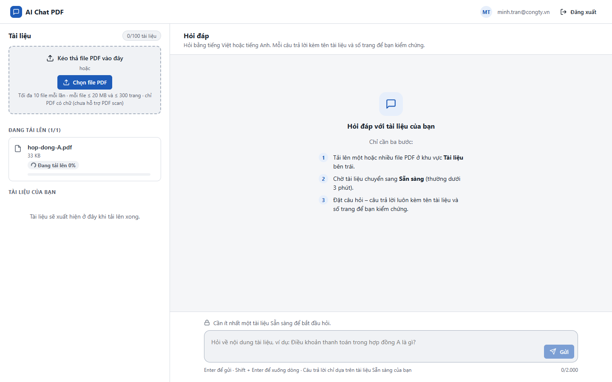
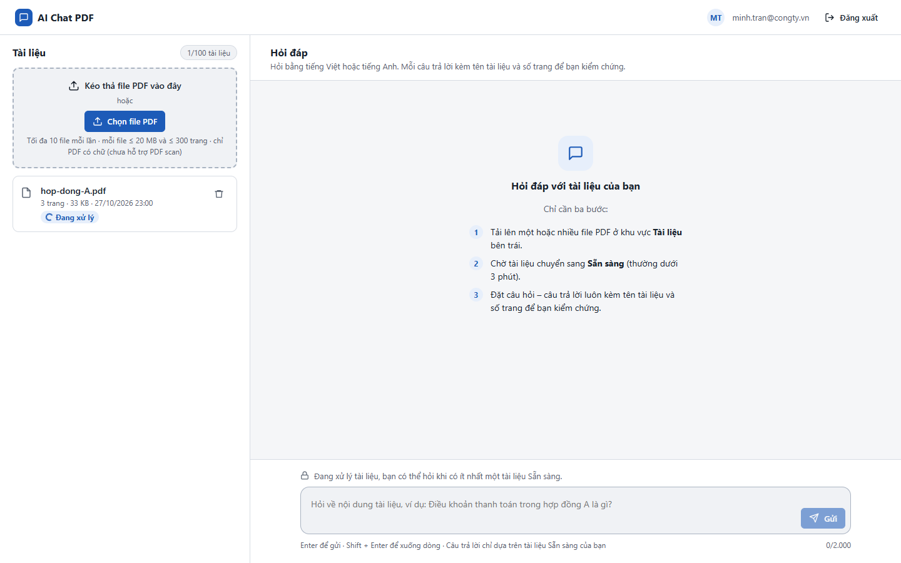
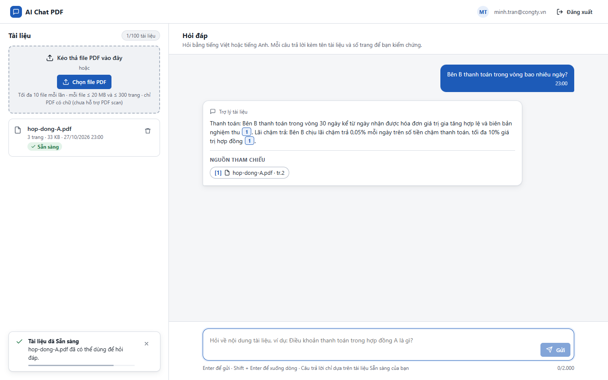

# Test report – UI-005: Trạng thái chờ

| Trường | Giá trị |
|---|---|
| Test case | [UI-005](../../doc/07-verification/test_cases/UI-005_trang-thai-cho.md) |
| Kết luận | **ĐẠT** |
| Bắt đầu | 2026-10-27T16:00:05.330Z |
| Kết thúc | 2026-10-27T16:00:15.651Z (10.3 s) |
| Cách thực hiện | Tự động – Playwright (app/frontend/evidence/fixture.ts) |
| URL ứng dụng | http://localhost:8080/ |
| Bản build | 166929f + thay đổi chưa commit trong app/ |
| Trình duyệt | Microsoft Edge (Playwright, channel msedge) |
| Hệ điều hành | win32 x64 |
| Spec | app/frontend/testcases/UI-005_trang-thai-cho.spec.ts |

## Kết quả từng bước

| # | Bước | Kết quả mong đợi | Kết quả thực tế | Trạng thái | Bằng chứng |
|---|---|---|---|---|---|
| 1 | Đăng nhập P2; tải file (làm chậm request 3 s) | Đang tải lên x% + thanh tiến độ | Như mong đợi | Đạt | [ảnh](screenshots/01-dang-nhap-p2-tai-file-lam-cham-request-3-s.png) |
| 2 | Chụp khi đang xử lý | Đang xử lý có biểu tượng xoay | Như mong đợi | Đạt | [ảnh](screenshots/02-chup-khi-dang-xu-ly.png) |
| 3 | Gửi câu hỏi, chụp ngay | Thẻ Trợ lý tài liệu có ba chấm và "Đang tìm trong tài liệu và soạn câu trả lời…" | Như mong đợi | Đạt | [ảnh](screenshots/03-gui-cau-hoi-chup-ngay.png) |

## Video

- [UI-005-app.webm](video/UI-005-app.webm)

## Ảnh chụp màn hình

## Log

- (không có)

## Ghi chú / lỗi phát hiện

- (không có)
