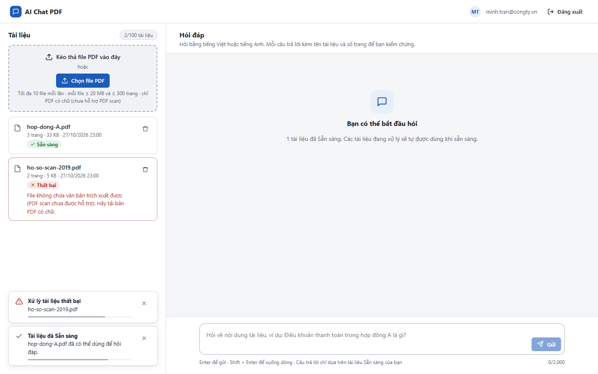
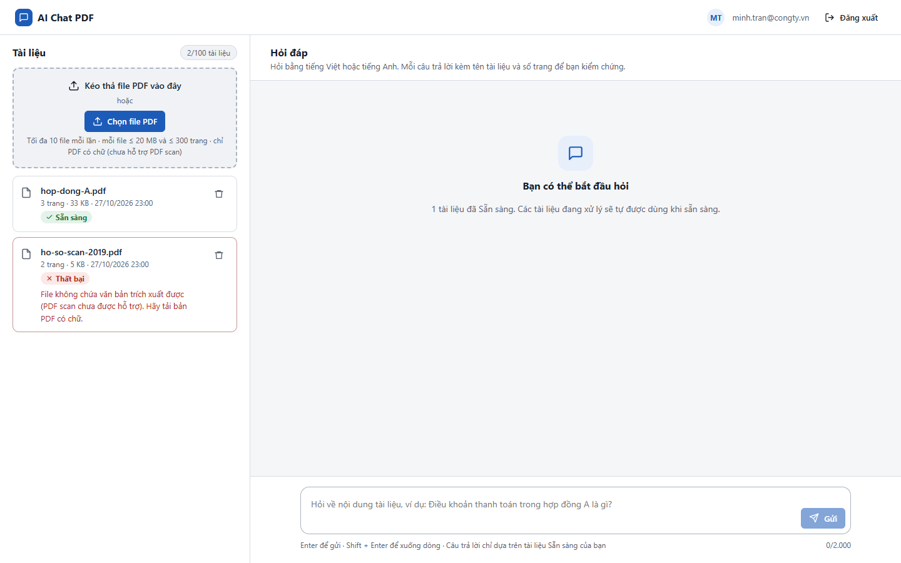

# Test report – UI-006: Thông báo tự ẩn

| Trường | Giá trị |
|---|---|
| Test case | [UI-006](../../doc/07-verification/test_cases/UI-006_thong-bao-tu-an.md) |
| Kết luận | **ĐẠT** |
| Bắt đầu | 2026-10-27T16:00:17.381Z |
| Kết thúc | 2026-10-27T16:00:34.701Z (17.3 s) |
| Cách thực hiện | Tự động – Playwright (app/frontend/evidence/fixture.ts) |
| URL ứng dụng | http://localhost:8080/ |
| Bản build | 166929f + thay đổi chưa commit trong app/ |
| Trình duyệt | Microsoft Edge (Playwright, channel msedge) |
| Hệ điều hành | win32 x64 |
| Spec | app/frontend/testcases/UI-006_thong-bao-tu-an.spec.ts |

## Kết quả từng bước

| # | Bước | Kết quả mong đợi | Kết quả thực tế | Trạng thái | Bằng chứng |
|---|---|---|---|---|---|
| 1 | Đăng nhập P2; tải 1 PDF có chữ và 1 PDF scan | Lần lượt xuất hiện "Tài liệu đã Sẵn sàng" và "Xử lý tài liệu thất bại" | Như mong đợi | Đạt | [ảnh](screenshots/01-dang-nhap-p2-tai-1-pdf-co-chu-va-1-pdf-scan.png) |
| 2 | Kiểm tra vị trí | Thông báo nằm góc dưới trái, không che ô hỏi | Toast: x=20..380; vùng ô hỏi bắt đầu x=400 | Đạt | [ảnh](screenshots/02-kiem-tra-vi-tri.png) |
| 3 | Chờ 6 s (tự ẩn ≤ 5 s) | Thông báo không còn | Như mong đợi | Đạt | [ảnh](screenshots/03-cho-6-s-tu-an-5-s.png) |

## Video

- [UI-006-app.webm](video/UI-006-app.webm)

## Ảnh chụp màn hình

## Log

- (không có)

## Ghi chú / lỗi phát hiện

- (không có)
