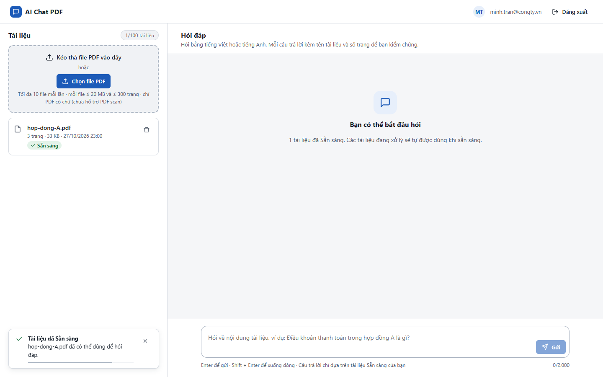
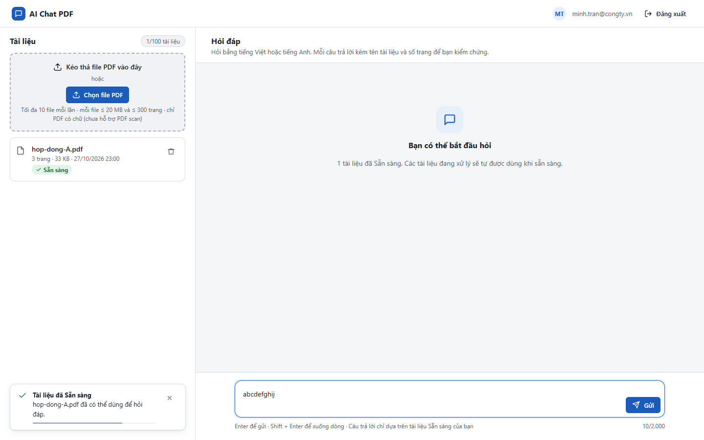
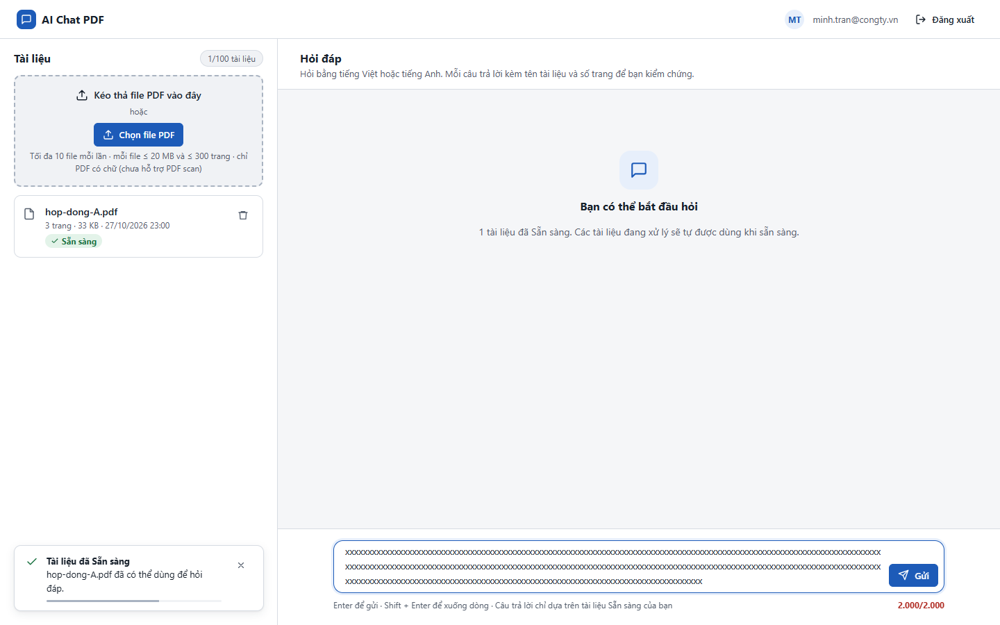

# Test report – UI-007: Bộ đếm và giới hạn ký tự

| Trường | Giá trị |
|---|---|
| Test case | [UI-007](../../doc/07-verification/test_cases/UI-007_bo-dem-va-gioi-han-ky-tu.md) |
| Kết luận | **ĐẠT** |
| Bắt đầu | 2026-10-27T16:00:36.544Z |
| Kết thúc | 2026-10-27T16:00:46.077Z (9.5 s) |
| Cách thực hiện | Tự động – Playwright (app/frontend/evidence/fixture.ts) |
| URL ứng dụng | http://localhost:8080/ |
| Bản build | 166929f + thay đổi chưa commit trong app/ |
| Trình duyệt | Microsoft Edge (Playwright, channel msedge) |
| Hệ điều hành | win32 x64 |
| Spec | app/frontend/testcases/UI-007_bo-dem-va-gioi-han-ky-tu.spec.ts |

## Kết quả từng bước

| # | Bước | Kết quả mong đợi | Kết quả thực tế | Trạng thái | Bằng chứng |
|---|---|---|---|---|---|
| 1 | Đăng nhập P2, tải hop-dong-A.pdf; xem bộ đếm khi ô trống | 0/2.000 | Như mong đợi | Đạt | [ảnh](screenshots/01-dang-nhap-p2-tai-hop-dong-a-pdf-xem-bo-dem-khi-o-t.png) |
| 2 | Gõ 10 ký tự | 10/2.000 | Như mong đợi | Đạt | [ảnh](screenshots/02-go-10-ky-tu.png) |
| 3 | Dán 2.100 ký tự | Ô chỉ nhận 2.000 ký tự; bộ đếm 2.000/2.000 màu cảnh báo | Như mong đợi | Đạt | [ảnh](screenshots/03-dan-2-100-ky-tu.png) |

## Video

- [UI-007-app.webm](video/UI-007-app.webm)

## Ảnh chụp màn hình

## Log

- (không có)

## Ghi chú / lỗi phát hiện

- (không có)
