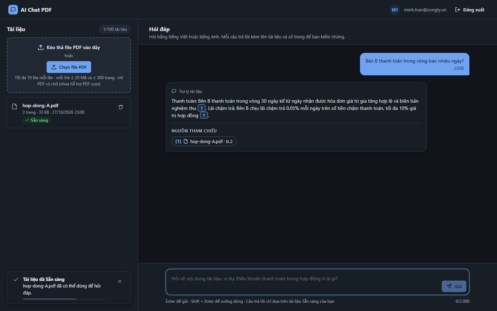
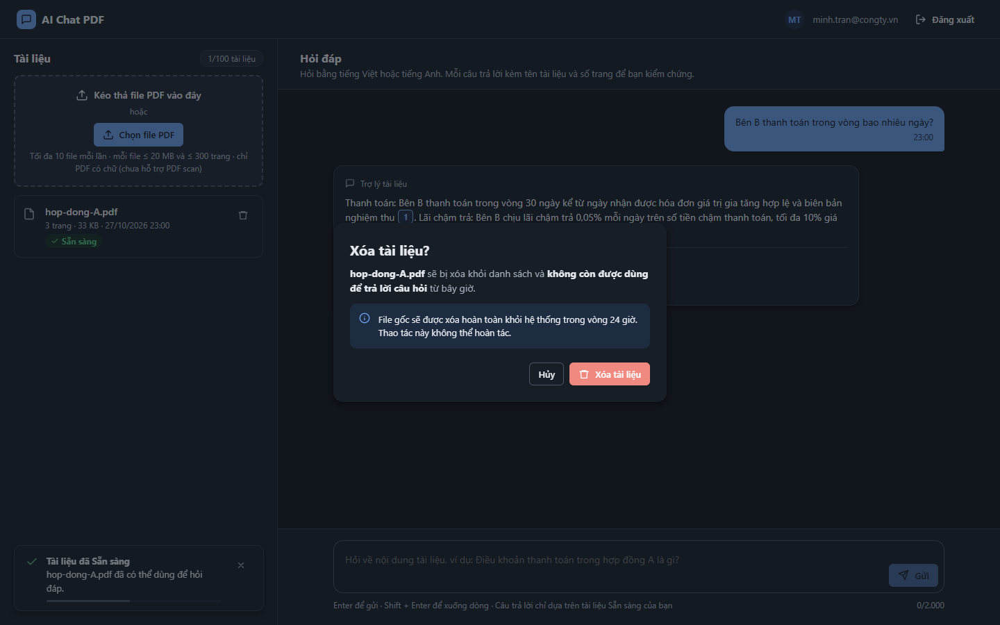
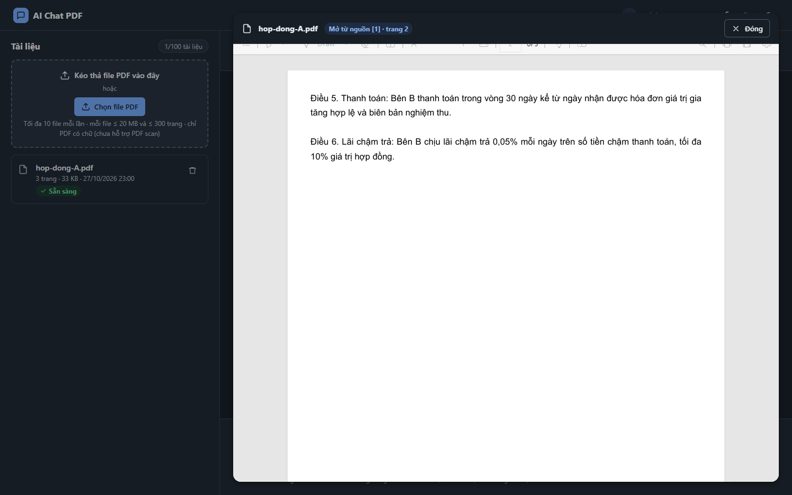
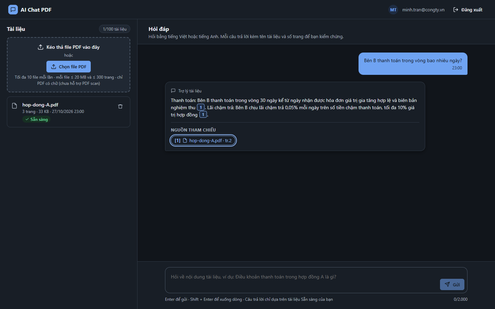
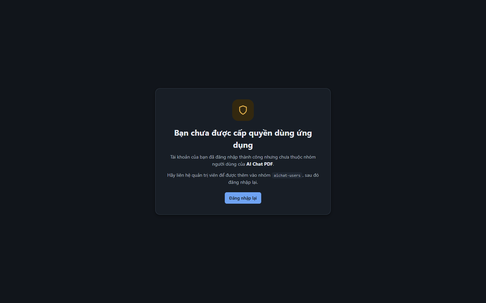
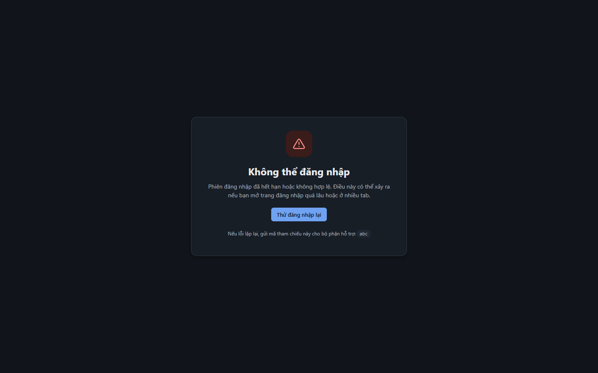
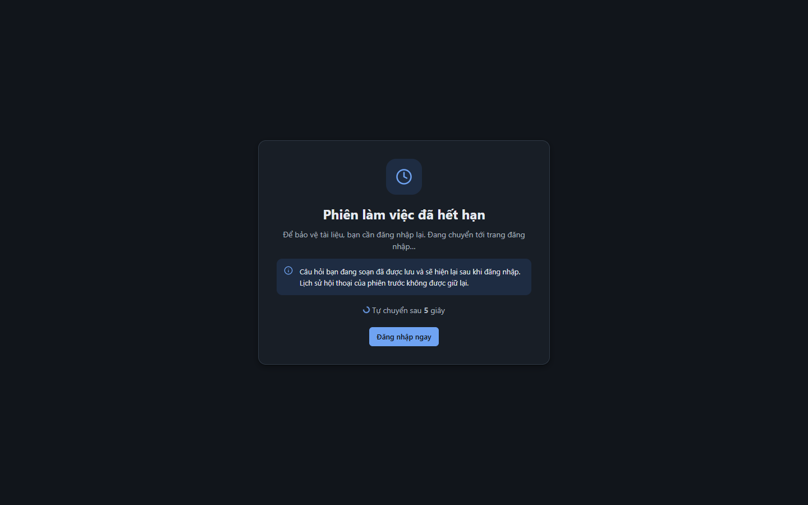

# Test report – UI-008: Giao diện tối

| Trường | Giá trị |
|---|---|
| Test case | [UI-008](../../doc/07-verification/test_cases/UI-008_giao-dien-toi.md) |
| Kết luận | **CẦN NGƯỜI XÁC NHẬN** |
| Bắt đầu | 2026-10-27T16:00:47.562Z |
| Kết thúc | 2026-10-27T16:01:04.731Z (17.2 s) |
| Cách thực hiện | Tự động – Playwright (app/frontend/evidence/fixture.ts) |
| URL ứng dụng | http://localhost:8080/ |
| Bản build | 166929f + thay đổi chưa commit trong app/ |
| Trình duyệt | Microsoft Edge (Playwright, channel msedge) |
| Hệ điều hành | win32 x64 |
| Spec | app/frontend/testcases/UI-008_giao-dien-toi.spec.ts |

## Kết quả từng bước

| # | Bước | Kết quả mong đợi | Kết quả thực tế | Trạng thái | Bằng chứng |
|---|---|---|---|---|---|
| 1 | Đăng nhập P2, tải hop-dong-A.pdf, hỏi một câu; bật colorScheme: dark | Nền tối, chữ sáng | body: nền rgb(17, 21, 27), chữ rgb(230, 234, 240) | Đạt | [ảnh](screenshots/01-dang-nhap-p2-tai-hop-dong-a-pdf-hoi-mot-cau-bat-co.png) |
| 2 | Chụp dialog xóa và trình xem trong giao diện tối | Không có khối màu sáng lạc | Như mong đợi | Đạt | [ảnh](screenshots/02-dialog-xoa-toi.png) [ảnh](screenshots/03-trinh-xem-toi.png) [ảnh](screenshots/04-chup-dialog-xoa-va-trinh-xem-trong-giao-dien-toi.png) |
| 3 | Chụp S09, S10, S11 giao diện tối | Đúng màu | Như mong đợi | Đạt | [ảnh](screenshots/05-trang-access-denied-toi.png) [ảnh](screenshots/06-trang-login-error-toi.png) [ảnh](screenshots/07-trang-session-expired-toi.png) [ảnh](screenshots/08-chup-s09-s10-s11-giao-dien-toi.png) |
| 4 | Designer đánh giá ảnh | Không lỗi màu | Ảnh giao diện tối đã chụp cho màn hình chính, dialog xóa, trình xem, S09–S11 – Designer xác nhận. | Cần người xác nhận | [ảnh](screenshots/09-designer-danh-gia-anh.png) |

## Video

- [UI-008-app.webm](video/UI-008-app.webm)

## Ảnh chụp màn hình

## Log

- (không có)

## Ghi chú / lỗi phát hiện

- (không có)
