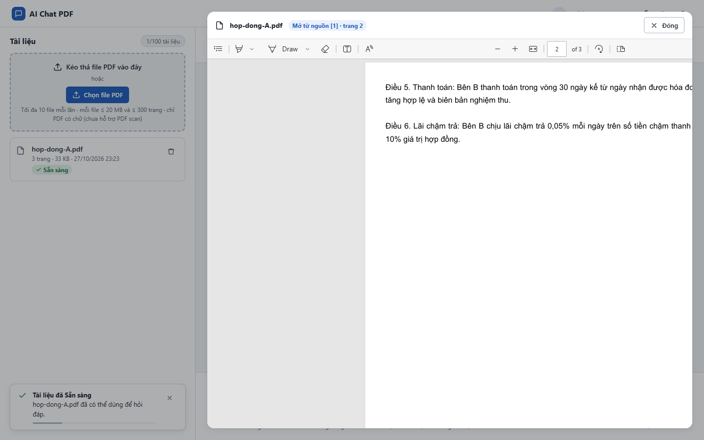
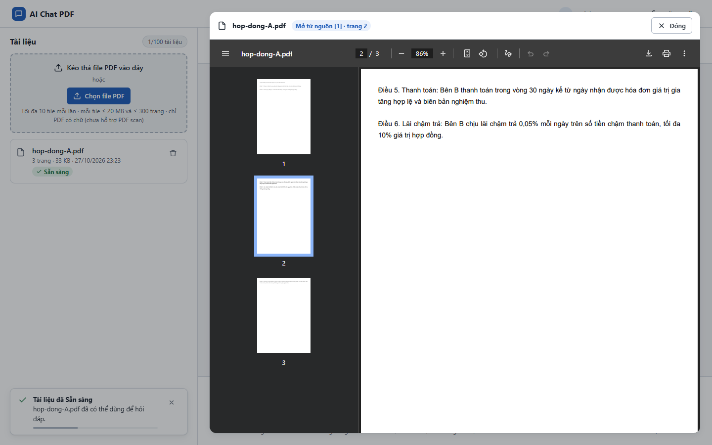

# Test report – UI-009: Tương thích Chrome và Edge

| Trường | Giá trị |
|---|---|
| Test case | [UI-009](../../doc/07-verification/test_cases/UI-009_tuong-thich-chrome-va-edge.md) |
| Kết luận | **ĐẠT** |
| Bắt đầu | 2026-10-27T16:23:13.230Z |
| Kết thúc | 2026-10-27T16:23:44.140Z (30.9 s) |
| Cách thực hiện | Tự động – Playwright (app/frontend/evidence/fixture.ts) |
| URL ứng dụng | http://localhost:8080/ |
| Bản build | 166929f + thay đổi chưa commit trong app/ |
| Trình duyệt | Microsoft Edge (Playwright, channel msedge) |
| Hệ điều hành | win32 x64 |
| Spec | app/frontend/testcases/UI-009_tuong-thich-chrome-va-edge.spec.ts |

## Kết quả từng bước

| # | Bước | Kết quả mong đợi | Kết quả thực tế | Trạng thái | Bằng chứng |
|---|---|---|---|---|---|
| 1 | Chạy luồng chính trên Edge | Đăng nhập → tải → hỏi → xem nguồn → xóa đều đạt | Edge 156.0.4314.42: luồng chính đạt | Đạt | [ảnh](screenshots/01-edge-trinh-xem.png) [ảnh](screenshots/02-chay-luong-chinh-tren-edge.png) |
| 2 | Chạy luồng chính trên Chrome | Đăng nhập → tải → hỏi → xem nguồn → xóa đều đạt | Chrome 156.0.8078.48: luồng chính đạt | Đạt | [ảnh](screenshots/03-chrome-trinh-xem.png) [ảnh](screenshots/04-chay-luong-chinh-tren-chrome.png) |

## Video

- [UI-009-app.webm](video/UI-009-app.webm)

## Ảnh chụp màn hình

## Log

- (không có)

## Ghi chú / lỗi phát hiện

- Phiên bản trình duyệt đã kiểm: Edge 156.0.4314.42; Chrome 156.0.8078.48. NFR-017 yêu cầu 2 phiên bản mới nhất của mỗi trình duyệt – lần chạy này chỉ có 1 phiên bản mỗi loại.
