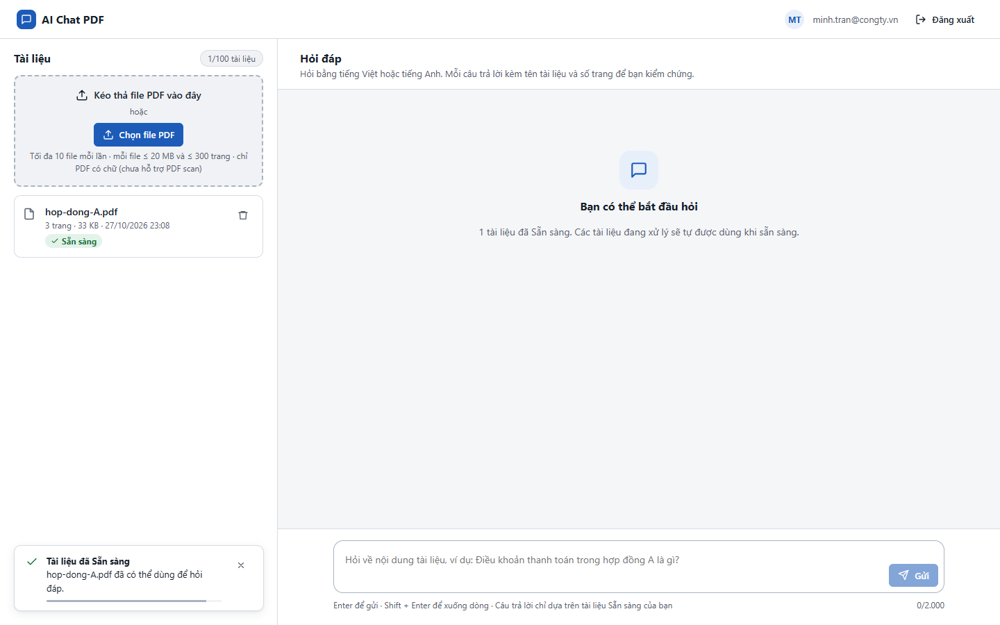
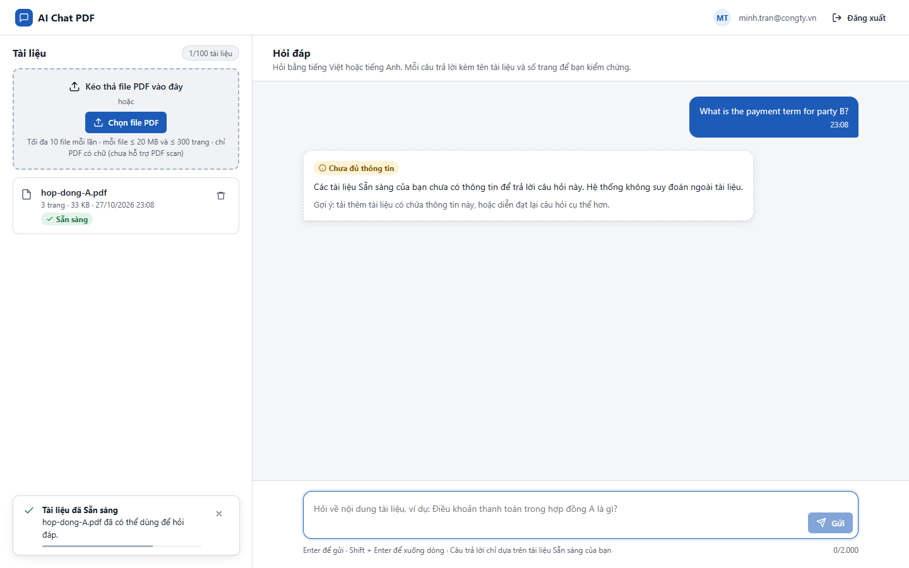

# Test report – UI-010: Ngôn ngữ giao diện và câu trả lời

| Trường | Giá trị |
|---|---|
| Test case | [UI-010](../../doc/07-verification/test_cases/UI-010_ngon-ngu-giao-dien-va-cau-tra-loi.md) |
| Kết luận | **CẦN NGƯỜI XÁC NHẬN** |
| Bắt đầu | 2026-10-27T16:08:08.617Z |
| Kết thúc | 2026-10-27T16:08:20.869Z (12.3 s) |
| Cách thực hiện | Tự động – Playwright (app/frontend/evidence/fixture.ts) |
| URL ứng dụng | http://localhost:8080/ |
| Bản build | 166929f + thay đổi chưa commit trong app/ |
| Trình duyệt | Microsoft Edge (Playwright, channel msedge) |
| Hệ điều hành | win32 x64 |
| Spec | app/frontend/testcases/UI-010_ngon-ngu-giao-dien-va-cau-tra-loi.spec.ts |

## Kết quả từng bước

| # | Bước | Kết quả mong đợi | Kết quả thực tế | Trạng thái | Bằng chứng |
|---|---|---|---|---|---|
| 1 | Đăng nhập P2, tải hop-dong-A.pdf; kiểm tra chữ trên giao diện | Toàn bộ tiếng Việt, đúng dấu | Như mong đợi | Đạt | [ảnh](screenshots/01-dang-nhap-p2-tai-hop-dong-a-pdf-kiem-tra-chu-tren-.png) |
| 2 | Hỏi "What is the payment term for party B?" | Có câu trả lời kèm nguồn hoặc "Chưa đủ thông tin" | Kết quả: Chưa đủ thông tin Các tài liệu Sẵn sàng của bạn chưa có thông tin để trả lời câu hỏi này. Hệ thống không suy đoán ngoài tài liệu. Gợi ý: tải thêm tài liệu có ch | Đạt | [ảnh](screenshots/02-hoi-what-is-the-payment-term-for-party-b.png) |
| 3 | Với LLM thật: câu trả lời dùng đúng ngôn ngữ câu hỏi (NFR-016) | Trả lời bằng tiếng Anh | Bộ trả lời trích xuất (offline) chỉ trích nguyên văn tiếng Việt, không dịch → NFR-016 "trả lời theo ngôn ngữ câu hỏi" chưa kiểm chứng được; cần LLM thật (LLM_PROVIDER=anthropic). | Cần người xác nhận | [ảnh](screenshots/03-voi-llm-that-cau-tra-loi-dung-dung-ngon-ngu-cau-ho.png) |

## Video

- [UI-010-app.webm](video/UI-010-app.webm)

## Ảnh chụp màn hình

## Log

- (không có)

## Ghi chú / lỗi phát hiện

- (không có)
