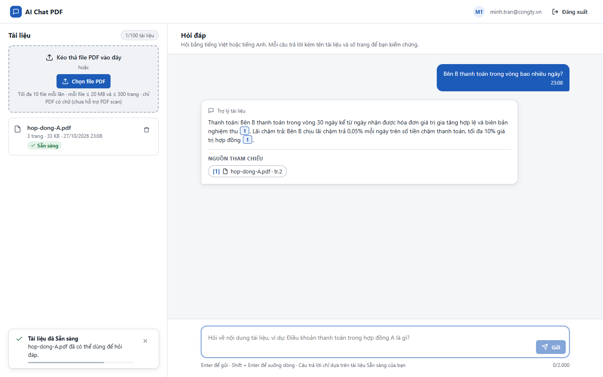
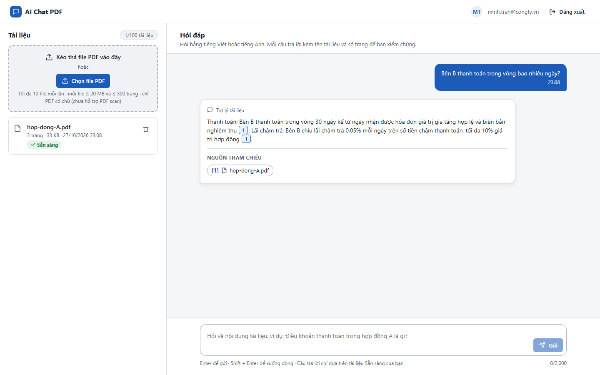
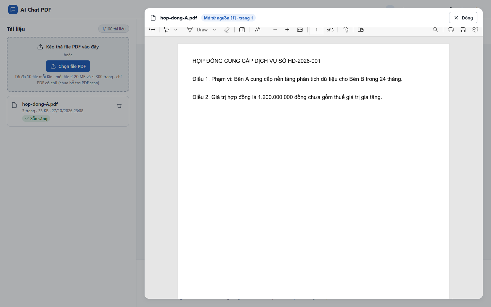

# Test report – UI-011: Nguồn không có số trang

| Trường | Giá trị |
|---|---|
| Test case | [UI-011](../../doc/07-verification/test_cases/UI-011_nguon-khong-co-so-trang.md) |
| Kết luận | **ĐẠT** |
| Bắt đầu | 2026-10-27T16:08:22.680Z |
| Kết thúc | 2026-10-27T16:08:35.784Z (13.1 s) |
| Cách thực hiện | Tự động – Playwright (app/frontend/evidence/fixture.ts) |
| URL ứng dụng | http://localhost:8080/ |
| Bản build | 166929f + thay đổi chưa commit trong app/ |
| Trình duyệt | Microsoft Edge (Playwright, channel msedge) |
| Hệ điều hành | win32 x64 |
| Spec | app/frontend/testcases/UI-011_nguon-khong-co-so-trang.spec.ts |

## Kết quả từng bước

| # | Bước | Kết quả mong đợi | Kết quả thực tế | Trạng thái | Bằng chứng |
|---|---|---|---|---|---|
| 1 | Đăng nhập P2, tải hop-dong-A.pdf, hỏi 1 câu | Chip "[1] hop-dong-A.pdf · tr.2" | Như mong đợi | Đạt | [ảnh](screenshots/01-dang-nhap-p2-tai-hop-dong-a-pdf-hoi-1-cau.png) |
| 2 | Sửa phản hồi /conversations/current: page_number = null (page.route); tải lại trang | Chip chỉ còn "[1] hop-dong-A.pdf", không có "tr." | Nhãn nguồn: "[1] hop-dong-A.pdf" | Đạt | [ảnh](screenshots/02-sua-phan-hoi-conversations-current-page-number-nul.png) |
| 3 | Bấm chip | Trình xem mở trang 1 | Như mong đợi | Đạt | [ảnh](screenshots/03-bam-chip.png) |

## Video

- [UI-011-app.webm](video/UI-011-app.webm)

## Ảnh chụp màn hình

## Log

- (không có)

## Ghi chú / lỗi phát hiện

- (không có)
