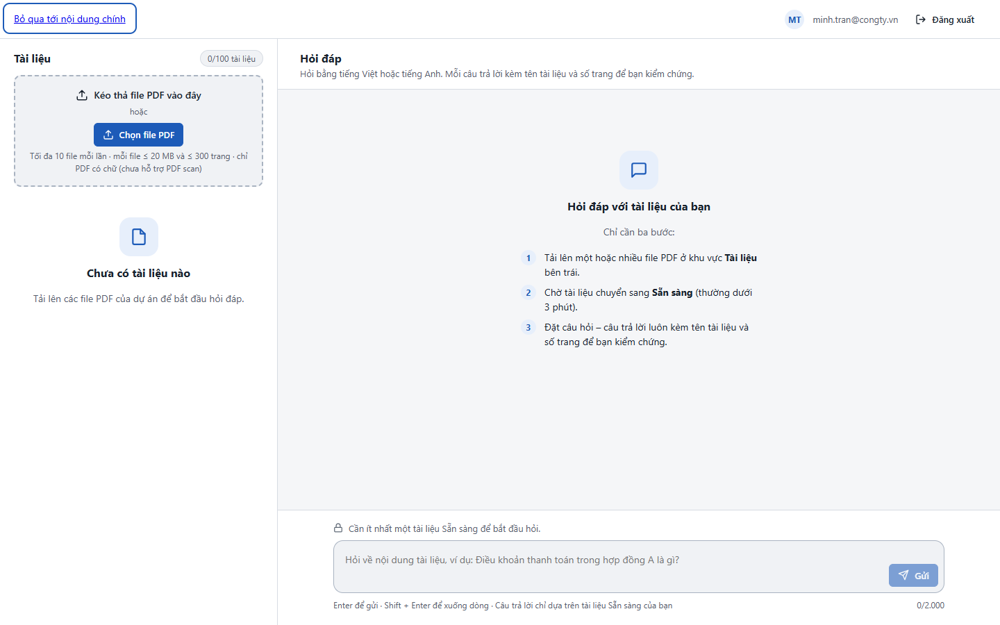
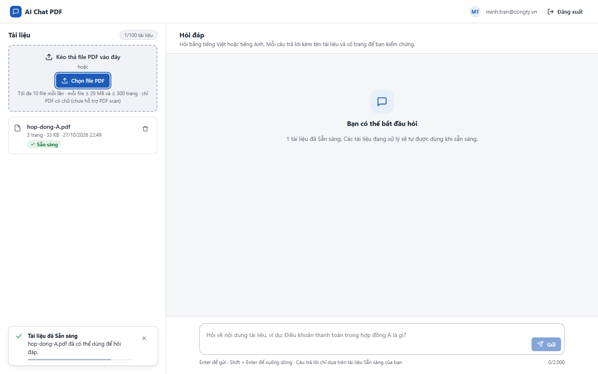
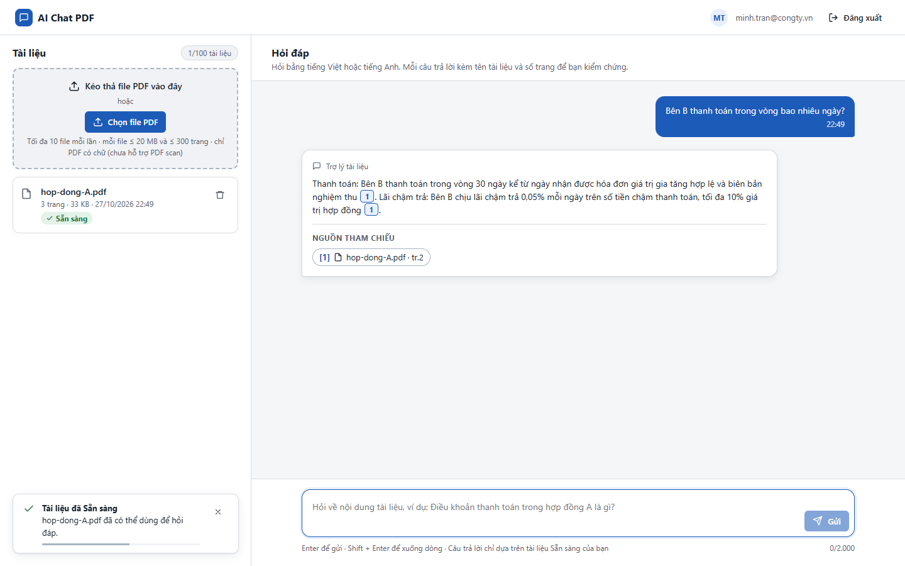
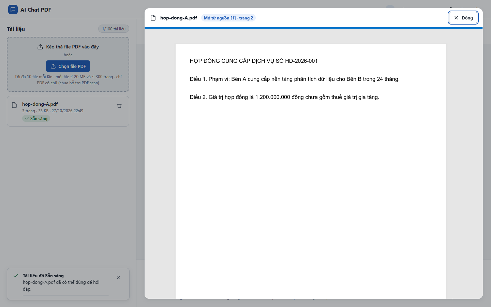
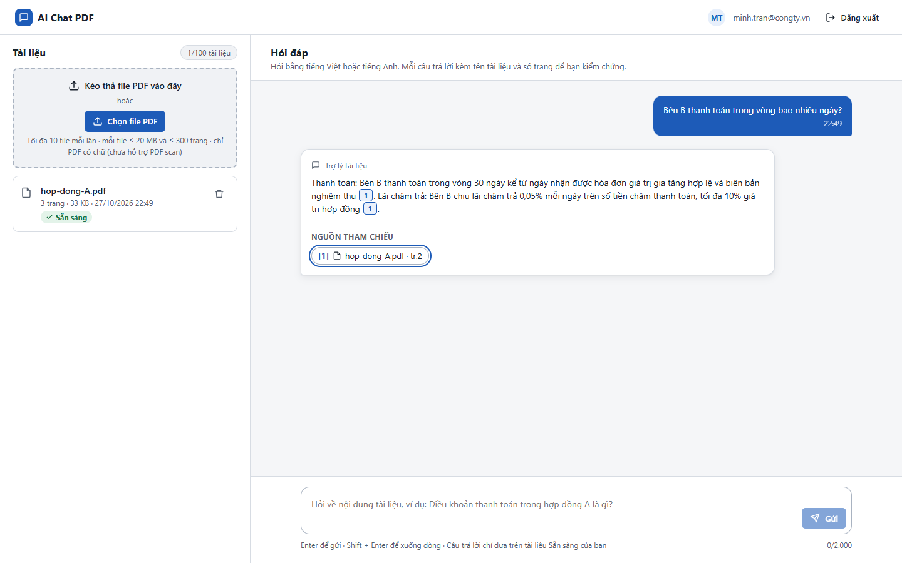
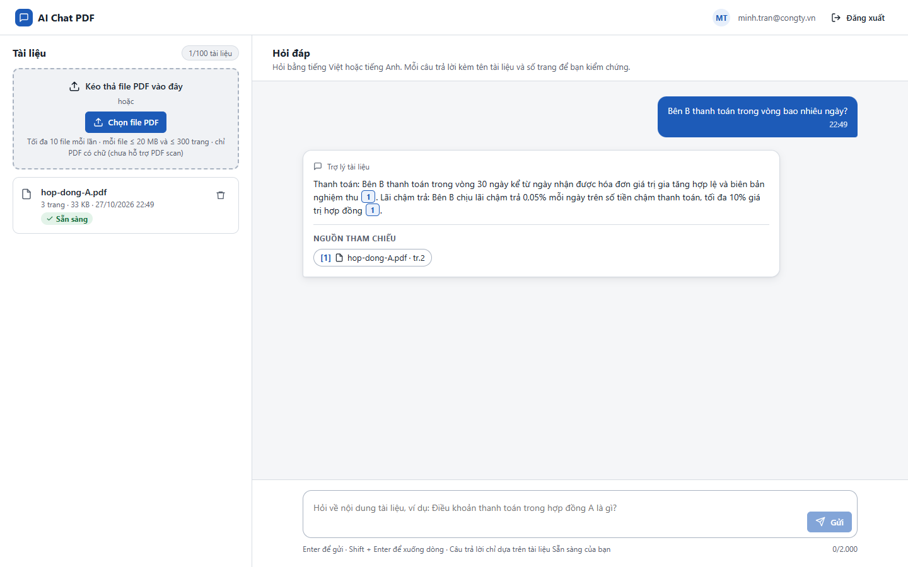

# Test report – ACC-001: Dùng toàn bộ luồng chính bằng bàn phím

| Trường | Giá trị |
|---|---|
| Test case | [ACC-001](../../doc/07-verification/test_cases/ACC-001_dung-toan-bo-luong-chinh-bang-ban-phim.md) |
| Kết luận | **CẦN NGƯỜI XÁC NHẬN** |
| Bắt đầu | 2026-10-27T15:49:30.851Z |
| Kết thúc | 2026-10-27T15:49:46.231Z (15.4 s) |
| Cách thực hiện | Tự động – Playwright (app/frontend/evidence/fixture.ts) |
| URL ứng dụng | http://localhost:8080/ |
| Bản build | 166929f + thay đổi chưa commit trong app/ |
| Trình duyệt | Microsoft Edge (Playwright, channel msedge) |
| Hệ điều hành | win32 x64 |
| Spec | app/frontend/testcases/ACC-001_dung-toan-bo-luong-chinh-bang-ban-phim.spec.ts |

## Kết quả từng bước

| # | Bước | Kết quả mong đợi | Kết quả thực tế | Trạng thái | Bằng chứng |
|---|---|---|---|---|---|
| 1 | Đăng nhập P2, xóa tài liệu cũ | Màn hình chính | Như mong đợi | Đạt | [ảnh](screenshots/01-dang-nhap-p2-xoa-tai-lieu-cu.png) |
| 2 | Nhấn Tab từ đầu trang | Phần tử đầu tiên là "Bỏ qua tới nội dung chính" | A\|\|\|Bỏ qua tới nội dung chính | Đạt | [ảnh](screenshots/02-nhan-tab-tu-dau-trang.png) |
| 3 | Tab tới "Chọn file PDF", Enter, chọn file | File được tải lên (hộp thoại chọn file mở bằng bàn phím) | Như mong đợi | Đạt | [ảnh](screenshots/03-tab-toi-chon-file-pdf-enter-chon-file.png) |
| 4 | Tab tới ô hỏi, gõ câu hỏi, Shift + Enter, Enter | Xuống dòng rồi gửi được | Như mong đợi | Đạt | [ảnh](screenshots/04-tab-toi-o-hoi-go-cau-hoi-shift-enter-enter.png) |
| 5 | Tab tới chip nguồn, Enter | Trình xem mở; focus ở nút Đóng | Như mong đợi | Đạt | [ảnh](screenshots/05-tab-toi-chip-nguon-enter.png) |
| 6 | Esc | Trình xem đóng; focus về chip nguồn | Như mong đợi | Đạt | [ảnh](screenshots/06-esc.png) |
| 7 | Tab tới nút xóa tài liệu, Enter; Enter trên Hủy | Hộp xác nhận mở, focus mặc định ở Hủy; Enter đóng hộp, tài liệu còn | Như mong đợi | Đạt | [ảnh](screenshots/07-tab-toi-nut-xoa-tai-lieu-enter-enter-tren-huy.png) |
| 8 | Xem video: thứ tự focus hợp lý, không bị kẹt | Đúng | Toàn bộ luồng thực hiện chỉ bằng bàn phím (trừ bước đăng nhập qua IdP giả lập) – người đánh giá xem video để xác nhận thứ tự focus. | Cần người xác nhận | [ảnh](screenshots/08-xem-video-thu-tu-focus-hop-ly-khong-bi-ket.png) |

## Video

- [ACC-001-app.webm](video/ACC-001-app.webm)

## Ảnh chụp màn hình

## Log

- (không có)

## Ghi chú / lỗi phát hiện

- (không có)
