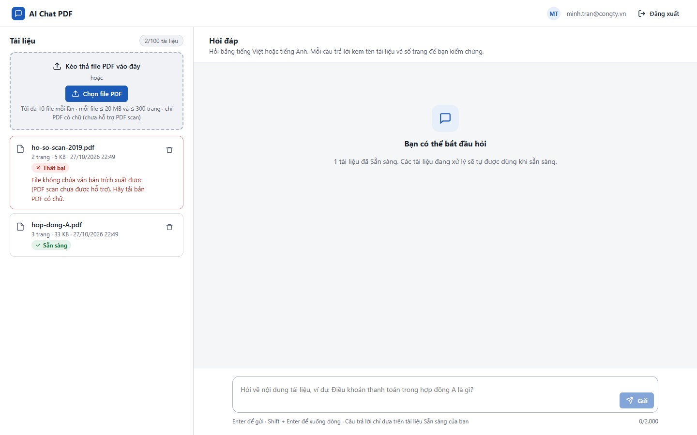
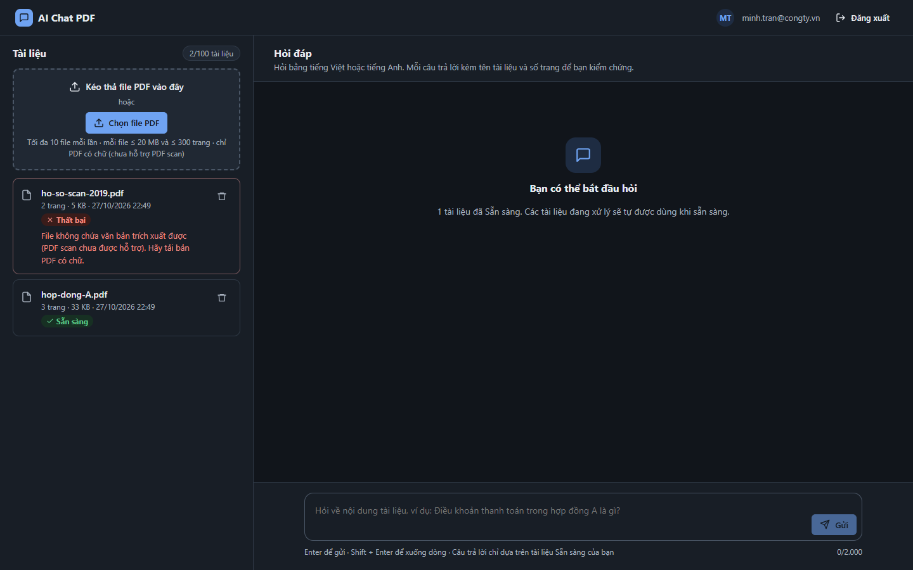
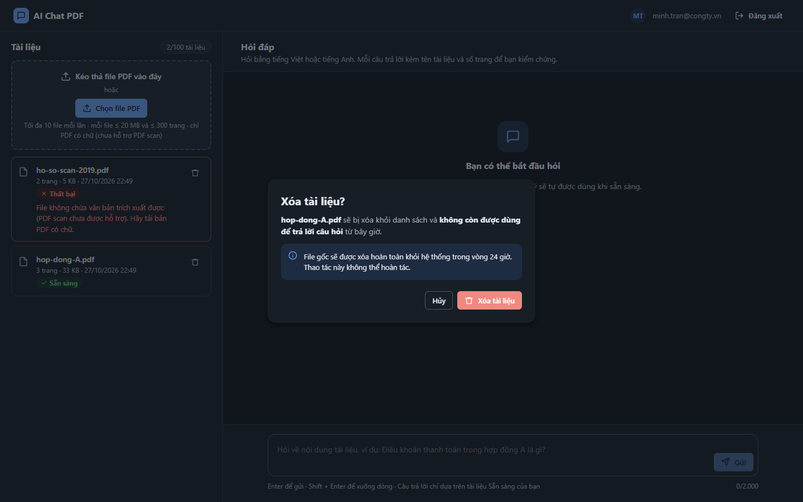

# Test report – ACC-003: Độ tương phản màu

| Trường | Giá trị |
|---|---|
| Test case | [ACC-003](../../doc/07-verification/test_cases/ACC-003_do-tuong-phan-mau.md) |
| Kết luận | **KHÔNG ĐẠT** |
| Bắt đầu | 2026-10-27T15:49:48.644Z |
| Kết thúc | 2026-10-27T15:50:22.892Z (34.2 s) |
| Cách thực hiện | Tự động – Playwright (app/frontend/evidence/fixture.ts) |
| URL ứng dụng | http://localhost:8080/ |
| Bản build | 166929f + thay đổi chưa commit trong app/ |
| Trình duyệt | Microsoft Edge (Playwright, channel msedge) |
| Hệ điều hành | win32 x64 |
| Spec | app/frontend/testcases/ACC-003_do-tuong-phan-mau.spec.ts |

## Kết quả từng bước

| # | Bước | Kết quả mong đợi | Kết quả thực tế | Trạng thái | Bằng chứng |
|---|---|---|---|---|---|
| 1 | Đăng nhập P2, tải hop-dong-A.pdf và scan; chạy axe color-contrast (giao diện sáng) | 0 vi phạm | màn hình chính (sáng): đạt, 0 vi phạm | Đạt | [ảnh](screenshots/01-dang-nhap-p2-tai-hop-dong-a-pdf-va-scan-chay-axe-c.png) |
| 2 | Giao diện tối (colorScheme: dark), chạy lại | 0 vi phạm | màn hình chính (tối): đạt, 0 vi phạm | Đạt | [ảnh](screenshots/02-giao-dien-toi-colorscheme-dark-chay-lai.png) |
| 3 | Lặp lại trên S09, S10, S11 và dialog xóa (sáng và tối) | 0 vi phạm | Vi phạm tương phản (dialog xóa (dark))  expect(received).toEqual(expected) // deep equality  - Expected  - 1 + Received  + 3 | Không đạt | [ảnh](screenshots/03-lap-lai-tren-s09-s10-s11-va-dialog-xoa-sang-va-toi.png) |

## Video

- [ACC-003-app.webm](video/ACC-003-app.webm)

## Ảnh chụp màn hình

## Log

- (không có)

## Ghi chú / lỗi phát hiện

- (không có)
