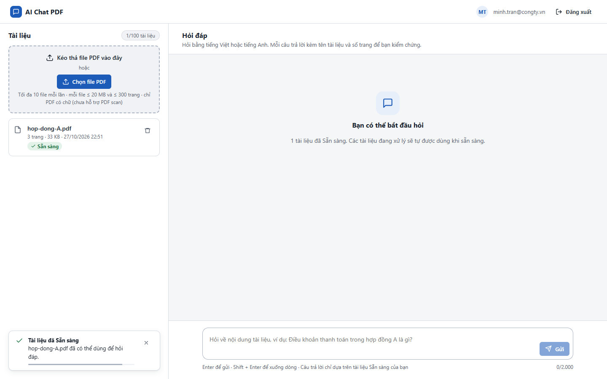
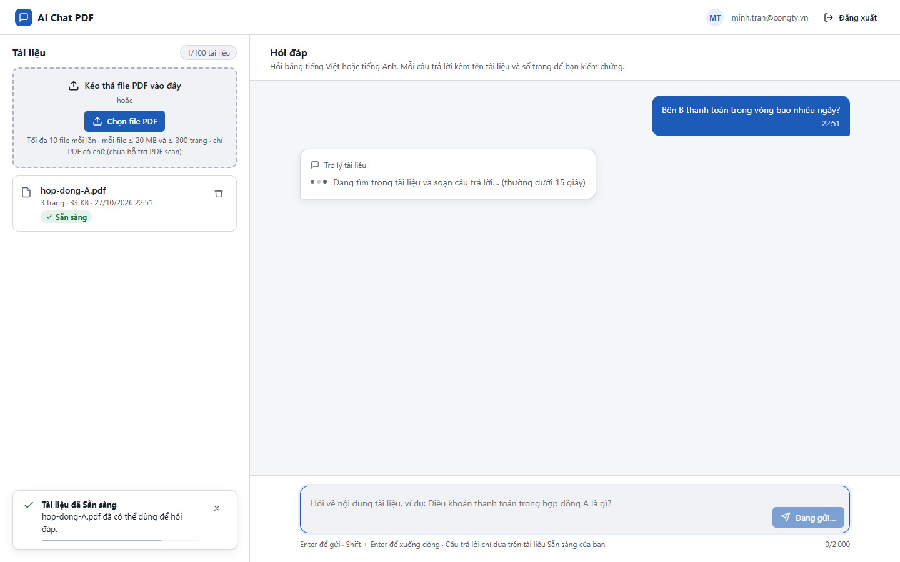

# Test report – ACC-007: Giảm chuyển động

| Trường | Giá trị |
|---|---|
| Test case | [ACC-007](../../doc/07-verification/test_cases/ACC-007_giam-chuyen-dong.md) |
| Kết luận | **KHÔNG ĐẠT** |
| Bắt đầu | 2026-10-27T15:51:24.881Z |
| Kết thúc | 2026-10-27T15:51:33.913Z (9.0 s) |
| Cách thực hiện | Tự động – Playwright (app/frontend/evidence/fixture.ts) |
| URL ứng dụng | http://localhost:8080/ |
| Bản build | 166929f + thay đổi chưa commit trong app/ |
| Trình duyệt | Microsoft Edge (Playwright, channel msedge) |
| Hệ điều hành | win32 x64 |
| Spec | app/frontend/testcases/ACC-007_giam-chuyen-dong.spec.ts |

## Kết quả từng bước

| # | Bước | Kết quả mong đợi | Kết quả thực tế | Trạng thái | Bằng chứng |
|---|---|---|---|---|---|
| 1 | Đăng nhập P2; emulateMedia reducedMotion: reduce; tải file (làm chậm 3 s để thấy biểu tượng xoay) | Biểu tượng .spin có animation-name: none | animation-name của .spin = none | Đạt | [ảnh](screenshots/01-dang-nhap-p2-emulatemedia-reducedmotion-reduce-tai.png) |
| 2 | Gửi câu hỏi (làm chậm 3 s) | Ba chấm .dots span không có animation | expect(received).toBe(expected) // Object.is equality  Expected: "none" Received: "blink" | Không đạt | [ảnh](screenshots/02-gui-cau-hoi-lam-cham-3-s.png) |

## Video

- [ACC-007-app.webm](video/ACC-007-app.webm)

## Ảnh chụp màn hình

## Log

- (không có)

## Ghi chú / lỗi phát hiện

- (không có)
