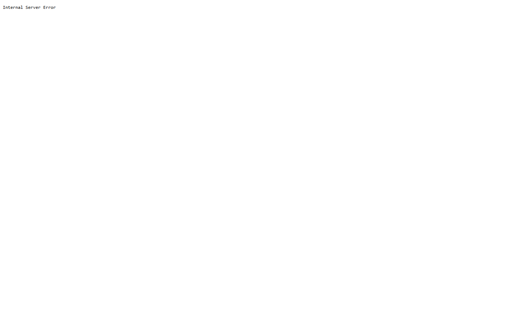

# Test report – API-003: Callback với state sai hoặc hết hạn

| Trường | Giá trị |
|---|---|
| Test case | [API-003](../../doc/07-verification/test_cases/API-003_callback-voi-state-sai-hoac-het-han.md) |
| Kết luận | **KHÔNG ĐẠT** |
| Bắt đầu | 2026-10-27T14:00:42.415Z |
| Kết thúc | 2026-10-27T14:00:51.322Z (8.9 s) |
| Cách thực hiện | Tự động – Playwright (app/frontend/evidence/fixture.ts) |
| URL ứng dụng | http://localhost:8080/ |
| Bản build | 166929f + thay đổi chưa commit trong app/ |
| Trình duyệt | Microsoft Edge (Playwright, channel msedge) |
| Hệ điều hành | win32 x64 |
| Spec | app/frontend/testcases/API-003_callback-voi-state-sai-hoac-het-han.spec.ts |

## Kết quả từng bước

| # | Bước | Kết quả mong đợi | Kết quả thực tế | Trạng thái | Bằng chứng |
|---|---|---|---|---|---|
| 1 | Mở /api/v1/auth/callback?code=p1&state=sai | 302 tới /login-error?ref=<request_id> | Timed out 5000ms waiting for expect(locator).toBeVisible()  Locator: getByRole('heading', { name: 'Không thể đăng nhập' }) Expected: visible Received: <element(s) not found> Call log: | Không đạt | [ảnh](screenshots/01-mo-api-v1-auth-callback-code-p1-state-sai.png) |

## Video

- [API-003-app.webm](video/API-003-app.webm)

## Ảnh chụp màn hình

## Log

- (không có)

## Ghi chú / lỗi phát hiện

- (không có)
