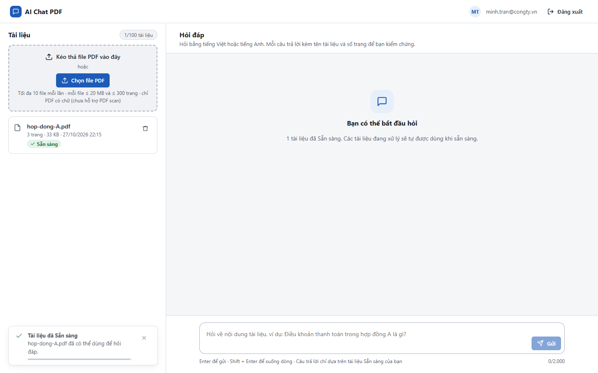
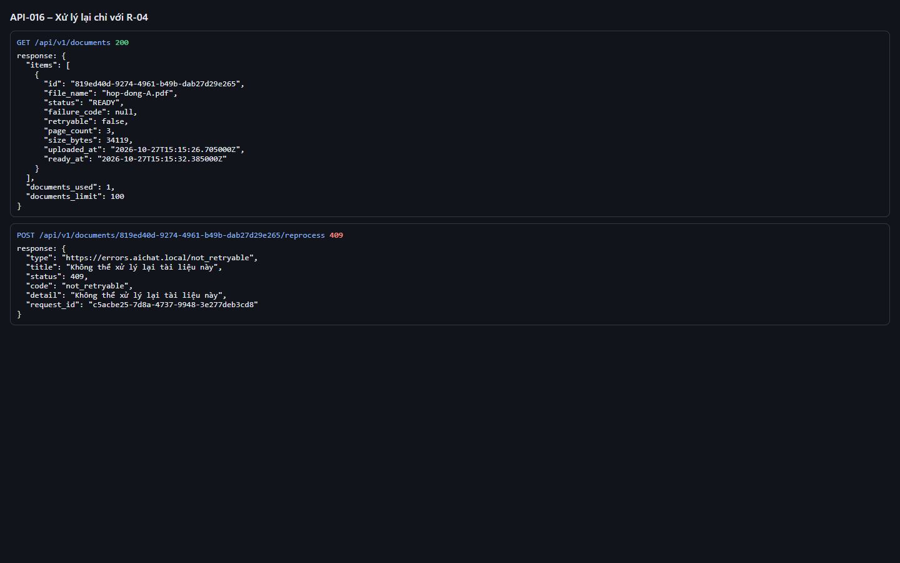
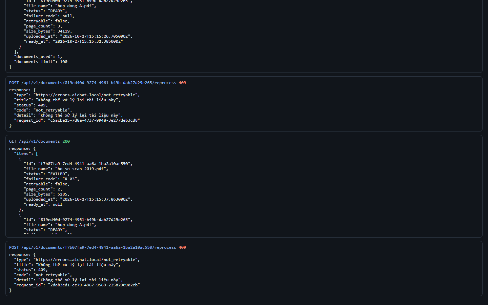
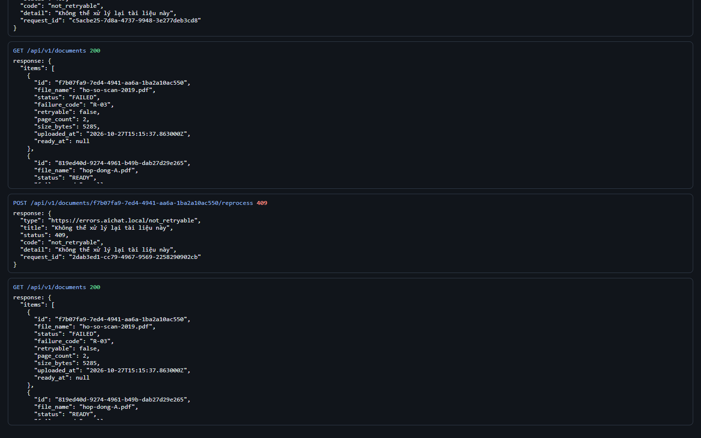

# Test report – API-016: Xử lý lại chỉ với R-04

| Trường | Giá trị |
|---|---|
| Test case | [API-016](../../doc/07-verification/test_cases/API-016_xu-ly-lai-chi-voi-r-04.md) |
| Kết luận | **KHÔNG ĐẠT** |
| Bắt đầu | 2026-10-27T15:15:19.954Z |
| Kết thúc | 2026-10-27T15:17:17.998Z (118.0 s) |
| Cách thực hiện | Tự động – Playwright (app/frontend/evidence/fixture.ts) |
| URL ứng dụng | http://localhost:8080/ |
| Bản build | 166929f + thay đổi chưa commit trong app/ |
| Trình duyệt | Microsoft Edge (Playwright, channel msedge) |
| Hệ điều hành | win32 x64 |
| Spec | app/frontend/testcases/API-016_xu-ly-lai-chi-voi-r-04.spec.ts |

## Kết quả từng bước

| # | Bước | Kết quả mong đợi | Kết quả thực tế | Trạng thái | Bằng chứng |
|---|---|---|---|---|---|
| 1 | Đăng nhập P2, tải hop-dong-A.pdf, chờ Sẵn sàng | Dòng Sẵn sàng | Như mong đợi | Đạt | [ảnh](screenshots/01-dang-nhap-p2-tai-hop-dong-a-pdf-cho-san-sang.png) |
| 2 | POST /reprocess với tài liệu READY | 409 not_retryable | Như mong đợi | Đạt | [ảnh](screenshots/02-post-reprocess-voi-tai-lieu-ready.png) |
| 3 | Tải ho-so-scan-2019.pdf (→ R-03); POST /reprocess | 409 not_retryable | Như mong đợi | Đạt | [ảnh](screenshots/03-tai-ho-so-scan-2019-pdf-r-03-post-reprocess.png) |
| 4 | Khởi động lại với dịch vụ embedding không tồn tại; tải bang-gia-Q4.pdf | Tài liệu thất bại R-04 sau 3 lần thử (≈ 3 phút) | Cannot read properties of undefined (reading 'failure_code') | Không đạt | [ảnh](screenshots/04-khoi-dong-lai-voi-dich-vu-embedding-khong-ton-tai-.png) |

## Video

- [API-016-app.webm](video/API-016-app.webm)
- [API-016-page2.webm](video/API-016-page2.webm)

## Ảnh chụp màn hình

## Log

- [api.log](logs/api.log)

## Ghi chú / lỗi phát hiện

- Khởi động lại ứng dụng với {"EMBEDDING_PROVIDER":"http","EMBEDDING_URL":"http://127.0.0.1:9"}: [app] restart xong – http://localhost:8080/ sẵn sàng
- Khởi động lại ứng dụng với {}: [app] restart xong – http://localhost:8080/ sẵn sàng
