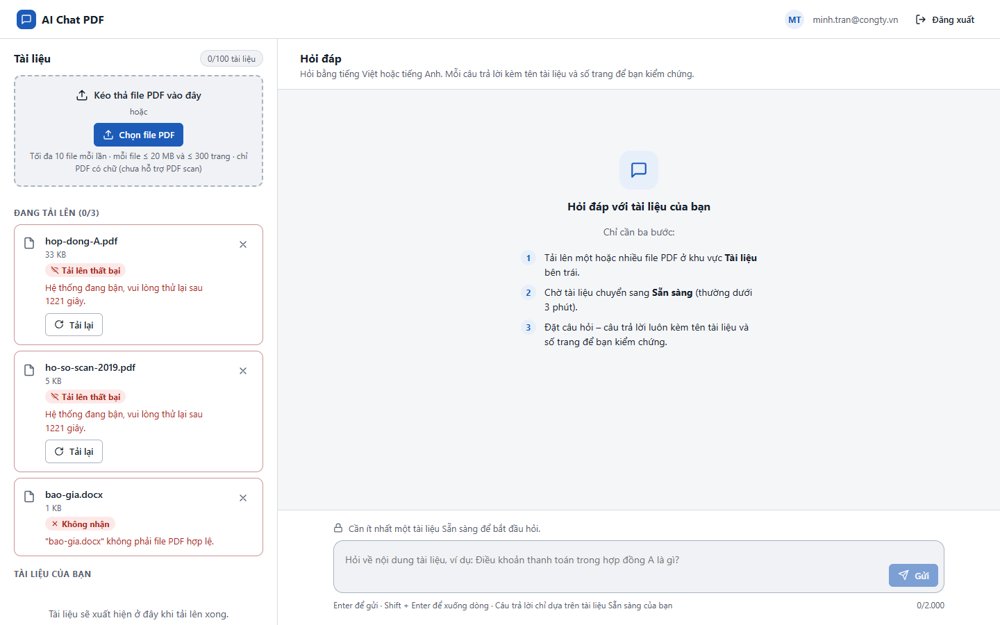

# Test report – E2E-001: Đăng nhập, tải PDF, hỏi, xem nguồn, xóa

| Trường | Giá trị |
|---|---|
| Test case | [E2E-001](../../doc/07-verification/test_cases/E2E-001_dang-nhap-tai-pdf-hoi-xem-nguon-xoa.md) |
| Kết luận | **KHÔNG ĐẠT** |
| Bắt đầu | 2026-10-27T14:39:34.716Z |
| Kết thúc | 2026-10-27T14:41:49.324Z (134.6 s) |
| Cách thực hiện | Tự động – Playwright (app/frontend/evidence/fixture.ts) |
| URL ứng dụng | http://localhost:8080/ |
| Bản build | 166929f + thay đổi chưa commit trong app/ |
| Trình duyệt | Microsoft Edge (Playwright, channel msedge) |
| Hệ điều hành | win32 x64 |
| Spec | app/frontend/testcases/E2E-001_dang-nhap-tai-pdf-hoi-xem-nguon-xoa.spec.ts |

## Kết quả từng bước

| # | Bước | Kết quả mong đợi | Kết quả thực tế | Trạng thái | Bằng chứng |
|---|---|---|---|---|---|
| 1 | Đăng nhập P2 (Trần Minh), xóa tài liệu cũ | Màn hình chính; Chưa có tài liệu nào; ô hỏi khóa | Như mong đợi | Đạt | [ảnh](screenshots/01-dang-nhap-p2-tran-minh-xoa-tai-lieu-cu.png) |
| 2 | Chọn cùng lúc hop-dong-A.pdf, ho-so-scan-2019.pdf, bao-gia.docx | docx: Không nhận – "không phải file PDF hợp lệ"; 2 PDF vào hàng đợi | Như mong đợi | Đạt | [ảnh](screenshots/02-chon-cung-luc-hop-dong-a-pdf-ho-so-scan-2019-pdf-b.png) |
| 3 | Chờ xử lý xong | hop-dong-A.pdf Sẵn sàng; ho-so-scan-2019.pdf Thất bại (PDF scan), không có nút Xử lý lại | Timed out 90000ms waiting for expect(locator).toBeVisible()  Locator: locator('li.row').filter({ hasText: 'hop-dong-A.pdf' }).getByText('Sẵn sàng') Expected: visible Received: <element(s) not found> Call log: | Không đạt | [ảnh](screenshots/03-cho-xu-ly-xong.png) |

## Video

- [E2E-001-app.webm](video/E2E-001-app.webm)

## Ảnh chụp màn hình

## Log

- (không có)

## Ghi chú / lỗi phát hiện

- (không có)
