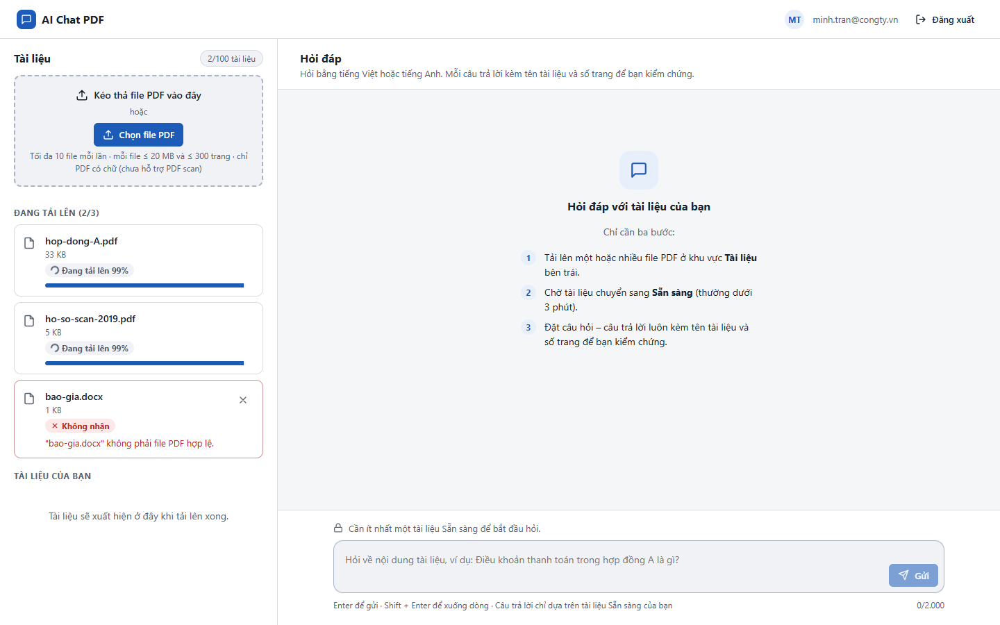
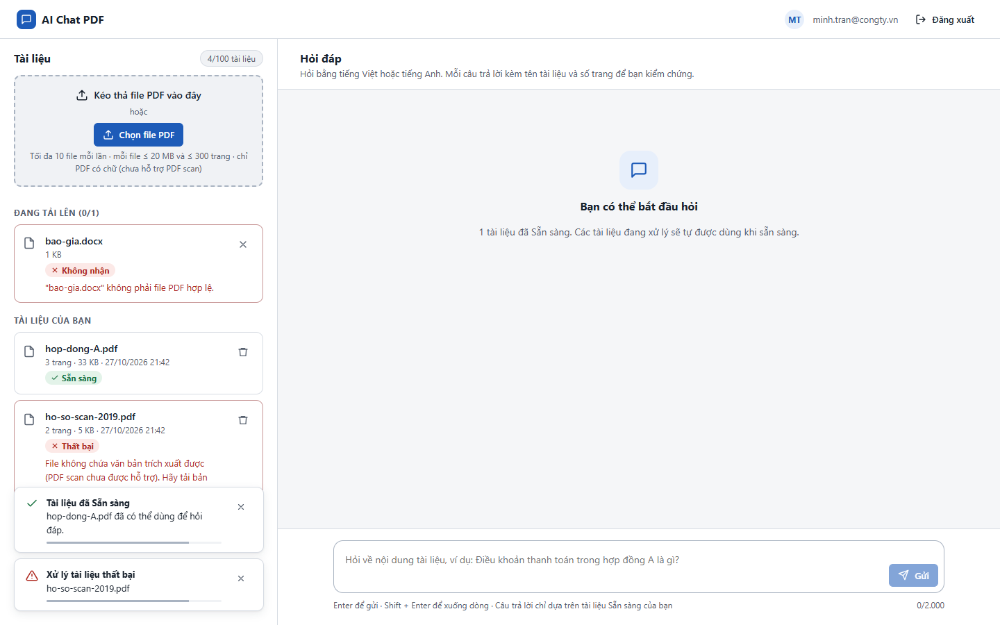
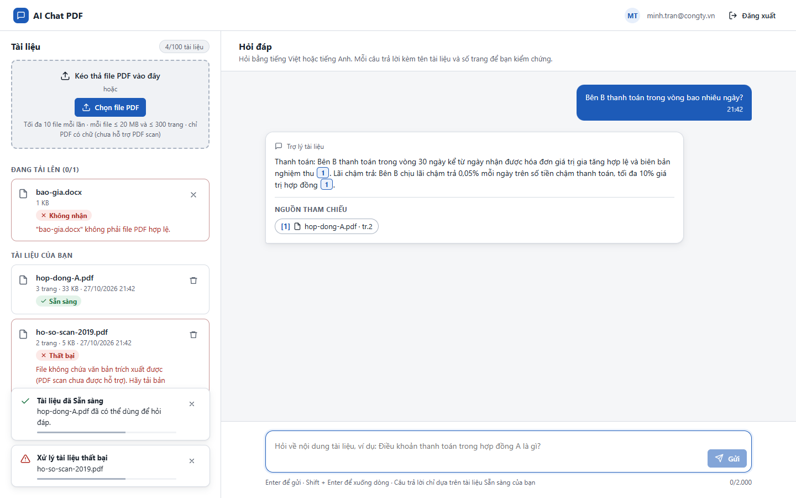
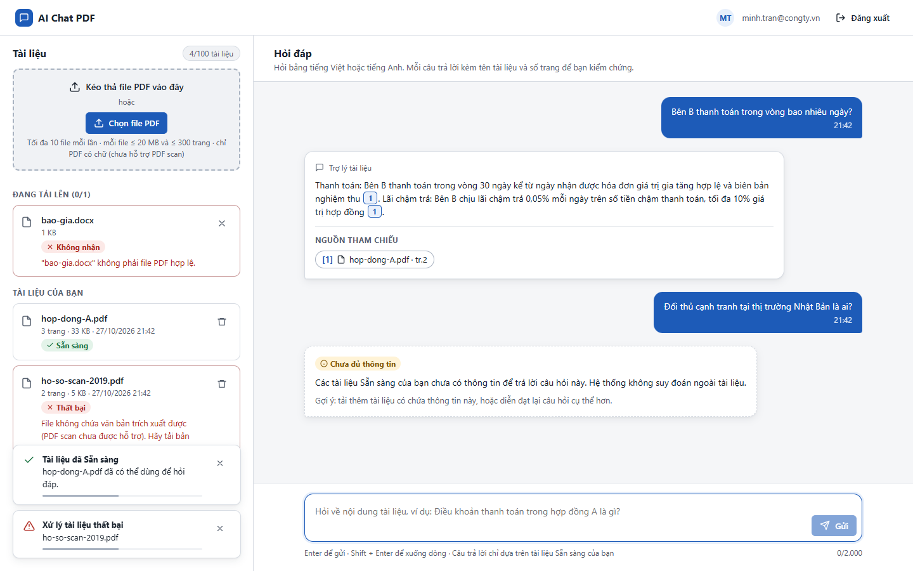
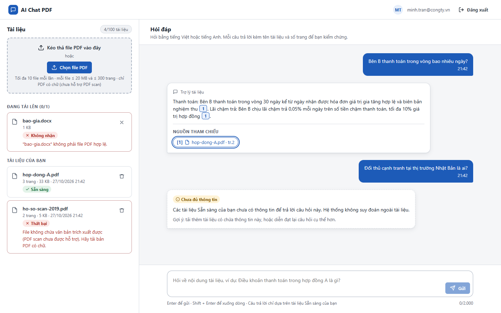
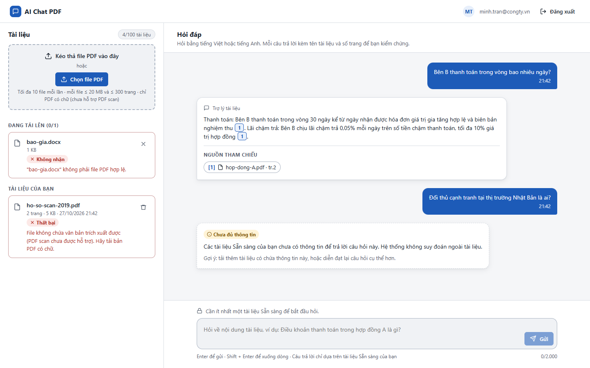

# Test report – E2E-001: Đăng nhập, tải PDF, hỏi, xem nguồn, xóa

| Trường | Giá trị |
|---|---|
| Test case | [E2E-001](../../doc/07-verification/test_cases/E2E-001_dang-nhap-tai-pdf-hoi-xem-nguon-xoa.md) |
| Kết luận | **ĐẠT** |
| Bắt đầu | 2026-10-27T14:42:33.682Z |
| Kết thúc | 2026-10-27T14:42:55.503Z (21.8 s) |
| Cách thực hiện | Tự động – Playwright (app/frontend/evidence/fixture.ts) |
| URL ứng dụng | http://localhost:8080/ |
| Bản build | 166929f + thay đổi chưa commit trong app/ |
| Trình duyệt | Microsoft Edge (Playwright, channel msedge) |
| Hệ điều hành | win32 x64 |
| Spec | app/frontend/testcases/E2E-001_dang-nhap-tai-pdf-hoi-xem-nguon-xoa.spec.ts |

## Kết quả từng bước

| # | Bước | Kết quả mong đợi | Kết quả thực tế | Trạng thái | Bằng chứng |
|---|---|---|---|---|---|
| 1 | Đăng nhập P2 (Trần Minh), xóa tài liệu cũ | Màn hình chính; Chưa có tài liệu nào; ô hỏi khóa | Như mong đợi | Đạt | [ảnh](screenshots/01-dang-nhap-p2-tran-minh-xoa-tai-lieu-cu.png) |
| 2 | Chọn cùng lúc hop-dong-A.pdf, ho-so-scan-2019.pdf, bao-gia.docx | docx: Không nhận – "không phải file PDF hợp lệ"; 2 PDF vào hàng đợi | Như mong đợi | Đạt | [ảnh](screenshots/02-chon-cung-luc-hop-dong-a-pdf-ho-so-scan-2019-pdf-b.png) |
| 3 | Chờ xử lý xong | hop-dong-A.pdf Sẵn sàng; ho-so-scan-2019.pdf Thất bại (PDF scan), không có nút Xử lý lại | Như mong đợi | Đạt | [ảnh](screenshots/03-cho-xu-ly-xong.png) |
| 4 | Hỏi "Bên B thanh toán trong vòng bao nhiêu ngày?" (Enter) | Câu trả lời chứa "30 ngày" và chip [1] hop-dong-A.pdf · tr.2 | Như mong đợi | Đạt | [ảnh](screenshots/04-hoi-ben-b-thanh-toan-trong-vong-bao-nhieu-ngay-ent.png) |
| 5 | Hỏi "Đối thủ cạnh tranh tại thị trường Nhật Bản là ai?" | Thẻ Chưa đủ thông tin, không có phần nguồn | Như mong đợi | Đạt | [ảnh](screenshots/05-hoi-doi-thu-canh-tranh-tai-thi-truong-nhat-ban-la-.png) |
| 6 | Bấm chip [1] hop-dong-A.pdf · tr.2 | Dialog trình xem: hop-dong-A.pdf, "Mở từ nguồn [1] · trang 2", PDF hiển thị | Như mong đợi | Đạt | [ảnh](screenshots/06-bam-chip-1-hop-dong-a-pdf-tr-2.png) |
| 7 | Nhấn Esc | Dialog đóng; focus quay lại chip nguồn | Như mong đợi | Đạt | [ảnh](screenshots/07-nhan-esc.png) |
| 8 | Xóa hop-dong-A.pdf (thùng rác → Xóa tài liệu) | Hộp xác nhận nêu "không còn được dùng để trả lời"; sau khi xóa dòng biến mất | Như mong đợi | Đạt | [ảnh](screenshots/08-xoa-hop-dong-a-pdf-thung-rac-xoa-tai-lieu.png) |
| 9 | Xem lại câu trả lời cũ | Chip nguồn "(đã xóa)", không bấm được; ô hỏi khóa (không còn tài liệu Sẵn sàng) | Như mong đợi | Đạt | [ảnh](screenshots/09-xem-lai-cau-tra-loi-cu.png) |

## Video

- [E2E-001-app.webm](video/E2E-001-app.webm)

## Ảnh chụp màn hình

![Bước 6 – Bấm chip [1] hop-dong-A.pdf · tr.2](screenshots/06-bam-chip-1-hop-dong-a-pdf-tr-2.png)

## Log

- (không có)

## Ghi chú / lỗi phát hiện

- (không có)
