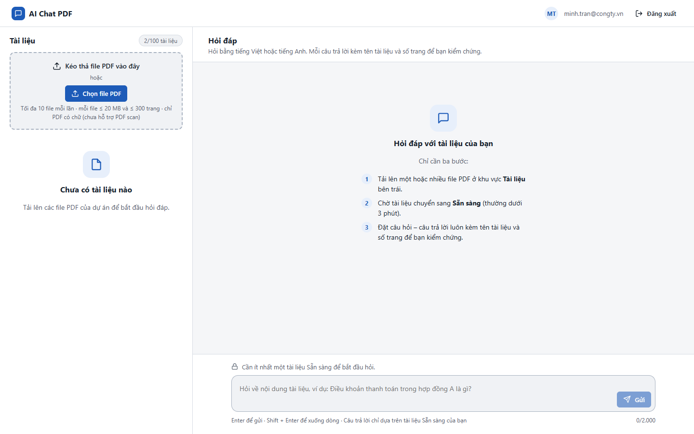
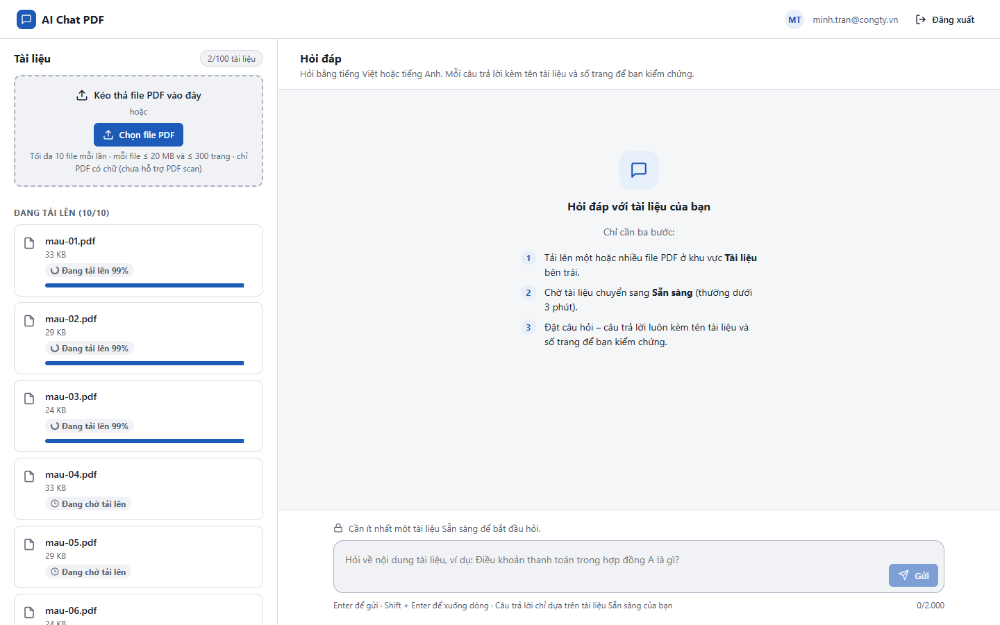
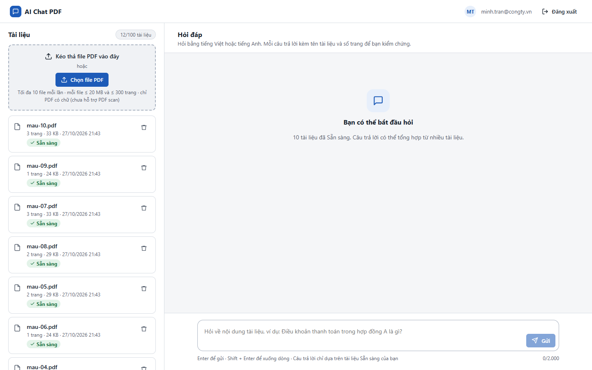

# Test report – E2E-004: Tải 10 file song song

| Trường | Giá trị |
|---|---|
| Test case | [E2E-004](../../doc/07-verification/test_cases/E2E-004_tai-10-file-song-song.md) |
| Kết luận | **KHÔNG ĐẠT** |
| Bắt đầu | 2026-10-27T14:42:58.175Z |
| Kết thúc | 2026-10-27T14:43:48.393Z (50.2 s) |
| Cách thực hiện | Tự động – Playwright (app/frontend/evidence/fixture.ts) |
| URL ứng dụng | http://localhost:8080/ |
| Bản build | 166929f + thay đổi chưa commit trong app/ |
| Trình duyệt | Microsoft Edge (Playwright, channel msedge) |
| Hệ điều hành | win32 x64 |
| Spec | app/frontend/testcases/E2E-004_tai-10-file-song-song.spec.ts |

## Kết quả từng bước

| # | Bước | Kết quả mong đợi | Kết quả thực tế | Trạng thái | Bằng chứng |
|---|---|---|---|---|---|
| 1 | Đăng nhập P2, xóa tài liệu cũ | Danh sách rỗng | Như mong đợi | Đạt | [ảnh](screenshots/01-dang-nhap-p2-xoa-tai-lieu-cu.png) |
| 2 | Chọn 10 PDF hợp lệ (làm chậm request PUT 2 s để quan sát hàng đợi) | Hàng đợi 10 dòng; tại mọi thời điểm ≤ 3 dòng Đang tải lên, còn lại Đang chờ tải lên | Số dòng "Đang tải lên" đồng thời tối đa quan sát được: 3 | Đạt | [ảnh](screenshots/02-chon-10-pdf-hop-le-lam-cham-request-put-2-s-de-qua.png) |
| 3 | Chụp ảnh khi đang tải | Thấy đồng thời trạng thái đang tải và đang chờ | Dòng đang chờ: 7; tổng dòng đang hiển thị: 10 | Đạt | [ảnh](screenshots/03-chup-anh-khi-dang-tai.png) |
| 4 | Chờ tất cả xử lý xong | 10 dòng Sẵn sàng; hạn mức 10/100 tài liệu | Timed out 5000ms waiting for expect(locator).toHaveText(expected)  Locator: locator('.quota') Expected string: "10/100 tài liệu" Received string: "12/100 tài liệu" Call log: | Không đạt | [ảnh](screenshots/04-cho-tat-ca-xu-ly-xong.png) |

## Video

- [E2E-004-app.webm](video/E2E-004-app.webm)

## Ảnh chụp màn hình

## Log

- (không có)

## Ghi chú / lỗi phát hiện

- (không có)
