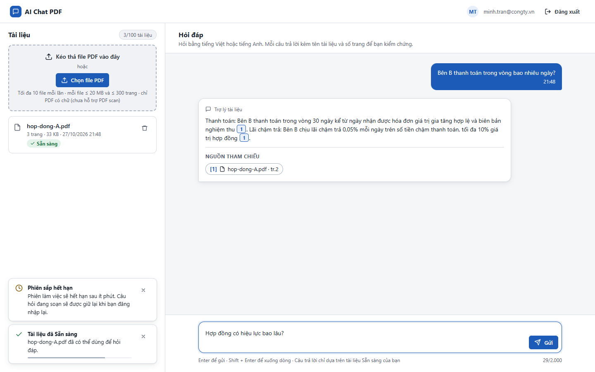
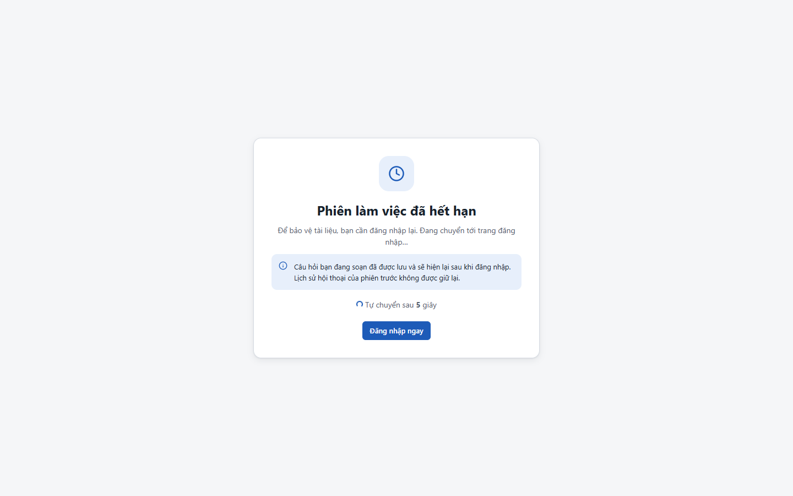
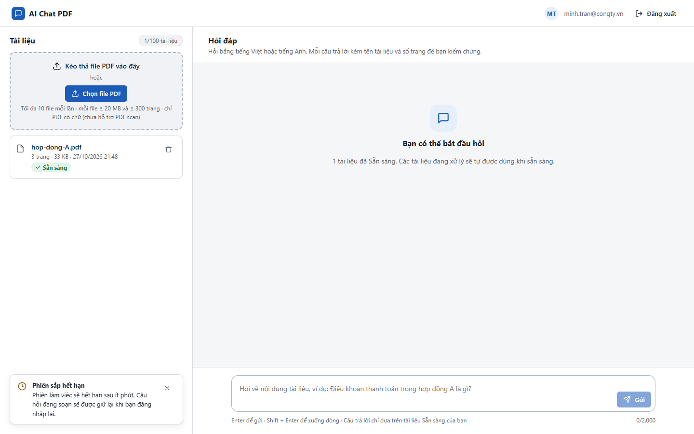

# Test report – E2E-008: Hết phiên khi đang soạn câu hỏi

| Trường | Giá trị |
|---|---|
| Test case | [E2E-008](../../doc/07-verification/test_cases/E2E-008_het-phien-khi-dang-soan-cau-hoi.md) |
| Kết luận | **KHÔNG ĐẠT** |
| Bắt đầu | 2026-10-27T14:48:16.734Z |
| Kết thúc | 2026-10-27T14:50:29.949Z (133.2 s) |
| Cách thực hiện | Tự động – Playwright (app/frontend/evidence/fixture.ts) |
| URL ứng dụng | http://localhost:8080/ |
| Bản build | 166929f + thay đổi chưa commit trong app/ |
| Trình duyệt | Microsoft Edge (Playwright, channel msedge) |
| Hệ điều hành | win32 x64 |
| Spec | app/frontend/testcases/E2E-008_het-phien-khi-dang-soan-cau-hoi.spec.ts |

## Kết quả từng bước

| # | Bước | Kết quả mong đợi | Kết quả thực tế | Trạng thái | Bằng chứng |
|---|---|---|---|---|---|
| 1 | Khởi động lại với SESSION_IDLE_MIN=1 | Ứng dụng sẵn sàng | Như mong đợi | Đạt | [ảnh](screenshots/01-khoi-dong-lai-voi-session-idle-min-1.png) |
| 2 | Đăng nhập P2, tải hop-dong-A.pdf, hỏi một câu và gõ dở câu thứ hai (không gửi) | Câu hỏi nằm trong ô | Như mong đợi | Đạt | [ảnh](screenshots/02-dang-nhap-p2-tai-hop-dong-a-pdf-hoi-mot-cau-va-go-.png) |
| 3 | Không thao tác 75 s, sau đó bấm Gửi | Trang "Phiên làm việc đã hết hạn" với đếm ngược và nút Đăng nhập ngay | Như mong đợi | Đạt | [ảnh](screenshots/03-khong-thao-tac-75-s-sau-do-bam-gui.png) |
| 4 | Bấm Đăng nhập ngay, chọn P2 | Màn hình chính; ô hỏi chứa sẵn câu đang soạn; hội thoại mới (không còn câu trước) | Timed out 5000ms waiting for expect(locator).toHaveValue(expected)  Locator: locator('#q') Expected string: "Hợp đồng có hiệu lực bao lâu?" Received string: "" Call log: | Không đạt | [ảnh](screenshots/04-bam-dang-nhap-ngay-chon-p2.png) |

## Video

- [E2E-008-app.webm](video/E2E-008-app.webm)

## Ảnh chụp màn hình

## Log

- (không có)

## Ghi chú / lỗi phát hiện

- Khởi động lại ứng dụng với {"SESSION_IDLE_MIN":"1"}: [app] restart xong – http://localhost:8080/ sẵn sàng
- Khởi động lại ứng dụng với {}: [app] restart xong – http://localhost:8080/ sẵn sàng
