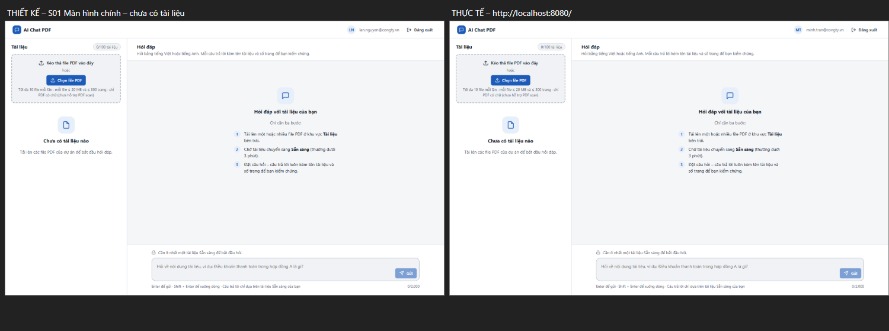
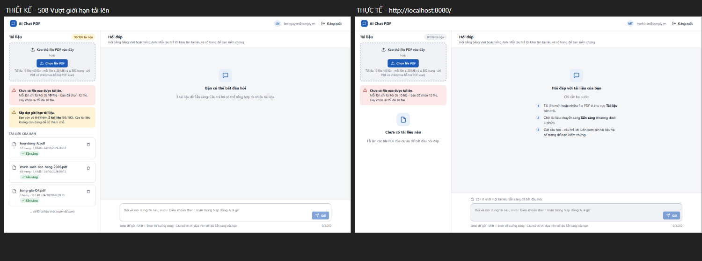
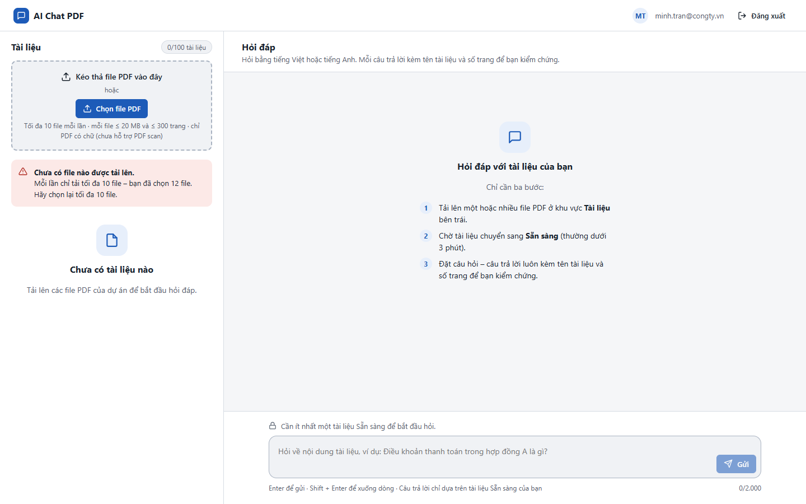
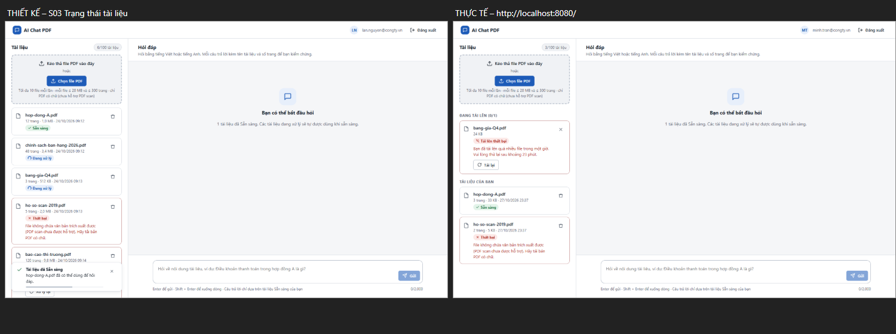
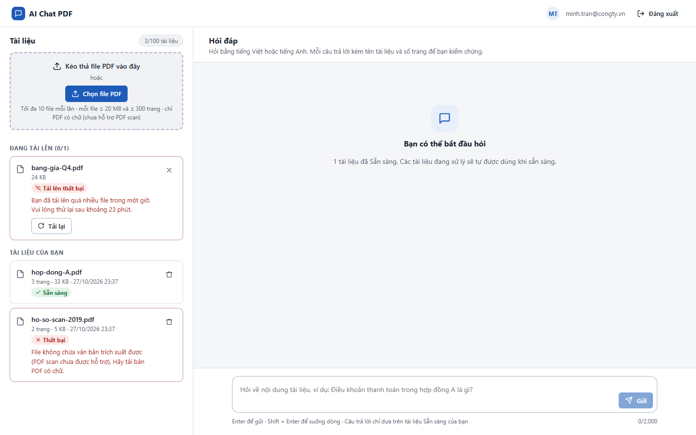
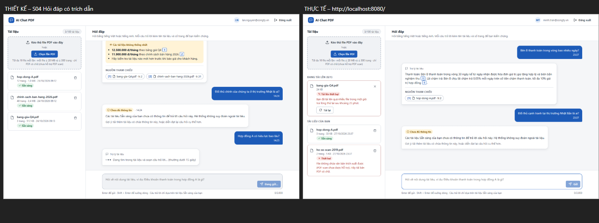
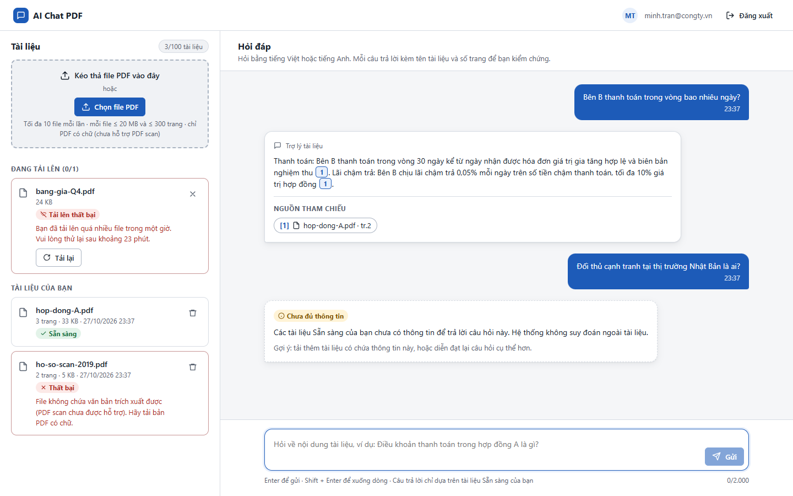
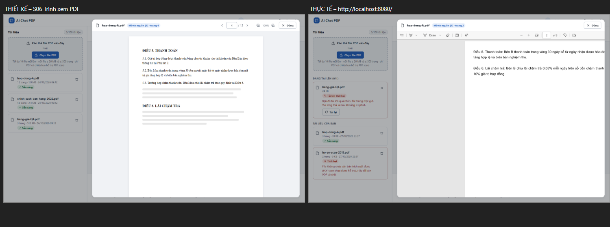
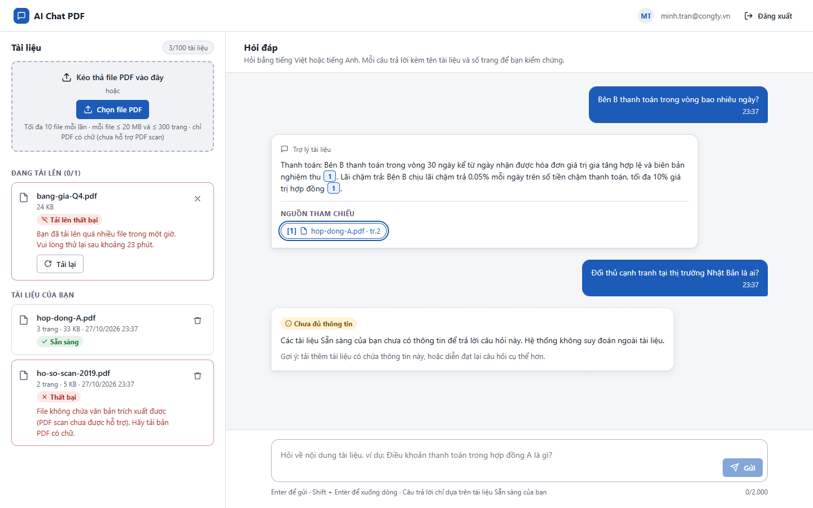

# Test report – UI-001: So sánh giao diện với thiết kế

| Trường | Giá trị |
|---|---|
| Test case | [UI-001](../../doc/07-verification/test_cases/UI-001_so-sanh-giao-dien-voi-thiet-ke.md) |
| Kết luận | **KHÔNG ĐẠT** |
| Bắt đầu | 2026-10-27T16:37:11.385Z |
| Kết thúc | 2026-10-27T16:38:27.394Z (76.0 s) |
| Cách thực hiện | Tự động – Playwright (app/frontend/evidence/fixture.ts) |
| URL ứng dụng | http://localhost:8080/ |
| Bản build | 166929f + thay đổi chưa commit trong app/ |
| Trình duyệt | Microsoft Edge (Playwright, channel msedge) |
| Hệ điều hành | win32 x64 |
| Spec | app/frontend/testcases/UI-001_so-sanh-giao-dien-voi-thiet-ke.spec.ts |

## Kết quả từng bước

| # | Bước | Kết quả mong đợi | Kết quả thực tế | Trạng thái | Bằng chứng |
|---|---|---|---|---|---|
| 1 | S01 Màn hình chính – chưa có tài liệu | Bố cục, chữ, trạng thái khớp thiết kế | Ảnh so sánh S01: thiết kế (S01_main_empty.html) và thực tế đặt cạnh nhau – Designer đánh giá bố cục, chữ, trạng thái. | Cần người xác nhận | [ảnh](screenshots/01-s01-so-sanh.png) [ảnh](screenshots/02-s01-man-hinh-chinh-chua-co-tai-lieu.png) |
| 2 | S08 Vượt giới hạn tải lên (chọn 12 file) | Khớp thiết kế | Ảnh so sánh S08: thiết kế (S08_upload_limits.html) và thực tế đặt cạnh nhau – Designer đánh giá bố cục, chữ, trạng thái. | Cần người xác nhận | [ảnh](screenshots/03-s08-so-sanh.png) [ảnh](screenshots/04-s08-vuot-gioi-han-tai-len-chon-12-file.png) |
| 3 | S03 Trạng thái tài liệu (Sẵn sàng, Thất bại) | Khớp thiết kế | Ảnh so sánh S03: thiết kế (S03_main_document_states.html) và thực tế đặt cạnh nhau – Designer đánh giá bố cục, chữ, trạng thái. | Cần người xác nhận | [ảnh](screenshots/05-s03-so-sanh.png) [ảnh](screenshots/06-s03-trang-thai-tai-lieu-san-sang-that-bai.png) |
| 4 | S04 Hỏi đáp có trích dẫn + Chưa đủ thông tin | Khớp thiết kế | Ảnh so sánh S04: thiết kế (S04_main_chat_answers.html) và thực tế đặt cạnh nhau – Designer đánh giá bố cục, chữ, trạng thái. | Cần người xác nhận | [ảnh](screenshots/07-s04-so-sanh.png) [ảnh](screenshots/08-s04-hoi-dap-co-trich-dan-chua-du-thong-tin.png) |
| 5 | S06 Trình xem tài liệu gốc | Khớp thiết kế | Ảnh so sánh S06: thiết kế (S06_pdf_viewer.html) và thực tế đặt cạnh nhau – Designer đánh giá bố cục, chữ, trạng thái. | Cần người xác nhận | [ảnh](screenshots/09-s06-so-sanh.png) [ảnh](screenshots/10-s06-trinh-xem-tai-lieu-goc.png) |
| 6 | S07 Xác nhận xóa | Khớp thiết kế | locator.click: Timeout 30000ms exceeded. Call log:   - waiting for locator('li.row').filter({ hasText: 'bang-gia-Q4.pdf' }).getByRole('button', { name: /^Xóa / })  | Không đạt | [ảnh](screenshots/11-s07-xac-nhan-xoa.png) |

## Video

- [UI-001-app.webm](video/UI-001-app.webm)

## Ảnh chụp màn hình

## Log

- (không có)

## Ghi chú / lỗi phát hiện

- (không có)
