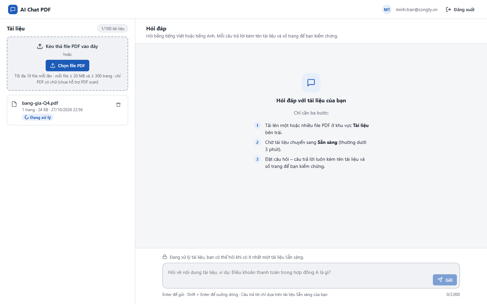

# Test report – UI-004: Trạng thái trống và lỗi

| Trường | Giá trị |
|---|---|
| Test case | [UI-004](../../doc/07-verification/test_cases/UI-004_trang-thai-trong-va-loi.md) |
| Kết luận | **KHÔNG ĐẠT** |
| Bắt đầu | 2026-10-27T15:56:00.294Z |
| Kết thúc | 2026-10-27T15:59:59.481Z (239.2 s) |
| Cách thực hiện | Tự động – Playwright (app/frontend/evidence/fixture.ts) |
| URL ứng dụng | http://localhost:8080/ |
| Bản build | 166929f + thay đổi chưa commit trong app/ |
| Trình duyệt | Microsoft Edge (Playwright, channel msedge) |
| Hệ điều hành | win32 x64 |
| Spec | app/frontend/testcases/UI-004_trang-thai-trong-va-loi.spec.ts |

## Kết quả từng bước

| # | Bước | Kết quả mong đợi | Kết quả thực tế | Trạng thái | Bằng chứng |
|---|---|---|---|---|---|
| 1 | Chưa có tài liệu (E-01) | Chưa có tài liệu nào + hướng dẫn 3 bước; ô hỏi khóa: "Cần ít nhất một tài liệu Sẵn sàng…" | Như mong đợi | Đạt | [ảnh](screenshots/01-chua-co-tai-lieu-e-01.png) |
| 2 | Tải 1 file, chụp ngay khi đang xử lý (E-02) | Ô hỏi khóa: "Đang xử lý tài liệu, bạn có thể hỏi khi…" | Như mong đợi | Đạt | [ảnh](screenshots/02-tai-1-file-chup-ngay-khi-dang-xu-ly-e-02.png) |
| 3 | Xóa hết, chỉ tải ho-so-scan-2019.pdf (mọi tài liệu Thất bại – E-03) | Ô hỏi khóa; dòng Thất bại có lý do | locator.click: Target page, context or browser has been closed Call log:   - waiting for getByRole('button', { name: /Trần Minh/ }).first()  | Không đạt |  |

## Video

- [UI-004-app.webm](video/UI-004-app.webm)

## Ảnh chụp màn hình

## Log

- (không có)

## Ghi chú / lỗi phát hiện

- (không có)
